# BillKit: техническое исследование

**Рекомендуемое направление — не искать единственный «идеальный billing engine», а строить семейство из узкого PHP payment kernel, необязательных invoice/collection-модулей и заменяемого серверного billing/metering backend.** Для профилей A/B основой должен оставаться собственный компактный execution journal вокруг существующего commerce-модуля; для профиля C наиболее полезны параллельные пилоты **Lago** и **Kill Bill**, а **OpenMeter** следует рассматривать прежде всего как metering/rating/entitlement-компонент и schema donor, но не как автоматически готового владельца платежей.

> Статус: **том 1 — архитектурный вывод, screening рынка, source/schema-аудит основных финалистов, варианты хранения, инварианты, композиции и backlog**.  
> Дата среза: **12 октября 2026 года**.  
> Маркировка: **[FACT]**, **[FACT—предоставлено]**, **[INFERENCE]**, **[RECOMMENDATION]**, **[UNVERIFIED]**.

***

## Главный вывод

[RECOMMENDATION] BillKit целесообразно разделить минимум на шесть независимо подключаемых областей:

1. **Payment contracts** — нейтральные команды и результаты `initiate/find/capture/cancel/refund/findRefund`, ссылки на продавца, merchant configuration и исходную операцию.
2. **Payment execution journal** — durable intent/attempt/operation, idempotency, unknown-result recovery, provider callbacks, reconciliation.
3. **Obligations and invoicing** — денежные обязательства, invoice, credit note, allocation, остаток долга.
4. **Commercial scheduling and rating** — периоды, fixed/seat/usage charges, proration, commitments, recurring schedule.
5. **Usage and credits** — измеренные факты, агрегация, reservations, grants и немонетарные credits.
6. **Coordination ports** — entitlement, licensing, provisioning, fiscal documents, accounting export и fulfilment.

[RECOMMENDATION] Эти области не обязаны жить в одном процессе или одной БД. Но для каждой денежной операции должен существовать **единственный execution owner**, а для каждого invoice/credit/reservation — единственный authoritative writer.

[FACT—предоставлено] Существующий commerce-модуль уже имеет payment attempts, refunds, unknown-result recovery, inbox/reconciliation и стабильные operation references. Следовательно, внедрение внешнего billing server не должно создавать второй независимый execution journal для тех же checkout/refund.

[INFERENCE] Наиболее опасная архитектура здесь — не «слишком маленькое ядро», а композиция из нескольких хороших продуктов, в которой одновременно активны два renewal engine, два proration engine или два механизма retry одного PSP effect.

***

## Решения по профилям

| Профиль | Рекомендуемый authority | Готовая основа | Собственный код | Не включать по умолчанию |
|---|---|---|---|---|
| A — магазин | Существующий commerce journal | PSP SDK или тонкий adapter; Omnipay/Payum как вспомогательный слой | Общие contracts, capability map, provider adapters, reconciliation/fiscal ports | Центральный subscription server, отдельный retry владельца charge |
| B — малое PHP-приложение | Встраиваемый payment runtime | PHP Money/decimal; отдельные PSP SDK; optional invoice package | Intent/attempt journal, idempotency, inbox/outbox, worker recovery | Kafka, ClickHouse, полный ERP, обязательный PostgreSQL для stateless contracts |
| C — billing service | Выбранный server engine либо собственная server composition | Lago или Kill Bill; OpenMeter для metering при подтверждённой необходимости | Seller partitioning, RU PSP/fiscal adapters, entitlement/provisioning coordination | Прямая запись продуктами в vendor financial tables |
| D — remote execution | Billing service владеет PSP effects | То же, что C, через versioned API | Shop projection, remote-command idempotency, unknown recovery | Локальная попытка «подстраховать» remote charge повторным PSP вызовом |

[RECOMMENDATION] Профиль A следует считать базовым ограничением всей архитектуры: server composition не должна становиться обязательной зависимостью автономного магазина.

***

## Классы решений

| Класс | Владеет | Не должен автоматически владеть |
|---|---|---|
| Payment adapter library | Формой gateway request/response | Journal, retry policy, reconciliation, invoice balance |
| Payment orchestrator | Intent/attempt, PSP side effects, callback recovery | Entitlement truth, tenant provisioning |
| Billing engine | Monetary schedule, rating, invoice generation | Retail cart, inventory, product activation |
| Metering engine | Usage events и агрегаты | Payment status, invoice settlement |
| Invoicing application | Invoice lifecycle и документы | Высокочастотный usage rating, resilient PSP orchestration |
| Entitlement library | Features, limits, grants | Денежное обязательство, refund, settlement |
| Accounting/ERP | Проводки, счета учёта, налоговые документы | Checkout authority и SaaS entitlement |
| Merchant of Record | Legal merchant, payment/tax responsibilities по договору | Self-hosted OSS infrastructure |
| PSP | Авторизация, capture/refund и provider facts | Бизнес-право на продукт или готовность ресурсов |

[RECOMMENDATION] В BillKit эта taxonomy должна стать частью ADR и публичной терминологии пакетов. Иначе класс `Subscription`, `Transaction` или `Account` быстро начнёт одновременно обозначать договор, право, schedule, provider operation и бухгалтерскую запись.

***

## Shortlist

### Lago

[FACT] Lago позиционируется как event-based metering и usage/subscription billing: события преобразуются billable metrics, планы задают rating, а invoices формируются по подписочным и usage-компонентам; usage charges рассчитываются в конце периода. [getlago](https://getlago.com/docs/guide/introduction/welcome-to-lago)

[FACT] Типовая self-hosted-композиция включает API, frontend, asynchronous worker, clock worker, PostgreSQL, Redis и PDF service; payment collection отделена от metering и pricing. [getlago](https://getlago.com/blog/self-hosted-billing)

[FACT] Основной серверный репозиторий распространяется по AGPL-3.0. Это не запрещает использование, но требует отдельной юридической проверки для modified network service, bundled distribution и форка. [github](https://github.com/getlago/lago-api)

**Пригодность:**

- [RECOMMENDATION] Сильный кандидат для profile C, если в центре находятся usage, hybrid pricing, wallets и invoices.
- [RECOMMENDATION] Хороший schema donor для subscription, billable metric, charge, invoice, wallet и organization scoping.
- [INFERENCE] Не подходит как обязательная embedded PHP dependency: это отдельная Ruby/Rails service composition.
- [RECOMMENDATION] Не следует отдавать Lago PSP execution профиля A без осознанной миграции authority.
- [UNVERIFIED] Нужен executable audit конкурентных partial allocations/refunds, поздних usage corrections, seller partitioning и конкретной OSS/Premium границы.

### Kill Bill

[FACT] Kill Bill — self-hosted billing/payment platform под Apache-2.0; она поддерживает subscriptions, usage, invoices, gateway plugins, tax plugins и несколько tenant partitions. [killbill](https://killbill.io/faqs)

[FACT] Система отделяет core payment API от gateway-specific payment plugins и использует конфигурируемую state machine для payment transitions. [docs.killbill](https://docs.killbill.io/latest/userguide_payment)

[FACT] Для неполных или неоднозначных платежей предусмотрен Janitor; retry-поведение различается для API-triggered и автоматически инициированных invoice payments. [docs.killbill](https://docs.killbill.io/latest/userguide_payment)

[FACT] Invoice plugins могут добавлять invoice items и запросить отложенный retry, если, например, tax service временно недоступен. [docs.killbill](https://docs.killbill.io/latest/invoice_plugin)

**Пригодность:**

- [RECOMMENDATION] Самый сильный референс для payment lifecycle, plugin boundaries, audit/history и recurring collection.
- [RECOMMENDATION] Кандидат для profile C, если важнее зрелый payment/subscription engine, чем минимальный operational footprint.
- [INFERENCE] Для PHP-экосистемы это отдельный Java service; попытка встраивать его как библиотеку нецелесообразна.
- [RECOMMENDATION] Apache-2.0 делает source reuse и адаптацию юридически проще, чем AGPL-путь, но техническая стоимость Java-service и сложной схемы остаётся.
- [UNVERIFIED] Нужна проверка текущего PostgreSQL DDL, блокировок invoice/payment balance и поддержки требуемых partial-payment сценариев именно на выбранном релизе.

### OpenMeter

[FACT] OpenMeter использует event-based metering; события различаются по `id` и `source`, которые служат ключом deduplication. [openmeter](https://openmeter.io/docs/metering/guides/best-practices)

[FACT] Поддерживаются `COUNT`, `UNIQUE_COUNT` и `LATEST`; ключевые свойства meter — slug, aggregation, event type и value property — после создания неизменяемы, поскольку их изменение переопределило бы смысл уже собранных данных. [openmeter](https://openmeter.io/docs/metering/guides/creating-meters)

[FACT] Metering pipeline описан как CloudEvents → Kafka → consumer → ClickHouse; usage event ingestion асинхронен. [openmeter](https://openmeter.io/docs/metering/events/how-it-works)

[FACT] На дату среза последним опубликованным релизом является [`v1.0.0-beta.236`](https://github.com/openmeterio/openmeter/releases/tag/v1.0.0-beta.236); release notes содержат исправления atomic lifecycle invoice lines, сохранения payment authorization и charge booking при retry. Сам факт наличия этих исправлений означает, что выбранную beta-версию нельзя принимать без targeted regression suite.

**Пригодность:**

- [RECOMMENDATION] Сильный кандидат для metering, aggregation, usage attribution, grants и entitlement balances.
- [RECOMMENDATION] Полезный референс для immutable meter semantics и ledger-like credit storage.
- [INFERENCE] Kafka/ClickHouse делают его чрезмерным для A/B без доказанной нагрузки.
- [RECOMMENDATION] Не считать его payment orchestrator до проверки app/provider contracts и recovery semantics.
- [UNVERIFIED] Следует проверить, какие billing/invoicing/payment возможности относятся к OSS edition, а какие — к hosted/Kong composition.

### PHP embedded path

[RECOMMENDATION] Для A/B нужен не урезанный Lago, а отдельный PHP-native путь:

- `moneyphp/money` или `brick/money` как arithmetic/value-object foundation;
- PSP-specific official SDK либо thin HTTP adapter;
- Omnipay/Payum только как transport/protocol helper там, где driver соответствует recovery requirements;
- собственный небольшой durable journal;
- optional invoice/collection/fiscal packages поверх него.

[INFERENCE] Omnipay и Payum не заменяют хранение operation owner, request fingerprint, merchant configuration snapshot, webhook inbox, reconciliation status и unknown recovery.

### Invoice applications

[RECOMMENDATION] Invoice Ninja, FOSSBilling, InvoicePlane и SolidInvoice полезны как:

- donors invoice numbering и document lifecycle;
- примеры customer/contact/tax/item snapshots;
- reference для back-office UI;
- источники migration patterns.

[RECOMMENDATION] Их нельзя автоматически принимать как usage billing или resilient payment orchestration engine. Наличие invoices и gateway plugins не доказывает recovery after unknown PSP result.

***

## Срез версий

Исходники просматривались как moving targets на следующих revisions:

| Решение | Просмотренный revision | Runtime | Лицензия | Роль |
|---|---|---|---|---|
| [Lago API](https://github.com/getlago/lago-api/tree/33ff49fa8c1ecd0b38094a05cf2eb5ce69a6a53e) | `33ff49fa8c1e` | Ruby/Rails, PostgreSQL; workers и Redis | AGPL-3.0  [github](https://github.com/getlago/lago-api) | Billing/usage server |
| [Kill Bill](https://github.com/killbill/killbill/tree/3868a5b2339c3b86531904d6738a36e1e82933bf) | `3868a5b2339c` | Java; MySQL/MariaDB/PostgreSQL | Apache-2.0  [killbill](https://killbill.io/faqs) | Billing/payment server |
| [OpenMeter](https://github.com/openmeterio/openmeter/tree/330e8120edab53fdd62f077d64fa5b51f57c1bd1) | `330e8120edab` | Go, PostgreSQL, Kafka, ClickHouse | Apache-2.0 | Metering/billing service |
| [Invoice Ninja](https://github.com/invoiceninja/invoiceninja/tree/f1ffa5f9989afbed4e7dc80b5c0cc18944335ffc) | `f1ffa5f9989a` | PHP 8.2–8.5, Laravel application | Elastic License | Invoice application/donor |
| [FOSSBilling](https://github.com/FOSSBilling/FOSSBilling/tree/8fb94eb95fd9064be7b616dbfe76e3180877cff9) | `8fb94eb95fd9` | PHP 8.3+ | Apache-2.0 | Hosting billing/reference |
| [Omnipay](https://github.com/thephpleague/omnipay/tree/4ccaf477499b6c39c2205d072a514adad5c29d6d) | `4ccaf477499b` | PHP 7.2/8.x | MIT | Payment adapter contracts |
| [Payum](https://github.com/Payum/Payum/tree/5d8bac7db3e2162aa25c0cb56f27f67102c9ee5b) | `5d8bac7db3e2` | PHP 8.1+ | MIT | Payment workflow library |
| [MoneyPHP](https://github.com/moneyphp/money/tree/a5199443bfd20c3d3644b8445b09054a4c014191) | `a5199443bfd2` | PHP 8.1–8.5 | MIT | Money primitives |
| [Brick Money](https://github.com/brick/money/tree/93f145c6c9f5b58160e2967088e7e083722e28cc) | `93f145c6c9f5` | PHP 8.2+ | MIT | Money/decimal primitives |

[RECOMMENDATION] Для vendor selection revisions должны быть заменены на конкретные release tags, после чего schema diff следует повторить. Branch HEAD полезен для исследования текущего направления, но не является production baseline.

***

## Screening решений

| Решение | Что реально интересно | Причина не делать основной embedded core |
|---|---|---|
| Lago | Usage rating, wallets, invoices, hybrid pricing | Ruby service, AGPL, заметный operational footprint |
| Kill Bill | Payments, retries, Janitor, subscriptions, plugins, audit | Java service и крупная связанная модель |
| OpenMeter | Metering, credits, grants, entitlement, event pipeline | Kafka/ClickHouse для полного профиля; beta billing surface |
| Invoice Ninja | Invoice/documents/UI/payment integrations | Application-first architecture и Elastic License |
| FOSSBilling | PHP modules, hosting subscriptions, invoices | Требуется отдельный concurrency/recovery audit |
| InvoicePlane/SolidInvoice | Invoice schema/UI references | Не full billing engine |
| Omnipay | Единообразная форма gateway messages | Не durable orchestrator |
| Payum | Gateway/actions/storage workflow | Не готовая seller ledger/invoice platform |
| Stripe Billing/Cashier | Быстрый provider-specific SaaS path | Provider lock-in и ограничения продавцов/регионов |
| Paddle | MoR route | MoR, а не self-hosted payment kernel |
| Chargebee/Recurly/Zuora | Market/API/reference | Hosted commercial systems, не OSS foundation |
| ERPNext/Tryton | Accounting, extension и document patterns | Слишком широкая ERP-модель для checkout |
| Ledger/accounting libraries | Double-entry references | Не управляют PSP effect или product rights |

[RECOMMENDATION] Hosted products полезны для сравнения API vocabulary, но не должны определять canonical storage BillKit. Внутренняя схема должна переживать замену Stripe/Paddle/Lago и не копировать provider object model один к одному.

***

## Модель ownership

| Состояние | Authoritative owner | Допустимые проекции |
|---|---|---|
| Plan и состав прав | Tariff/entitlement component | Billing plan reference |
| Price version | Billing/commerce quote owner | Entitlement display metadata |
| Retail promotion | Commerce | Billing charge snapshot |
| Agreement | Product coordinator или billing contract module | Entitlement subscription projection |
| Monetary schedule | Billing | Product UI projection |
| Entitlement period | Tariff/rights | Billing correlation |
| Usage fact | Metering source/collector | Rating aggregates |
| Usage reservation | Единственный credit/quota owner | Product-local pending operation |
| Charge | Billing или commerce — один writer | Accounting export |
| Payment intent/attempt | Payment execution owner | Order/invoice projection |
| Invoice | Invoice module/server | Commerce/accounting projection |
| Allocation | Invoice/receivables owner | Reporting projection |
| Refund | Execution owner + receivable correction | Entitlement compensation trigger |
| Settlement fact | Reconciliation/payment module | Accounting import |
| Fiscal receipt | Fiscal module/provider | Invoice/order status projection |
| License | Licensing authority | Billing correlation |
| Provisioning readiness | Provisioning/product coordinator | Billing display status |
| Company posting | Financial/accounting SDK | Billing export/import reference |
| Reward | Reward ledger | Entitlement grant conversion |
| Publisher payout | Будущий settlement domain | Billing reference |

[RECOMMENDATION] Рабочая гипотеза из задания в целом верна, но требует уточнения: billing может владеть **commercial agreement schedule**, тогда как entitlement-компонент владеет **grant schedule**. Между ними нужен versioned correlation contract, а не общий изменяемый `subscription` row.

***

## Границы подписки

Один пользовательский «тариф» фактически раскладывается как минимум на четыре разных объекта:

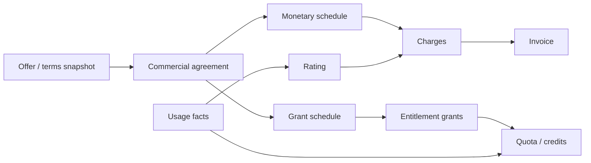

[RECOMMENDATION] Годовая оплата с ежемесячными AI credits должна хранить:

- annual monetary period;
- monthly grant/reset period;
- stable agreement/component identity;
- unique grant occurrence per component and grant window;
- независимые lifecycle states оплаты и права.

Нельзя выводить месячный grant только из факта «subscription active» при каждом worker retry: это создаёт двойную выдачу.

***

## Схема Lago

### Фактические области

Source tree Lago показывает отдельные модели для:

- organizations и billing entities;
- customers и provider customers;
- subscriptions;
- billable metrics, charges и charge filters;
- events, quantified/enriched events и ClickHouse event storage;
- invoices, invoice subscriptions, fees и applied taxes;
- payments, payment intents, payment requests и receipts;
- credit notes и refunds;
- wallets, wallet credits и wallet transactions;
- idempotency records;
- integrations и external customers.

[FACT] Документация подтверждает, что events являются исходными фактами потребления, billable metrics выполняют aggregation, plans связывают pricing с metrics, а finalized invoice передаётся payment collection. [getlago](https://getlago.com/docs/guide/introduction/welcome-to-lago)

### Концептуальная ERD

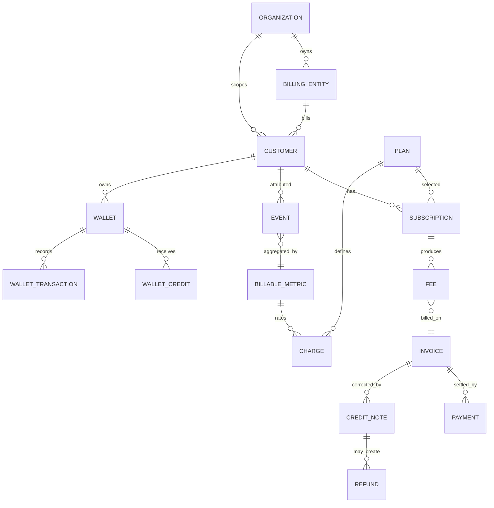

### Сильные стороны

- [INFERENCE] `organization_id` последовательно добавлялся в financial tables и idempotency records; это важный donor pattern для seller scoping.
- [INFERENCE] Wallet credit/transaction separation лучше одного изменяемого поля `balance`.
- [INFERENCE] Plan charge, subscription и generated fee образуют полезное разделение definition → agreement → rated result.
- [INFERENCE] Отдельные provider customer records позволяют сохранять привязку к конкретному PSP/merchant context.

### Риски

- [UNVERIFIED] Нужно доказать, что organization равен legal seller partition, а не только SaaS tenant.
- [UNVERIFIED] Требуется проверить, входит ли merchant configuration version в payment/refund provenance.
- [UNVERIFIED] Нужен transaction-level аудит invoice allocations: payment row сам по себе ещё не означает поддержку нескольких частичных платежей по нескольким обязательствам.
- [RECOMMENDATION] Lago wallets нельзя переиспользовать для reward tokens без проверки liability semantics.
- [RECOMMENDATION] Не копировать всю Lago schema в PHP-модули: её связность соответствует server product, а не lightweight kernel.

***

## Схема OpenMeter

### Фактические области

В inspected source существуют отдельные schemas для:

- customer;
- meter;
- plan/rate card/add-on;
- subscription и subscription revisions;
- entitlement и grant;
- balance snapshot и usage reset;
- billing profile, invoice и invoice lines;
- flat-fee, usage-based и credit-purchase charges;
- ledger customer account, transactions, entries, void/breakage records;
- event outbox;
- application/provider integrations.

[FACT] OpenMeter различает subject как потребителя ресурса и customer как billable entity. Это прямо поддерживает требование не сводить actor, device, workspace и payer к одному `account_id`. [openmeter](https://openmeter.io/docs/metering/overview)

[FACT] `LATEST` предназначен для snapshot/gauge-сценариев вроде disk size или seat count, тогда как `COUNT` и `UNIQUE_COUNT` имеют другую агрегационную семантику. [openmeter](https://openmeter.io/docs/metering/guides/creating-meters)

### Концептуальная ERD

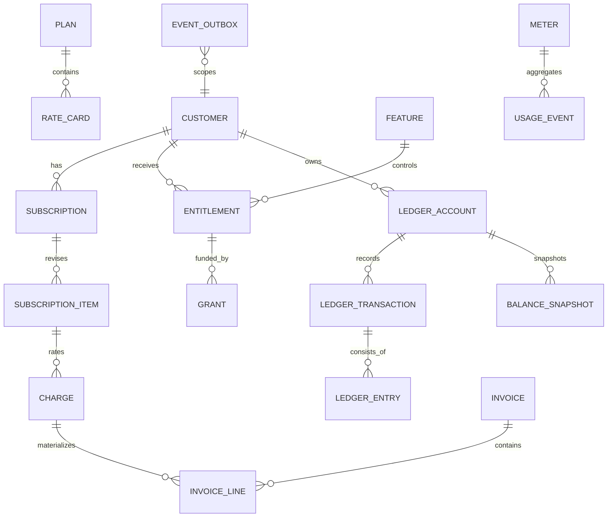

### Сильные стороны

- [RECOMMENDATION] Лучший из финалистов donor для разделения usage event, meter definition, entitlement grant, ledger entry и balance snapshot.
- [RECOMMENDATION] Immutable meter semantics следует перенести в BillKit contract: изменение aggregation должно создавать новую metric version.
- [RECOMMENDATION] `subject` не должен быть billing account; attribution должна быть отдельной versioned связью.
- [INFERENCE] Ledger entries и lineage полезны для reserve/commit/release и correction provenance.

### Риски

- [FACT] Event processing асинхронен, поэтому только что принятый event может ещё не быть доступен в usage query. [openmeter](https://openmeter.io/docs/api/v3)
- [RECOMMENDATION] Нельзя использовать асинхронный metering query как строгий online global quota gate без отдельной reservation authority.
- [FACT] Collector retry после исчерпания настроенного числа попыток может завершиться drop, если operator не изменил политику; поэтому collector buffering нельзя путать с бесконечным durable retention. [openmeter](https://openmeter.io/docs/collectors/high-availability)
- [UNVERIFIED] Утверждение документации об exactly-once insert требует fault-injection проверки Kafka offsets, ClickHouse dedupe и retention границ. [openmeter](https://openmeter.io/docs/metering/events/how-it-works)
- [RECOMMENDATION] Для A/B OpenMeter не должен быть обязательным runtime.

***

## Схема Kill Bill

### Фактические области

Kill Bill storage разделяет:

- accounts и payment methods;
- catalog/subscription/bundles;
- invoices и invoice items;
- invoice payments;
- payments, payment transactions и payment attempts;
- blocking states;
- notification queues;
- bus events;
- audit logs и history tables;
- per-tenant configuration;
- plugin properties.

[FACT] History records содержат target record, serialized entity/change type и соответствующую audit entry; history tables существуют не для всех сущностей. [github](https://github.com/killbill/killbill/issues/938)

[FACT] Payment transitions управляются state machine, а Janitor обрабатывает incomplete payment states. [docs.killbill](https://docs.killbill.io/latest/userguide_payment)

### Концептуальная ERD

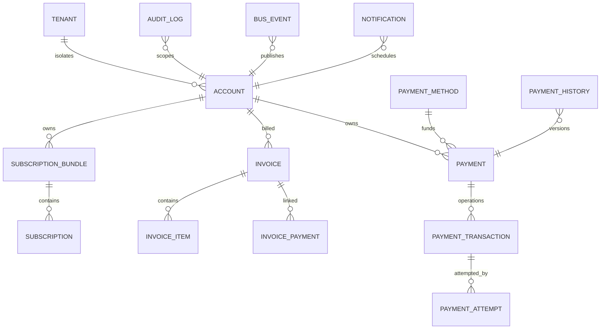

### Сильные стороны

- [RECOMMENDATION] Наиболее полезная модель для разделения logical payment, provider transaction и retry attempt.
- [RECOMMENDATION] Janitor pattern следует использовать как референс для unknown-result recovery.
- [RECOMMENDATION] Payment plugin, payment control plugin и invoice plugin дают более ясные extension boundaries, чем «gateway class с методом pay».
- [FACT] Kill Bill не является gateway: PSP operation выполняется через plugin. [killbill](https://killbill.io/faqs)

### Риски

- [INFERENCE] Сложная history/audit/state-machine модель увеличивает migration и operational cost.
- [UNVERIFIED] Необходимо установить, какие cross-entity invariants защищены DB constraints, а какие Java code/global locks.
- [UNVERIFIED] Требуется проверить seller isolation: Kill Bill tenant не обязательно совпадает с legal seller, merchant account и product tenant.
- [RECOMMENDATION] Нельзя экспортировать Kill Bill internal UUID как единственный business reference: нужен собственный external operation ID.

***

## Минимальное payment storage

Для A/B рекомендуется собственная компактная схема, не зависящая от Lago/Kill Bill:

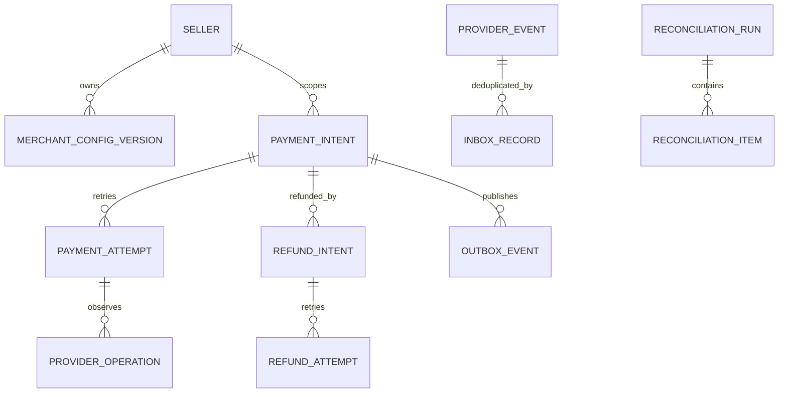

### Строгие поля

| Сущность | Обязательные строгие данные |
|---|---|
| Seller | Stable ID, environment, status |
| Merchant config version | Provider, merchant identity reference, credential key reference, valid interval |
| Payment intent | Seller, business reference, amount minor units, currency, operation kind, state, request hash |
| Attempt | Intent, attempt number, idempotency key, merchant config version, lease/fence, timestamps |
| Provider operation | Provider operation ID, provider state, amount/currency, observed time, raw-event reference |
| Refund intent | Original payment, requested amount, remaining refundable invariant, reason/reference |
| Provider event | Provider, merchant config version, provider event ID, signature result, received time |
| Inbox | Handler, event key, processing state, attempts |
| Outbox | Aggregate, event type/version, payload, created/dispatched time |
| Reconciliation item | Expected fact, provider fact, discrepancy code, resolution provenance |

### Где допустим JSON

- Sanitized provider payload subset.
- Non-authoritative provider metadata.
- Versioned event payload.
- UI/display attributes.
- Unindexed optional fiscal/provider extensions.

### Где JSON недопустим как единственное хранение

- Amount/currency.
- Seller и merchant context.
- Provider operation reference.
- Payment/refund state.
- Invoice balance/allocation.
- Idempotency scope и request hash.
- Tax totals и invoice line amount snapshots.
- Usage metric type и aggregation version.
- Ledger debit/credit dimensions.

[RECOMMENDATION] JSON metadata должна иметь schema version и size limits. Поля, участвующие в authorization, uniqueness, reconciliation или due-job query, должны быть реляционными и индексируемыми.

***

## Invoice-модуль

При подключении invoicing поверх payment kernel добавляются:

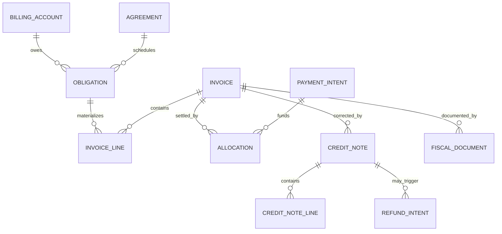

### Ключевой invariant

\[
\text{open amount}
=
\text{issued total}
-
\text{valid allocations}
-
\text{credit applications}
\]

Refund сам по себе не обязательно увеличивает invoice balance. Это зависит от того, отменяется ли обязательство, возвращается переплата или делается customer accommodation.

[RECOMMENDATION] Payment, allocation, credit note и refund должны быть разными сущностями:

- **Payment** — provider или offline receipt fact.
- **Allocation** — применение стоимости payment к obligation/invoice.
- **Credit note** — уменьшение или коррекция receivable.
- **Refund** — исходящий PSP effect.
- **Wallet credit** — отдельное обещание/обязательство, если оно денежно погашаемое.

***

## Server storage

Профиль C может использовать vendor DB как authority, но вокруг него нужны anti-corruption tables:

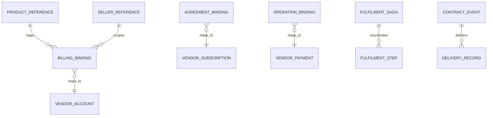

[RECOMMENDATION] Anti-corruption layer хранит:

- internal role IDs;
- vendor ID;
- vendor type/version;
- seller/environment;
- mapping lifecycle;
- source operation reference;
- last synchronized revision;
- migration/cutover status.

Продуктовые компоненты не должны напрямую использовать vendor table IDs или vendor statuses в entitlement decisions.

***

## Payment lifecycle

```mermaid
sequenceDiagram
    participant Host
    participant DB as Execution DB
    participant Worker
    participant PSP
    participant Inbox
    participant Outbox

    Host->>DB: INSERT intent + request_hash
    DB-->>Host: stable operation reference
    Worker->>DB: claim attempt with lease/fence
    Worker->>PSP: create/payment request with provider idempotency
    alt PSP returned terminal result
        PSP-->>Worker: paid/failed
        Worker->>DB: persist provider fact + state + outbox
    else timeout or process crash
        Worker->>DB: mark unknown or leave recoverable
        Worker->>PSP: lookup by provider/business reference
        PSP-->>Worker: found / not found / ambiguous
        Worker->>DB: reconcile; never infer failure from timeout
    end
    PSP->>Inbox: signed webhook
    Inbox->>DB: dedupe and validate seller/amount/currency
    DB->>Outbox: durable domain event
    Outbox-->>Host: payment fact
```

### Transaction boundaries

1. Intent и local idempotency record создаются в одной DB transaction.
2. PSP call происходит **вне** DB transaction.
3. Перед PSP call должна существовать recoverable local запись.
4. Terminal provider fact и outbox event фиксируются в одной local transaction.
5. Webhook сначала сохраняется в inbox, затем обрабатывается.
6. Timeout оставляет `unknown`, а не `failed`.
7. Повторный worker сначала выполняет lookup/reconciliation.
8. Fencing защищает local ownership, но не отменяет уже отправленный PSP request.
9. Provider idempotency TTL не считается вечной гарантией.
10. Late callback может изменить `unknown` в terminal state, но не должен откатывать уже подтверждённый несовместимый terminal fact без manual discrepancy workflow.

[RECOMMENDATION] Универсального exactly-once между PostgreSQL и PSP нет. Реалистичная цель — at-least-once command delivery, provider idempotency где доступно, durable recovery и exactly-once application каждого уникального provider fact внутри локальной БД.

***

## Idempotency contract

Рекомендуемый logical scope:

```text
seller
+ environment
+ command kind
+ operation namespace
+ idempotency key
```

Хранимые данные:

- request hash;
- canonical serialization version;
- response/result reference;
- first-seen time;
- retention deadline;
- terminal/non-terminal state;
- original merchant configuration;
- conflict flag;
- audit provenance.

Поведение:

- Тот же key и тот же hash → вернуть прежний operation reference/result.
- Тот же key и другой hash → deterministic conflict.
- Повтор после local retention → поиск по durable business reference; не создавать новую покупку молча.
- Истёкший provider idempotency TTL → запрещён blind retry create; сначала lookup/reconciliation/manual policy.
- Idempotency key не заменяет uniqueness бизнес-события, например `seller + order + payment_sequence`.

***

## Provider operations

[RECOMMENDATION] Neutral contract должен описывать capabilities, а не притворяться, что все PSP одинаковы:

```php
interface PaymentGateway
{
    public function initiate(InitiatePayment $command): InitiationResult;
    public function find(FindPayment $query): PaymentObservation;
    public function capture(CapturePayment $command): OperationResult;
    public function cancel(CancelPayment $command): OperationResult;
    public function refund(RefundPayment $command): RefundResult;
    public function findRefund(FindRefund $query): RefundObservation;
    public function verifyWebhook(WebhookEnvelope $request): VerifiedWebhook;
}
```

Отдельная capability-модель:

- create with provider idempotency;
- lookup by provider operation ID;
- lookup by merchant/business reference;
- authorization/capture;
- partial capture;
- cancellation;
- partial/multiple refund;
- saved payment method;
- recurring consent;
- webhook signature;
- webhook event lookup;
- receipt passthrough;
- settlement reports;
- dispute API.

[RECOMMENDATION] Неподдерживаемая capability должна возвращать typed `UnsupportedCapability`, а не generic failure.

***

## Merchant versioning

Смена credentials создаёт проблему recovery: исходный charge может быть виден только под прежним merchant account.

Поэтому attempt/refund должны ссылаться на immutable `merchant_configuration_version`, содержащую:

- seller;
- provider;
- merchant account reference;
- credential secret locator;
- environment;
- API/profile version;
- valid-from/valid-to;
- rotation predecessor;
- disabled-for-new-operations flag;
- lookup/refund availability policy.

[RECOMMENDATION] Старая версия может быть закрыта для новых charge, но должна оставаться доступной для lookup/refund/reconciliation до истечения business retention.

***

## Usage architecture

### Типы metric

| Тип | Пример | Aggregation |
|---|---|---|
| Additive | API requests, tokens, messages | Sum/count |
| Gauge/snapshot | Storage bytes, active seats | Latest, max или time-weighted policy |
| Distinct | MAU, unique devices | Cardinality over a window |
| Duration | Compute seconds, call minutes | Interval/duration sum |
| Rate | Requests per second tier | Derived from window |
| Cost fact | Provider token cost | Separate cost metric/version |
| Reservation | Предполагаемые AI units | Stateful credit owner, не обычный meter |

[FACT] OpenMeter прямо разделяет `COUNT`, `UNIQUE_COUNT` и `LATEST`, причём `LATEST` возвращает последний reported value в окне. [openmeter](https://openmeter.io/docs/metering/guides/creating-meters)

[RECOMMENDATION] Metric definition должна быть versioned и после первого usage факта не менять:

- aggregation kind;
- value unit;
- event filter;
- value extraction;
- attribution semantics;
- correction policy.

### Late events

Нужно выбрать policy для каждого metric:

- accept while period open;
- accept within grace watermark;
- reject after closure;
- create next-period adjustment;
- reopen and rerate;
- manual correction.

[RECOMMENDATION] Issued invoice не следует silently rerate. Late event после closure должен создавать traceable adjustment либо correction document.

### Provenance

Rated line должна хранить:

- metric version;
- price/rate-card version;
- event window;
- aggregation result;
- rounding version;
- tax version;
- source event query/hash или batch reference;
- rerating/correction predecessor.

***

## Credits и reservations

Необходимо различать:

| Понятие | Liability | Может оплатить invoice | Consumption owner |
|---|---:|---:|---|
| Monetary prepayment | Обычно да | Да, по договорным правилам | Billing/wallet ledger |
| Usage credits | Обычно нет | Обычно нет | Entitlement/credit ledger |
| Promotional grant | Нет или ограниченное обязательство | Обычно нет | Entitlement |
| Reward token | Не считать деньгами по умолчанию | Нет | Reward ledger |
| Provider cost budget | Внутренняя себестоимость | Нет | Cost/control domain |
| Publisher payable | Обязательство перед издателем | Не customer balance | Settlement domain |

### Async AI usage

Рекомендуемая state machine:

```text
AVAILABLE
  -> RESERVED
  -> COMMITTED
  -> RELEASED
  -> EXPIRED
  -> ADJUSTED
```

Ключи:

- stable usage operation ID;
- owner account/grant bucket;
- reserved quantity;
- actual quantity;
- partial-success policy;
- expiry;
- late-result policy;
- compensation reference.

[RECOMMENDATION] `consume()` внутри entitlement library недостаточно, если external AI call может завершиться частично или после timeout. Нужен atomic reserve owner и deterministic late-result policy.

***

## Invoice mutability

| Состояние | Допустимые изменения |
|---|---|
| Draft | Lines, tax calculation, recipient details по policy |
| Finalizing | Только контролируемый engine workflow |
| Issued | Не менять financial meaning; metadata — только allow-list |
| Partially paid | Добавление allocations; correction отдельным документом |
| Paid | Допустим refund/credit workflow, но не переписывание original total |
| Voided | Сохраняется история; новый документ вместо reuse |
| Written off | Отдельный reason/authorization; obligation history сохраняется |

[RECOMMENDATION] Номер, seller, buyer snapshot, currency, totals, issued lines и tax snapshots после issuance не редактируются обычным CRUD. Исправление выполняется credit note, void/reissue или accounting adjustment в зависимости от legal policy.

***

## Outbox и inbox

Минимальные outbox fields:

- `id`;
- seller/partition;
- aggregate type/ID/version;
- event type/version;
- payload;
- occurred/created time;
- dispatch availability time;
- attempts;
- locked-by/lease-until/fence;
- dispatched time;
- last error;
- dead-letter state.

Inbox fields:

- source/provider;
- seller;
- external message/event ID;
- payload hash;
- signature verification result;
- received time;
- processing state;
- attempts;
- handler version;
- processed time;
- error/discrepancy.

[RECOMMENDATION] Financial commit и outbox insert выполняются в одной local transaction. `afterCommit()` callback без durable outbox не является гарантией доставки.

***

## Конкуренция

### Partial refund

Рекомендуемый invariant:

\[
\sum(\text{successful refunds}) + \sum(\text{reserved refunds})
\leq
\text{refundable captured amount}
\]

Transaction:

1. Lock refundable aggregate или использовать optimistic version.
2. Пересчитать successful + active reserved refunds.
3. Создать refund intent/reservation.
4. Commit.
5. Выполнить PSP call.
6. Подтвердить или освободить reservation по provider fact.

### Allocation

Для concurrent partial payments:

- lock obligation/invoice balance aggregate;
- prohibit allocation beyond payment unallocated amount;
- prohibit allocation beyond obligation open amount;
- use deterministic ordering when one payment covers several invoices;
- retry serialization/deadlock failures;
- store reversal as a new row, not deletion.

### Recurring schedule

Unique occurrence рекомендуется определять как:

```text
agreement component
+ monetary period start
+ monetary period end
+ schedule revision
+ occurrence kind
```

Повтор worker должен находить existing charge/invoice occurrence, а не создавать новый.

***

## Расширяемость

### Extension map

| Расширение | Правильная граница | Собственные таблицы | Core mutation |
|---|---|---:|---:|
| Новый PSP | Gateway adapter + capability descriptor | Да, для provider-specific state | Нет |
| Rating rule | Rating strategy/version | Да, если rule хранит состояние | Только registry |
| Metric type | Meter contract + immutable version | Да | Возможно новая enum/version |
| Tax | Tax quotation/finalization port | Да, cache/provenance | Invoice получает snapshot |
| Fiscal adapter | Receipt command/status port | Да | Только reference/status projection |
| Customer attributes | Namespaced extension table/JSON | Да | Нет |
| Host authorization | Policy/context adapter | Нет | Нет |
| UI/API profile | Separate application module | Да | Нет |
| Accounting export | Mapper/outbox consumer | Да | Нет |
| Product provisioning | Saga/coordination port | Да | Нет |

### Plugin migrations

Каждый module должен объявлять:

- module ID;
- schema namespace;
- migration stream/version;
- required core API range;
- event contract versions;
- dependencies;
- uninstall/disable policy;
- data retention policy.

[RECOMMENDATION] Модуль может владеть своими таблицами и FK на stable core IDs, но не должен напрямую изменять invoice/payment tables без core migration contract.

### Disable и uninstall

- `disable` прекращает новые operations;
- historical readers продолжают работать;
- pending operations либо завершаются прежней версией, либо переводятся в explicit intervention;
- данные не удаляются;
- secrets могут быть revoked отдельно;
- uninstall binary не означает purge schema;
- purge — отдельная privileged retention operation.

***

## Эволюция схемы

Рекомендуемый expand/contract:

1. Добавить nullable column/table/index concurrently.
2. Развернуть код, умеющий читать старую и новую форму.
3. Backfill с checkpoint.
4. Проверить discrepancy query.
5. Начать dual-write либо переключить writer.
6. Установить constraint как `NOT VALID`, если PostgreSQL pattern подходит.
7. Validate constraint.
8. Переключить readers.
9. Удалить старое поле только после rollback window.

[RECOMMENDATION] Enum status лучше хранить как constrained text или lookup/versioned type, если ожидается частая эволюция. PostgreSQL enum требует отдельной operational дисциплины и усложняет rollback.

[RECOMMENDATION] Rollback финансовой migration не должен удалять уже созданные business facts. При несовместимом deploy rollback откатывает code path, а financial correction выполняется отдельной бизнес-операцией.

***

## Query paths

| Запрос | Индекс |
|---|---|
| Due invoices | seller, state, due_at |
| Renewals | seller, next_occurrence_at, schedule state |
| Unknown attempts | seller, state, next_reconcile_at |
| Provider lookup | provider, merchant config version, provider operation ID |
| Business idempotency | seller, environment, command kind, idempotency key |
| Refundable balance | original payment ID, refund state |
| Usage period | customer/subject, metric version, event time |
| Undelivered events | dispatch state, available_at |
| Webhook dedupe | provider, merchant config, provider event ID |
| Fiscal retry | seller, receipt state, next_retry_at |
| Provisioning repair | agreement/purchase, readiness state, next_retry_at |
| Reconciliation gaps | seller, discrepancy state, observed_at |

[RECOMMENDATION] Partitioning не нужно вводить заранее. Первый кандидат на partitioning — append-only usage/provider event journal по времени и seller, но только после measurement реальных объёмов и maintenance cost.

***

## PHP и Dart

### Общий contract

PHP и Dart не должны делить implementation library. Они должны делить:

- canonical Money serialization;
- currency code/exponent policy;
- signed integer bounds;
- decimal/rate representation;
- rounding mode names;
- allocation algorithm fixtures;
- date/period boundary fixtures;
- reference grammar;
- idempotency canonicalization;
- event envelopes;
- signature fixtures.

Пример transport:

```json
{
  "amount": {
    "minor": "-1250",
    "currency": "RUB"
  },
  "reference": "pay_01...",
  "occurredAt": "2026-10-12T13:00:00Z",
  "schemaVersion": 1
}
```

[RECOMMENDATION] `minor` лучше передавать JSON string, если contract должен пережить JavaScript-клиентов без потери integer precision.

### Arithmetic

- Никаких `float`.
- Rates хранятся decimal string или numerator/denominator по спецификации.
- Rounding выполняется только в явно заданной точке.
- Allocation сообщает remainder policy.
- Currency exponent берётся из versioned table/spec.
- Custom/internal units не маскируются под ISO currency.
- Overflow behaviour одинаково тестируется в PHP и Dart.

### Authority варианты

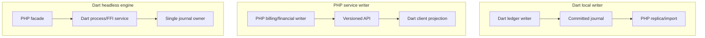

[RECOMMENDATION] На текущих фактах предпочтительны V1 для локальной company accounting и V2 для online vendor billing. Dual local/cloud writer одной книги не выбирать без отдельного conflict/fencing protocol.

[FACT—предоставлено] Репликация committed journal не должна повторять posting, tax или FX. Импорт сохраняет source journal ID, source sequence, schema/tax/FX versions и authentication provenance.

***

## Purchase-to-ready

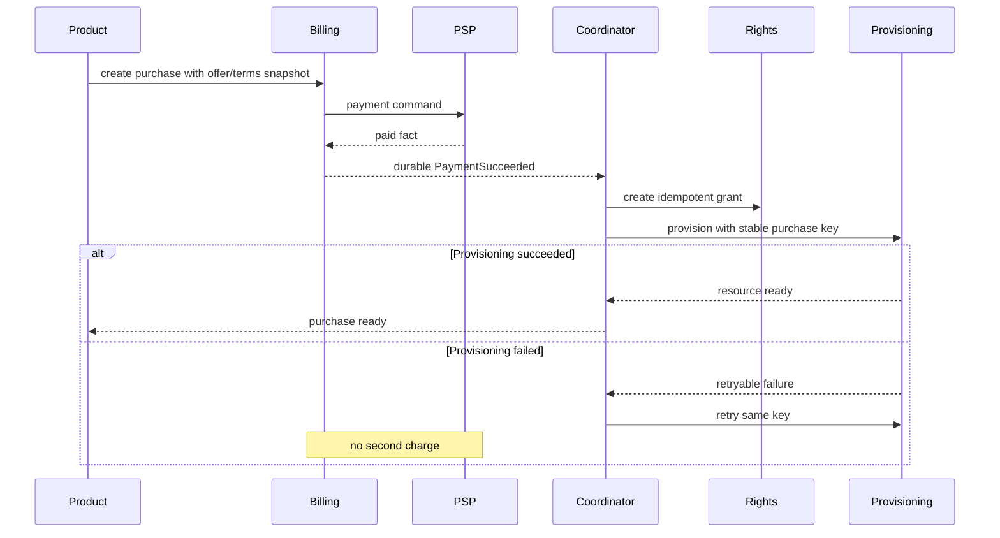

### Compensation cases

| Случай | Действие |
|---|---|
| Paid, provisioning failed | Retry provisioning; payment остаётся paid |
| Refund до activation | Cancel pending grant/provision command |
| Activation arrived late after refund | Coordinator rejects by agreement generation/state |
| License issued, refund approved | Apply product policy: revoke future lease/update right, not rewrite payment |
| Receipt provider unavailable | Money, receipt и access states остаются раздельными |
| Partial bundle refund | Cancel corresponding agreement component only |
| Unpaid vendor subscription in POS | Product-specific grace/read-only policy; guest operations не блокируются универсально |

***

## Multi-seller

Минимальный seller boundary включает:

- legal seller ID;
- billing entity details/version;
- merchant configuration;
- invoice numbering series;
- tax/fiscal configuration;
- bank/settlement references;
- mandate namespace;
- wallet/liability scope;
- operator permissions;
- encryption/secrets scope;
- retention policy.

[RECOMMENDATION] Root user может иметь billing accounts у нескольких sellers. Customer profile можно связать с root identity, но mandate, balance, invoice numbering и merchant credentials не должны быть общими без explicit legal mapping.

[RECOMMENDATION] Seller boundary должна присутствовать в каждом financial aggregate и unique key, а не только выводиться через customer join.

***

## RU-провайдеры

На данном проходе не завершён primary-source audit YooKassa, CloudPayments, СБП через конкретных участников, МКБ и Atol. Поэтому ниже фиксируется contract checklist, а не утверждение о готовой поддержке.

| Capability | YooKassa | CloudPayments | СБП | МКБ | Atol |
|---|---|---|---|---|---|
| Create/initiate | R-PSP-01 | R-PSP-02 | Зависит от provider | R-PSP-04 | Не payment create |
| Lookup | R-PSP-01 | R-PSP-02 | Provider-specific | R-PSP-04 | Receipt lookup |
| Capture/cancel | Проверить | Проверить | Обычно иной flow | Проверить | Н/Д |
| Partial refund | Проверить | Проверить | Provider-specific | Проверить | Refund receipt отдельно |
| Saved method/mandate | Проверить consent/revocation | Проверить recurrent token | Не универсально | Проверить | Н/Д |
| Webhook verification | Проверить официальный механизм | Проверить | Provider-specific | Проверить | Callback/auth |
| Receipt data | Проверить встроенную кассу/receipt fields | Проверить cloud receipt flow | Через merchant/кассу | Проверить | Основная область |
| Reconciliation | Проверить statements/API | Проверить | Bank/provider reports | Проверить | Fiscal status |

[RECOMMENDATION] СБП моделируется как payment method family/capability, а не как один глобальный gateway adapter.

[RECOMMENDATION] Atol — fiscal adapter с отдельным receipt lifecycle. Успешный payment не означает успешный receipt, а receipt outage не должен превращать paid order в unpaid.

***

## Лицензионные границы

| Использование | Основной риск |
|---|---|
| MIT/Apache dependency | Notices, trademarks, patent terms |
| Копирование исходников | Сохранять notices; учитывать modifications |
| AGPL network service | Проверить обязанность предоставить corresponding source пользователям сервиса |
| Модифицированный Lago fork | Высокая вероятность существенных AGPL obligations |
| Немодифицированный отдельный service | Всё равно нужна юридическая оценка фактической distribution/network boundary |
| Elastic License application | Проверить разрешённые production/embed/service сценарии |
| REST integration | Не считать автоматическим освобождением от всех license obligations |
| Schema/idea donor | Идеи не равны копированию кода, но literal migrations/code требуют анализа |

[RECOMMENDATION] Из-за AGPL Lago выгоднее сначала пилотировать как replaceable remote service за anti-corruption API, не копируя его models/migrations в PHP core.

***

## Три композиции

### Композиция 1: PHP-first modular

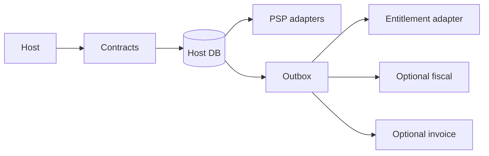

**Подходит:** A и B.

**Плюсы:**

- минимальная зависимость;
- естественная интеграция с Laravel;
- существующий commerce остаётся authority;
- RU adapters можно развивать независимо;
- нет обязательного отдельного service.

**Минусы:**

- invoicing, allocation и recurring надо либо строить модулями, либо подключать позже;
- usage rating не появляется бесплатно;
- требуется собственный rigorous recovery suite.

**Build gap:** durable provider execution invariant.

### Композиция 2: Lago-centered server

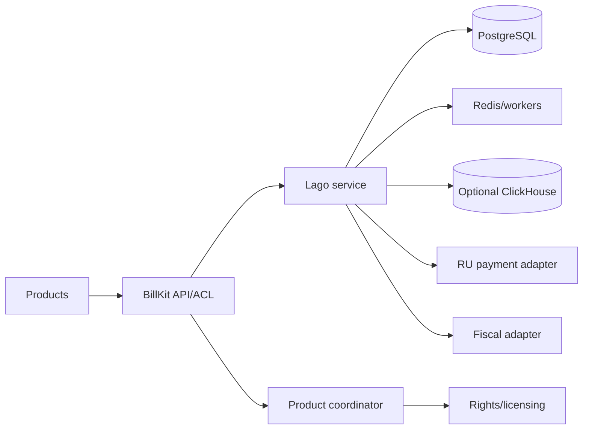

**Подходит:** C, частично D.

**Плюсы:**

- богатая usage/subscription/invoice/wallet model;
- современная API-oriented composition;
- сильный reference для hybrid pricing.

**Минусы:**

- AGPL;
- Ruby operational stack;
- требуется seller/legal partition audit;
- payment ownership с existing commerce надо разделить;
- возможная OSS/Premium граница.

**Fork trigger:** необходимость менять core financial workflow или добавлять first-class seller semantics через core tables.

### Композиция 3: Kill Bill payment/billing server

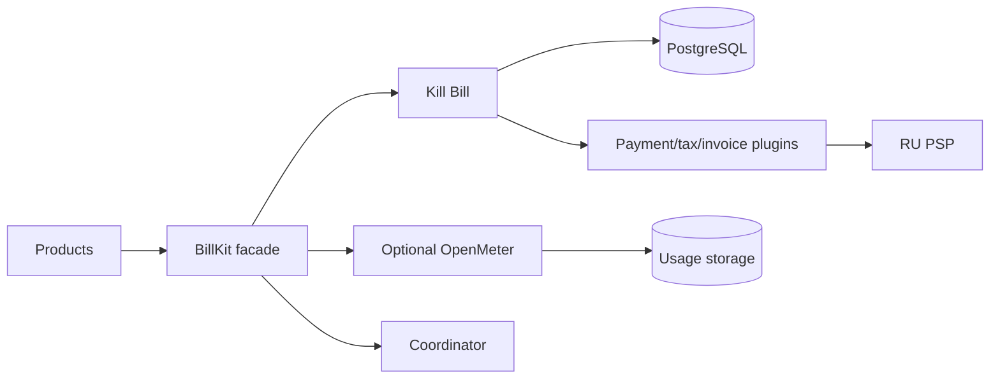

**Подходит:** C/D, если payment/subscription maturity важнее простоты.

**Плюсы:**

- Apache-2.0;
- развитые payment/plugin/retry patterns;
- Janitor и state-machine reference;
- audit/history.

**Минусы:**

- Java service;
- сложная модель;
- интеграция OpenMeter создаёт два schedule/rating центра, если не ограничить ownership;
- high adaptation cost для custom entitlement/grant periods.

**Fork trigger:** изменение core invoice/payment state machines вместо plugin/API extension.

### Композиция 4: Hybrid recommended

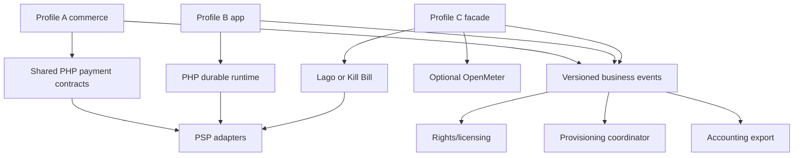

[RECOMMENDATION] Это основное направление: shared language-neutral contracts и PHP adapters — общие; server engine заменяем; профили A/B не зависят от C; OpenMeter подключается только при обоснованном metering масштабе.

***

## Fault stories

| История | Механизм | Gap/spike |
|---|---|---|
| Duplicate checkout | Business uniqueness + idempotency hash | Проверить конфликт другого payload |
| PSP accepted, process died | Persist-before-call + lookup | Kill process после socket write |
| Timeout | `unknown`, delayed lookup | Проверить ambiguous not-found |
| Expired worker lease | Fence local write + provider lookup | Старый worker после нового |
| Expired PSP idempotency | Durable business reference | Повтор после provider TTL |
| Concurrent partial refund | Refund reservation + row/version lock | 20 concurrent refund commands |
| Out-of-order webhook | State transition guard + inbox | Shuffle event order |
| Credential rotation | Merchant config version on operation | Refund старого merchant |
| Two sellers | Seller in every key/config | Cross-seller negative tests |
| Price change | Immutable terms/rate snapshot | Recompute historical invoice |
| Issued invoice edit | State-specific mutation policy | Direct API/DB rejection |
| Annual billing/monthly grants | Unique grant occurrence | Retry upgrade/renewal |
| AI reservation | Reserve/commit/release | Late success after expiry |
| Gauge correction | Metric-version correction policy | Closed-period adjustment |
| Duplicate schedule job | Unique occurrence | Parallel schedulers |
| Paid/provision failed | Idempotent provisioning key | Kill between create and reply |
| Refund before activation | Agreement generation/state check | Delayed activation event |
| Receipt outage | Independent receipt state | Fiscal service down 24h |
| Offline POS | Local product policy | Billing service disconnected |
| Journal replication | Source journal dedupe | Replay committed record |
| Forged organization ID | Host-authenticated context | Payload tampering |
| Reward/settlement confusion | Separate ledgers | Reject refund from reward |
| Bundle cancellation | Agreement components | Refund one component |
| Commit-before-dispatch crash | Transactional outbox | Kill after commit |
| Rolling upgrade | Expand/contract migration | Old/new workers concurrently |
| Restore/replay | Reconciliation checkpoints | Restore snapshot and compare PSP |

***

## Reuse verdict

| Unit | Verdict |
|---|---|
| Money arithmetic | Ready dependency after conformance tests |
| Date/period/reference contracts | Existing component/spec adaptation |
| Existing commerce payment journal | Preserve and adapt |
| Omnipay/Payum | Optional adapter dependency |
| Lago | Candidate external server / schema donor |
| Kill Bill | Candidate external server / architectural reference |
| OpenMeter | Optional metering service / schema donor |
| Invoice Ninja | UI/document/schema donor |
| FOSSBilling | PHP/module/schema reference |
| Subscriptionify | Migration source/entitlement adapter, not second money owner |
| PSP adapters | Build thin adapters where no verified driver meets lifecycle |
| RU fiscal integration | Build adapter boundary |
| Idempotency/outbox/inbox kernel | Narrow domain build |
| Usage reservation ledger | Narrow build unless selected engine proves invariant |
| Publisher settlement | Defer as separate domain |
| Universal ERP | Do not build |
| Dual-writer PHP/Dart ledger | Defer until protocol proof |

***

## Pilot

Минимальный pilot должен быть меньше full billing service, но проверять самые дорогие инварианты.

### Scope

- Один seller.
- RUB.
- Один PSP с create/find/refund/findRefund.
- One-off charge.
- Одно recurring agreement.
- Один fixed fee и один additive usage metric.
- Invoice и partial allocation.
- Partial refund.
- Fiscal status как отдельная mock/adapter state machine.
- Entitlement grant и idempotent provisioning mock.
- PHP/Dart Money fixtures.
- Outbox/inbox/reconciliation workers.

### Обязательные failure injections

- Crash before PSP call.
- Crash after PSP accepted, before local response.
- Duplicate webhook.
- Webhook before HTTP result.
- Late refund callback.
- Concurrent partial refunds.
- Recurring worker duplicate.
- Provisioning timeout after resource creation.
- Outbox dispatcher crash.
- Restore DB snapshot, then reconcile provider facts.

### Vendor bake-off

Один и тот же acceptance suite должен быть выполнен в трёх реализациях:

1. PHP durable runtime.
2. Lago adapter.
3. Kill Bill adapter.

Результатом должна быть не feature checklist, а таблица:

- сколько core изменений потребовалось;
- какие invariants доказаны;
- какие состояния невозможно выразить;
- какие vendor IDs/statuses протекли наружу;
- operational services;
- migration/export path;
- license impact.

***

## Backlog вопросов

| ID | Priority | Нерешённый вопрос |
|---|---:|---|
| R-01 | P0 | Кто владеет commercial agreement: billing или product coordinator? |
| R-02 | P0 | Какой engine проходит duplicate/unknown/refund acceptance suite без fork? |
| R-03 | P0 | Legal interpretation AGPL для planned Lago deployment/modification |
| R-04 | P0 | Seller partition: organization/tenant или отдельная billing entity? |
| R-05 | P0 | RU PSP create/find/refund/webhook capability audit |
| R-06 | P0 | Fiscal lifecycle и retry для Atol/PSP receipts |
| R-07 | P0 | Local idempotency retention после provider TTL |
| R-08 | P0 | Allocation/refund concurrency в Lago |
| R-09 | P0 | Invoice/payment locks и Janitor recovery в Kill Bill PostgreSQL |
| R-10 | P0 | OpenMeter OSS/payment/billing edition boundary |
| R-11 | P1 | OpenMeter late/corrected event semantics |
| R-12 | P1 | Lago seller/merchant config version provenance |
| R-13 | P1 | Kill Bill tenant vs legal seller isolation |
| R-14 | P1 | Laravel 13 compatibility выбранных PHP dependencies |
| R-15 | P1 | MoneyPHP против Brick Money на Dart fixture corpus |
| R-16 | P1 | Subscriptionify migration mapping и двойной paid state |
| R-17 | P1 | Annual billing/monthly grant ownership |
| R-18 | P1 | Offline AI budgets и global quota trade-off |
| R-19 | P1 | Bundle component cancellation/proration |
| R-20 | P1 | Billing-to-accounting export contract |
| R-21 | P1 | Restore/reconciliation procedure |
| R-22 | P1 | Plugin migration ownership и disable semantics |
| R-23 | P2 | Invoice numbering/legal document profiles |
| R-24 | P2 | Chargeback/dispute representation у RU PSP |
| R-25 | P2 | Publisher settlement boundary |
| R-26 | P2 | Archive/retention of event/provider journals |
| R-27 | P2 | Reporting replica versus direct financial queries |
| R-28 | P2 | Portable SQLite profile для локальных приложений |
| R-29 | P2 | Admin manual repair authorization/audit |
| R-30 | P2 | Vendor replacement/export completeness |

***

## Follow-up prompts

### Prompt 1: Lago schema

> Проведи source-level аудит Lago API на конкретном stable tag, ближайшем к commit `33ff49fa8c1ecd0b38094a05cf2eb5ce69a6a53e`. Исследуй PostgreSQL migrations и Rails models для organizations, billing entities, customers, subscriptions, charges, fees, invoices, payments, credit notes, refunds, wallets и idempotency records. Для каждой таблицы дай fields/types, PK/FK/UNIQUE/CHECK/indexes, nullable semantics, organization/seller scope и deletion policy. Затем восстанови transaction boundaries для concurrent invoice payment, wallet consumption и partial refund. Требуются exact GitHub URLs, tag/commit, implementation services и tests. Не делай вывод по API docs, если persistence source доступен.

### Prompt 2: Kill Bill recovery

> На выбранном текущем stable release Kill Bill исследуй payment, payment transaction, payment attempt, invoice payment и Janitor recovery. Покажи DDL для PostgreSQL, Java DAO/services, state-machine configuration, locks/transactions и tests для process crash после PSP acceptance, plugin timeout, duplicate retry, late webhook и partial refund. Отдели API-triggered payment retry от automatic invoice collection. Формат: invariant → source file/line → DB constraint/lock → recovery query → test → residual gap.

### Prompt 3: OpenMeter credits

> Исследуй OpenMeter `v1.0.0-beta.236` и ближайший commit source. Восстанови persistence model для meter, entitlement, grant, ledger customer account, transaction, entry, balance snapshot, usage reset, subscription и usage-based charge. Проверь reserve/commit/release, correction, late event, balance snapshot consistency и concurrent consumption. Укажи PostgreSQL Ent schemas/migrations, ClickHouse event tables, Kafka processing и tests. Отдельно ответь, можно ли использовать этот ledger как strict online AI quota owner.

### Prompt 4: YooKassa

> По актуальной официальной документации YooKassa на октябрь 2026 года составь adapter specification для PHP payment runtime: payment create, idempotency, lookup, confirmation, capture/cancel, saved payment method, recurring consent, partial/multiple refunds, refund lookup, webhook verification, merchant context, receipts и reconciliation. Для каждого capability укажи official URL, request/reference keys, terminal/non-terminal statuses, ambiguity after timeout и credential-rotation implications. Не использовать сторонние SDK как единственный источник.

### Prompt 5: CloudPayments

> По официальной CloudPayments API documentation на октябрь 2026 года восстанови payment lifecycle для charge/auth-confirm/void/refund/recurring token/webhooks. Особое внимание: request idempotency, lookup после timeout, partial refund, webhook authenticity, merchant/public key scope и receipt integration. Результат — neutral capability mapping и gaps относительно `initiate/find/capture/cancel/refund/findRefund`.

### Prompt 6: Atol

> Исследуй актуальные официальные API Atol Online и нормативные ссылки ФНС, необходимые для adapter boundary. Раздели payment, fiscal receipt, advance, full settlement, refund receipt, correction receipt и closing documents. Покажи receipt lifecycle, retry/status lookup, idempotency or external ID, callback authentication, failure recovery и какие данные должны быть immutable snapshots. Не давать универсальное юридическое заключение; перечислить вопросы, зависящие от seller и operation type.

### Prompt 7: PHP Money

> Сравни MoneyPHP и Brick Money на последних stable tags для PHP 8.4 и предполагаемой Laravel 13 integration. Проверь integer/BigInteger storage, currencies/exponents, decimal parsing, allocation, rounding modes, serialization и overflow. Построй language-neutral fixture specification для conformance с Dart Money: RUB/JPY/KWD, negative amounts, allocation remainder, tax rate precision, huge values и JSON transport. Укажи exact source/tests и license.

### Prompt 8: Subscription migration

> Исследуй `revoltify/subscriptionify`, `Foysal50x/tashil` и `masterix21/laravel-entitlements` на конкретных current tags/commits. Восстанови migrations/models для plans, subscriptions, features, quotas и consumption. Определи, где они пересекаются с monetary schedule, proration, renewal и usage credits. Предложи migration mapping, при котором existing paid state и quota consumption не дублируются. Нужны source paths, Laravel version constraints и explicit gaps.

### Prompt 9: Lago licensing

> Подготовь техническо-лицензионную границу использования Lago AGPL-3.0 в четырёх сценариях: unmodified self-hosted service, modified private service, distributed appliance, copied migrations/models in proprietary PHP packages. Используй LICENSE, repository notices и официальные Lago edition/licensing materials. Отдели текст лицензии от юридической интерпретации; выпиши вопросы для counsel.

### Prompt 10: Restore drill

> Спроектируй executable disaster-recovery drill для payment/invoice system с PostgreSQL, PSP и outbox. Сценарий: восстановление БД из backup, часть PSP charges/refunds и webhooks произошла после backup, часть outbox deliveries уже была применена downstream. Нужны reconciliation queries, provider lookup order, inbox/outbox replay rules, duplicate protection, manual repair audit и success criteria. Не предполагать exactly-once между системами.

***

## Лучшие референсы

| Тема | Источник | Что доказывает | Как использовать |
|---|---|---|---|
| Lago core | [Repository](https://github.com/getlago/lago-api) | Реальная Rails schema/models/services | Source-level vendor audit |
| Lago overview | [Official introduction](https://getlago.com/docs/guide/introduction/welcome-to-lago) | Event → metric → plan → invoice flow  [getlago](https://getlago.com/docs/guide/introduction/welcome-to-lago) | Domain vocabulary |
| Lago deployment | [Self-hosting overview](https://getlago.com/blog/self-hosted-billing) | Operational components и payment separation  [getlago](https://getlago.com/blog/self-hosted-billing) | Footprint estimate |
| Lago releases | [Release history](https://github.com/getlago/lago-api/releases) | Migration/feature evolution  [github](https://github.com/getlago/lago-api/releases) | Upgrade review |
| Kill Bill core | [Repository](https://github.com/killbill/killbill) | DDL, DAOs, state machines | Deep payment audit |
| Kill Bill docs | [Documentation](https://docs.killbill.io/) | Supported modules  [docs.killbill](https://docs.killbill.io/) | Capability navigation |
| Payment lifecycle | [Payment guide](https://docs.killbill.io/latest/userguide_payment) | Plugin lifecycle, states, Janitor  [docs.killbill](https://docs.killbill.io/latest/userguide_payment) | Recovery architecture |
| Invoice plugins | [Invoice plugin guide](https://docs.killbill.io/latest/invoice_plugin) | Plugin retry contract  [docs.killbill](https://docs.killbill.io/latest/invoice_plugin) | Tax/rating extension |
| Kill Bill audit | [History discussion](https://github.com/killbill/killbill/issues/938) | History/audit mechanics  [github](https://github.com/killbill/killbill/issues/938) | Audit donor |
| OpenMeter core | [Repository](https://github.com/openmeterio/openmeter) | Ent schemas, migrations, billing code | Meter/ledger audit |
| Meter semantics | [Creating meters](https://openmeter.io/docs/metering/guides/creating-meters) | COUNT/UNIQUE/LATEST и immutability  [openmeter](https://openmeter.io/docs/metering/guides/creating-meters) | Metric contract |
| Event semantics | [Best practices](https://openmeter.io/docs/metering/guides/best-practices) | `id + source` dedupe  [openmeter](https://openmeter.io/docs/metering/guides/best-practices) | Usage event spec |
| Pipeline | [How it works](https://openmeter.io/docs/metering/events/how-it-works) | Kafka/ClickHouse pipeline  [openmeter](https://openmeter.io/docs/metering/events/how-it-works) | Operational decision |
| API consistency | [API reference](https://openmeter.io/docs/api/v3) | Async event processing/query surface  [openmeter](https://openmeter.io/docs/api/v3) | Client contract |
| Collector | [High availability](https://openmeter.io/docs/collectors/high-availability) | Buffer/retry/dedupe boundaries  [openmeter](https://openmeter.io/docs/collectors/high-availability) | Edge ingestion |
| Invoice Ninja | [Repository](https://github.com/invoiceninja/invoiceninja) | Laravel invoice application | UI/schema donor |
| FOSSBilling | [Repository](https://github.com/FOSSBilling/FOSSBilling) | PHP billing modules | Extension donor |
| Omnipay | [Repository](https://github.com/thephpleague/omnipay) | PHP gateway abstraction | Adapter reference |
| Payum | [Repository](https://github.com/Payum/Payum) | PHP payment actions/storage | Runtime reference |
| MoneyPHP | [Repository](https://github.com/moneyphp/money) | Money arithmetic | PHP/Dart conformance |
| Brick Money | [Repository](https://github.com/brick/money) | Money/decimal arithmetic | Alternative foundation |

***

## Coverage audit

| Блок задания | Покрытие | Доказанность | Следующий шаг |
|---|---|---|---|
| Market taxonomy | Выполнено | Средняя/высокая | Расширить hosted comparison |
| Shortlist | Выполнено | Высокая на уровне границ | Vendor acceptance suite |
| Versions/licenses | Частично | Revision подтверждён, stable tags не везде | Pin tags |
| Functional matrix | Частично | Основные области | Детализировать 60+ capabilities |
| Lago schema | Архитектурный audit | Средняя | R-08/R-12 |
| Kill Bill schema | Архитектурный audit | Средняя | R-09/R-13 |
| OpenMeter schema | Архитектурный audit | Средняя | R-10/R-11 |
| A–D storage variants | Выполнено | Recommendation | Prototype migrations |
| Invariants/recovery | Выполнено | Design-level | Executable fault suite |
| Extension points | Выполнено концептуально | Vendor-specific частично | Source-level plugin audit |
| Usage/credits | Выполнено | OpenMeter evidence + recommendation | Reservation spike |
| PHP/Dart | Выполнено концептуально | Existing facts | Conformance corpus |
| RU PSP | Не завершено | Unverified | R-05 |
| Fiscal/legal | Не завершено | Unverified | R-06/R-23 |
| Operations/restore | Основной дизайн | Recommendation | R-21 |
| Three compositions | Выполнено | Recommendation | Bake-off |
| Reuse verdict | Выполнено | Recommendation | ADR |
| Pilot | Выполнено | Recommendation | Implement test harness |
| Follow-up prompts | 10 готовых | Самодостаточные | Выполнять по dependency order |
| 40–60 references | Частично | 21 high-value references | Довести после RU/vendor source drills |

***

## Порядок следующих исследований

1. **Сначала:** R-01, R-02, R-04 — ownership и одинаковый acceptance suite.
2. **Параллельно:** R-03, R-05, R-06 — лицензия и RU execution/fiscal feasibility.
3. **Затем:** R-08, R-09, R-10 — source-level vendor drills.
4. **После выбора engine:** canonical API/events и anti-corruption schema.
5. **Параллельно после contract freeze:** PHP/Dart Money fixtures и Subscriptionify migration.
6. **После pilot:** operational restore, reconciliation и rolling-upgrade drills.
7. **Отложить:** publisher settlements, universal ERP integration, global offline quota и масштабное partitioning.

**Точная команда продолжения:**  
`Продолжи исследование BillKit томом 2: проведи source-level аудит Lago, Kill Bill и OpenMeter по backlog R-02, R-08, R-09, R-10 и R-11; добавь подробные таблицы migrations/fields/constraints/transactions/tests и расширь annotated catalog до 40–60 первичных источников.`