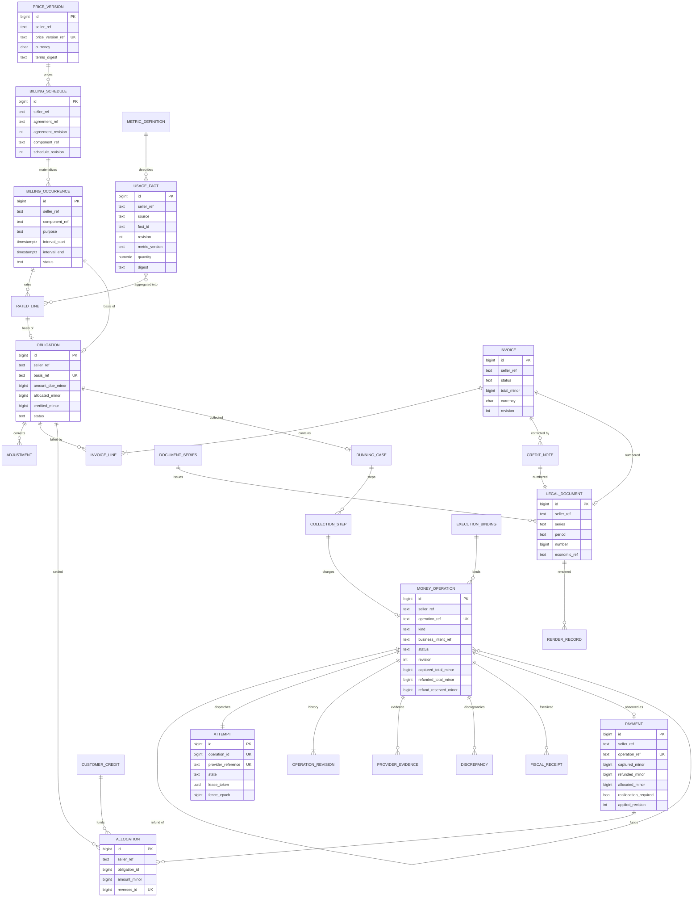
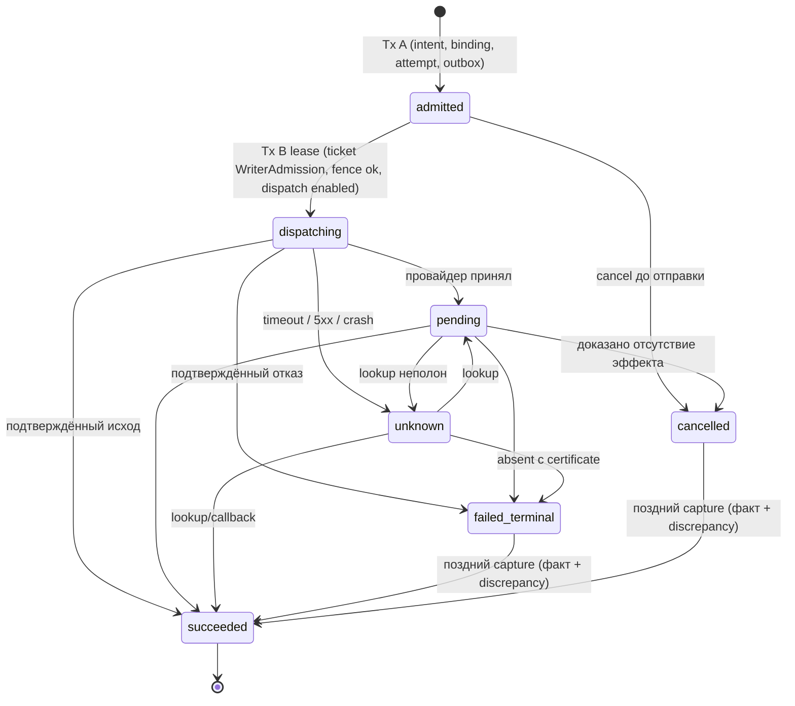
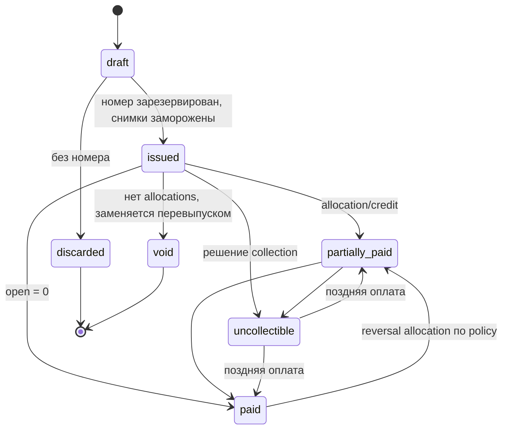

# Billium — модель данных

Уточнение 2026-10-24: D54, D57 и D60–D63 заменяют прежние допущения restore, bounded provider
facts и части platform/ledger алгоритмов. Это целевая модель; P3–P10 не реализованы.
[Полнота дизайна](design-coverage.md) задаёт поддерживаемые границы.

Статус: PLAN1.P1.6 (2026-10-17), корректировка PLAN1.P1.10 по review P1.9. Модель построена от владения
(`docs/requirements.md` § Владение) и инвариантов, а не от таблиц кандидатов аудита. Сущности соседей
(соглашение хоста, PlanVersion Tariffler, заказ Commerz, книга AiFina) — только строковые ссылки `*_ref`.
Решения: D11–D15, D19–D23, D25–D28, D34–D37. Это целевая модель для P3–P7; DDL пишут фазы реализации,
отклонение — D#.

Общие правила схемы:

- Каждая денежная таблица несёт `seller_ref text NOT NULL`; бизнес-ключи уникальности и FK — составные
  с `seller_ref` (INV-14, D23).
- Деньги — `bigint` minor units + `currency char(3)`; exponent — из версионированной таблицы ISO 4217;
  float запрещён (D19, REQ-CON-30). Количества usage — `numeric` с метрикой, не деньги.
- Статусы — `text` + CHECK, не enum БД (REQ-FAIL-29). JSON — только санитизированный payload и
  metadata со `schema_version` и лимитом размера (REQ-CON-39).
- Время — `timestamptz` UTC. Идентификаторы сущностей — `bigint` identity внутри, внешние `*_ref` —
  стабильные строки (ULID/UUID) в wire.
- Таблицей владеет ровно один модуль ядра; запись — только через его OperationRunner (INV-01, M-55).

## ERD

Служебные таблицы модуля platform (без связей с доменными в ERD): `idempotency_receipt`,
`intent_tombstone`, `inbox_message`, `outbox_event`, `feed_partition`, `installation_state`,
`money_commit_log` — см.
«Словарь данных».

## Инварианты

| ID | Инвариант | Constraint | Lock | Обход, который закрыт | Тест-идея | Источник |
|:--|:--|:--|:--|:--|:--|:--|
| INV-01 | Один writer на сущность | Реестр владельцев таблиц; production application role не меняет защищённые allocation/counter поля напрямую: guarded DB routines, миграции под отдельной ролью | OperationRunner + scoped TransactionContext participants; каждый модуль меняет свои данные | Nested root Tx, cross-module SQL, bypass counters от application role; DBA bypass вне модели | Direct DML denied; foreign context rejected; allocation journals = counters после гонок | INV-01, D17, D60 |
| INV-02 | Один исполнитель на операцию на всю жизнь | Frozen execution_profile/binding, одна logical attempt; external WriterAdmission и RetirementProof/ActivationCertificate | financial_session FOR SHARE для root Tx, seal FOR UPDATE; tickets/CAS в dispatch; внешний hard fence старых отправителей | Любая смена владельца открывает recovery; release или совпадение max(identity) не активируют; old session не пишет после seal | Post-release mutation; recovery-release-acquire bypass; out-of-order commit_no; paused old worker; clone same checkpoint: 0 новых effects до квалифицированной activation | INV-02, REQ-FAIL-15, D26, D34, D37, D40, D54, D60 |
| INV-03 | Сетевой вызов вне транзакции | Правило приложения: gateway драйвера, renderer и доставка отвергают вызов при открытой транзакции | Tx B (lease attempt) коммитится до вызова; finish — отдельная Tx C | Вызов внутри Tx при pinned connection хоста | Double драйвера проверяет уровень транзакции = 0 | INV-03, D10, D27 |
| INV-04 | `unknown` разрешается lookup-ом | CHECK: `failed-terminal` только с `outcome_evidence_id` или `absence_certificate_ref`; одна attempt на операцию — UNIQUE (`operation_id`), второй attempt нет; повтор после terminal — новая операция по новому основанию через admission (D37) | Операция FOR UPDATE при применении исхода lookup/callback | Повтор новым ключом после timeout/404; таймер вместо lookup; повторная отправка той же операции | Timeout → нет новой отправки до ответа lookup; вставка второй attempt → UNIQUE-отказ | INV-04, REQ-FAIL-02, REQ-FAIL-08, D28, D37 |
| INV-05 | Ключ + digest; тот же ключ с другим payload — conflict | UNIQUE (`environment`, `seller_ref`, `command_kind`, `command_key`) на `idempotency_receipt` (installation — БД инсталляции); сравнение `digest` | Claim — первая запись корневой Tx (блокировка уникального индекса), до locks агрегатов | check-then-insert; повтор с изменённым телом | N процессов: тот же ключ, разные digest | INV-05, REQ-CON-32, REQ-FAIL-06, D22 |
| INV-06 | Cumulative totals присваиваются, не суммируются | UNIQUE economic revision/digest; обычная applied projection имеет bounded totals; immutable observed effects сохраняются отдельно, включая отклонения | Operation/payment lock, compare material economic digest | Повтор callback как дельта; потеря overrefund из-за bounded CHECK | Duplicate/shuffled observations; actual refund140 при capture100 сохраняет exposure40+hold, applied остаётся last-consistent | INV-06, REQ-FAIL-10, D28, D57, D60 |
| INV-07 | Refund — к исполнителю исходного charge | FK (`seller_ref`, `original_operation_id`) на charge; триггер копирует `binding_id` charge в refund, иной binding отвергается | Charge FOR UPDATE при admission refund | Refund через новый маршрут, merchant или драйвер по умолчанию | Смена маршрута, затем refund старого charge | INV-07, REQ-OWN-20, REQ-OWN-21, D26 |
| INV-08 | Транспортный ACK — не бизнес-receipt | `inbox_message.status` (received → applied/quarantined) отделён от ACK; receipts — отдельные типы с ссылкой на применённую revision | Вставка inbox ON CONFLICT DO NOTHING; применение — под lock операции | Ответ 200 / ACK relay принят за применение | ACK, затем crash до apply → повторное применение без дубля | INV-08, REQ-CON-10, REQ-FAIL-26, D28 |
| INV-09 | Сохранение receivable и allocatable funds | Guarded DB routine владеет journal+counter mutation; приложение не увеличивает counters повторно; account/seller/currency совпадают; financialHold запрещает новые allocations | Полный lock plan: obligation → invoice → payment/customer_credit, ids ascending | Concurrent raw application DML, cross-customer allocation, inconsistent counter increment | Counter/journal equality; direct application INSERT rejected; normal refund reallocation, exceptional evidence preserved under hold | INV-09, D11, D27, D35, D57, D60 |
| INV-10 | Admission refund ≤ фактически доступная captured ёмкость минус confirmed/pending/unknown refunds | Nonnegative reserve; admission predicate под lock исходного charge; actual provider evidence не ограничивается этим predicate и при нарушении создаёт discrepancy+hold | Charge lock при reserve/reduce; unknown reserve не освобождается по таймеру | Конкурирующие refunds, потерянный поздний внешний факт, повтор after TTL | Concurrent partial refunds; late original success после replacement: actual excess сохранён, spendable=0, автоматических новых effects нет | INV-10, REQ-FAIL-09, REQ-FAIL-10, D27, D57 |
| INV-11 | Уникальность occurrence — бизнес-идентичность | EXCLUDE USING gist (`seller_ref`, `component_ref`, `purpose`, `tstzrange(interval)` &&) WHERE status ≠ superseded; UNIQUE (`seller_ref`, `basis_ref`) на obligation | Schedule FOR UPDATE при материализации и supersession | Две revisions расписания; повтор scheduler job | Две revisions одного периода; двойной job | INV-11, REQ-ACC-09, D12 |
| INV-12 | Денежные условия неизменяемы | Триггер отвергает UPDATE суммы, валюты, `price_version_id`, `terms_digest` obligation после создания; изменение — строка `adjustment` | Obligation FOR UPDATE при adjustment | Пересчёт по новой PriceVersion | Смена цены после obligation → adjustment, не пересчёт | INV-12, REQ-CON-33, D12 |
| INV-13 | Invoice после выпуска неизменяем | Триггер: при `status ≠ draft` UPDATE замороженных колонок и изменения `invoice_line` отвергаются; metadata — allow-list; UNIQUE номер в `legal_document` | Invoice FOR UPDATE; series FOR UPDATE при выпуске | Правка строк напрямую; смена номера при перерендере | Правка issued invoice → отказ; перерендер сохраняет номер | INV-13, REQ-CON-38, D20 |
| INV-14 | Seller в каждом агрегате и ключе | `seller_ref` NOT NULL; составные FK (`seller_ref`, `id`); все бизнес-UNIQUE и scope идемпотентности включают seller. Исключение — business binding операции (D36): UNIQUE шире продавца, совпадение с иным seller → `billium.idempotency.conflict` без раскрытия чужой операции | Не требуется: структурный constraint; seller берётся из аутентифицированного контекста admission | Ссылка на сущность другого продавца; seller из payload | Allocation платежа продавца A на obligation продавца B → FK-отказ; тот же intent от продавца B → conflict | INV-14, REQ-PROF-08, REQ-CON-21, D23, D36 |

## FSM денежной операции

Базовая FSM sale/refund сохраняет v1 (D28). D57 добавляет отдельные authorize/capture/provider-void
commands и effect observations; local payment.cancel не становится PSP void. Totals — cumulative
атрибуты. Actual observed effects и bounded applied projection разделены; discrepancy удерживает hold.

Запрещено (триггер или OperationRunner): `succeeded` → любое другое состояние; любое → `admitted`;
`unknown` → `failed_terminal` по timeout, 404, пустому lookup или истёкшему TTL (REQ-FAIL-08); вторая
attempt операции в любом состоянии (UNIQUE `operation_id`, D37); изменение суммы, валюты, binding,
профиля; снижение `revision`; та же revision с другим digest — quarantine вместо перехода (REQ-FAIL-04);
`cancelled` при уже отправленном запросе без доказанного отсутствия (REQ-CON-07).

Attempt (D37): у операции ровно одна attempt, создаётся в Tx A. Её `state` повторяет фазу отправки
(`admitted → dispatching → sent`); cancel и Tx B сериализуются блокировкой `money_operation` (D40), поэтому
cancel при attempt `dispatching|sent` отказан; смена worker после потери lease — новый `lease_token` и `fence_epoch`
той же attempt, recovery идёт lookup-ом (INV-04). Lookup и reconcile — `operation_revision` и
`provider_evidence`, не attempts. Повтор после `failed_terminal` или `cancelled` — новая операция по
новому основанию (новый intent хоста или новый collection step) через admission, binding и ключ заново
(INV-05, REQ-FAIL-07).

## FSM инвойса

Запрещено: `issued|partially_paid|paid|uncollectible|void` → `draft`; любые переходы из `void` и
`discarded`; `void` при ненулевых allocations (сначала reversal или credit note); смена номера,
seller, валюты, строк и итогов после `draft` (INV-13). `paid`/`partially_paid` — производные от
open amount в той же транзакции, что и allocation (INV-09).

## Коррекции

| Ситуация | Механизм | Что остаётся неизменным | Основа |
|:--|:--|:--|:--|
| Новая revision расписания (AC-03) | occurrences в `planned` → `superseded`, новые создаются по бизнес-ключу; occurrence с obligation корректируется adjustment | ключ occurrence, выставленные obligation | INV-11, D12 |
| Новая PriceVersion | действует для будущих occurrences | obligation и invoice по старой цене | INV-12, REQ-CON-33 |
| Поздний usage-факт | adjustment в исходном периоде или связанная obligation по policy метрики | закрытый invoice | REQ-FAIL-21, D13 |
| Ошибка в выпущенном invoice | credit note (свой номер) или void + перевыпуск | номер и строки исходного | INV-13, D20 |
| Ошибочная allocation | reversal-строка с `reverses_id` и новая allocation | исходная allocation | INV-09, D11 |
| Refund после оплаты | refund-операция к исходному charge; ledger меняется только после succeeded refund — наблюдение, затем policy reallocation: `credit_note` — reversal с `cause = refund` плюс credit note на ту же сумму в одной Tx (долг закрыт), `reversal` — reversal с `cause = refund` без credit note (долг открыт, collection не стартует) (D35) | исход charge; allocations до подтверждения refund | INV-07, INV-10, D35 |
| Внешний эффект сверх границ | `discrepancy` с evidence и repair receipt; авто-возврат запрещён | применённые revisions | REQ-FAIL-10, REQ-FAIL-18 |
| Ошибка чека | чек коррекции через исполнителя | денежный исход | REQ-CON-24, REQ-FAIL-24 |
| Ручная починка | привилегированная команда с audit и provenance коррекции | факты, кроме добавленных | REQ-FAIL-10, D22 |

## Retention и restore

- Три хранилища (REQ-FAIL-30, D25): `outbox_event` — очередь доставки, prune после доставки выше
  retention floor; журнал фактов (`operation_revision`, `provider_evidence`, `inbox_message`,
  receipts, `allocation`, `adjustment`) — append-only до горизонта; `intent_tombstone` и
  `idempotency_receipt` — до горизонта повторов, refund, backup и позднего callback (REQ-FAIL-16).
  Числовые горизонты — вопрос владельцу.
- После горизонта namespace закрывается: старый ключ → `expired` / `recovery-required`, нового эффекта
  нет (REQ-FAIL-25).
- Новый потребитель feed после prune: snapshot + committed cursor + tail (REQ-FAIL-22); историческая
  allocation не восстанавливается из текущих цен.
- Restore/clone и смена ownership (D54): `installation_state` и `money_commit_log` копируются
  с БД, поэтому не доказывают freshness или право отправки. External authority выдаёт исключительную
  session. Любое новое acquire, в том числе после clean release, открывает recovery. Продолжить active
  может та же deployment owner session с непрерывным lease. Обычный worker получает новый process token
  и присоединяется к ней без recovery; expected epoch и attachment берутся из host authority, не из БД (D62).
- Seal: остановить admission/collection/tickets; exclusive lock `financial_session` ждёт завершения
  уже допущенных root financial Tx и фиксирует sealed. Old epoch не может применить новые изменения.
  Raw authenticated callbacks/responses продолжают custody без изменения sealed projection.
- RetirementProof от deployment подтверждает прекращение старых отправителей и их исходящего PSP
  доступа; lease timeout или copied flag недостаточны. Уже принятые PSP запросы могут завершиться позднее.
- Recovery сверяет локальные admitted/pending/unknown и provider inventory от backup horizon до
  подтверждённого completeness watermark, включая потерянные после snapshot операции. Восстанавливаются
  original refs, receipts/tombstones, source-feed и accounting/fiscal discrepancies. Unsupported lookup
  или неполное inventory оставляет namespace закрытым; отсутствие записи не становится новым intent.
- ActivationCertificate связывает selected DB lineage/session/epoch, RetirementProof, per-namespace
  coverage watermarks, unresolved dispositions, projection checks, actor/verdict, expiry и one-use nonce.
  Отдельная привилегированная activation CAS допускает только перечисленные reconciled namespaces.
  Release/reacquire не заменяет activation. Никакого сравнения max(identity) для auto-active нет.
- Raw evidence и observed actual totals сохраняют late overcapture/overrefund. Bounded applied projection
  остаётся last-consistent; financialHold даёт spendable=0, discrepancy показывает actual exposure,
  repair имеет отдельное разрешение/receipt. Значения не обрезаются молча (D57, D60).
- Recovery barrier: операции `admitted|dispatching|pending|unknown` из restored-копии проходят lookup
  до любого dispatch; отсутствие записи — не свежее намерение (REQ-FAIL-25).
- Источник feed восстановлен ниже применённой revision → `feed_partition.state = recovery_required`
  (REQ-FAIL-23).
- Миграции — forward-only, репетиция на клоне, восстановление = restore + replay (M-31, REQ-FAIL-29).

## Fault stories

| ID | Механизм | Где в модели | Основание |
|:--|:--|:--|:--|
| FS-01 | Claim ключа + UNIQUE business binding без seller; digest или иной seller → conflict | `idempotency_receipt`, `money_operation.business_intent_ref` | INV-05, REQ-FAIL-07, D36 |
| FS-02 | Persist-before-call: Tx A/B до сети, lookup после crash | `attempt.state = dispatching`, lookup worker | INV-03, INV-04 |
| FS-03 | Timeout → unknown; lookup до повтора | FSM операции | INV-04, REQ-FAIL-02 |
| FS-04 | Fenced finish по `lease_token`; evidence сохраняется до перехода | `attempt`, `provider_evidence` | INV-02, REQ-FAIL-17 |
| FS-05 | Бизнес-reference attempt = ключ драйвера; после TTL провайдера — lookup, не create | `attempt.provider_reference` | INV-04, REQ-FAIL-16 |
| FS-06 | Резерв ёмкости под lock charge | `refund_reserved_minor` | INV-10, D27 |
| FS-07 | Inbox dedupe + монотонная revision + hold | `inbox_message`, `operation_revision` | INV-06, REQ-FAIL-13 |
| FS-08 | Неизменяемый binding с account, ротация credential в account | `execution_binding` | REQ-OWN-21, D26 |
| FS-09 | seller в ключах и составных FK | все денежные таблицы | INV-14, D23 |
| FS-10 | Неизменяемые условия; adjustment | `obligation.terms_digest`, `adjustment` | INV-12 |
| FS-11 | Триггер заморозки issued invoice; credit note/void | `invoice`, `invoice_line` | INV-13, D20 |
| FS-12 | Billing occurrence отдельно от grant; ссылка хоста | `billing_occurrence` | INV-11, REQ-NBR-07 |
| FS-13 | Вне Billium: резерв у Tariffler, Billium принимает итоговый факт | `usage_fact` | REQ-OUT-10, D13 |
| FS-14 | Gauge заменяется более поздней revision по метрике | `metric_definition.semantics`, `usage_fact.revision` | REQ-CON-16, REQ-FAIL-21 |
| FS-15 | EXCLUDE по бизнес-интервалу + UNIQUE basis obligation | `billing_occurrence`, `obligation` | INV-11, REQ-OWN-03 |
| FS-16 | Исход оплаты не зависит от provisioning хоста | `money_operation` | REQ-FAIL-27, REQ-OUT-11 |
| FS-17 | Cancellation generation хоста закрывает collection | `dunning_case`, `billing_schedule` | REQ-FAIL-19, REQ-NBR-06 |
| FS-18 | Чек — отдельный lifecycle, `external_id` стабилен | `fiscal_receipt` | REQ-CON-24, REQ-FAIL-24 |
| FS-19 | Вне Billium: офлайн-фискал зала — AiResto | — | REQ-OUT-12 |
| FS-20 | Экспорт по стабильному `sourceFactRef`, коррекция — новый факт | `outbox_event` (finbridge) | REQ-CON-34, REQ-CON-35 |
| FS-21 | seller из аутентифицированного контекста, ID в payload — селектор | admission | REQ-CON-21, INV-14 |
| FS-22 | Денежный prepaid отделён от credits/rewards продуктов | `customer_credit` | REQ-OWN-12, REQ-OUT-05 |
| FS-23 | Allocation и credit note по компоненту, без переоценки | `allocation`, `credit_note` | REQ-OWN-13, REQ-OWN-19 |
| FS-24 | Transactional outbox в той же Tx | `outbox_event` | REQ-CON-18, INV-08 |
| FS-25 | Expand/contract, text-статусы, совместимые workers | все таблицы | REQ-FAIL-29, D21 |
| FS-26 | WriterAdmission: каждая смена owner — recovery; session seal, external retirement proof, inventory reconciliation и отдельный activation certificate; release/commit_no не разрешают auto-active | financial_session, feed_partition, external authority/deployment | REQ-FAIL-15, REQ-FAIL-23, D25, D54, D60 |

## Операции и блокировки

Глобальный порядок (D27, уточнения D55/D60): claim идемпотентности → `financial_session` FOR SHARE
→ `installation_state` (административные изменения) → `module_state` FOR SHARE (rank 25)
→ `feed_partition` → `billing_schedule` → `billing_occurrence` → `dunning_case`
→ `settlement_intent` (rank 65, id asc) → `obligation` (id asc) → `invoice` (id asc) → `payment`/`customer_credit` (id asc) → charge → refund
→ attempt → document_series. Seal берёт exclusive session lock и не получает domain locks после него.
Полный LockSet вычисляется до мутаций; изменившийся набор требует restart root Tx. READ COMMITTED;
40001/40P01 повторяет только локальную Tx. Сеть/authority/PSP/renderer — вне Tx.

Один root OperationRunner выдаёт unforgeable TransactionContext с connection/session/LockSet. Typed
participant port позволяет владельцу ledger участвовать в root Tx documents/collection/rating;
обычный public Ledger API остаётся root-only и не вызывается вложенно. Ни один participant не получает
права писать чужие таблицы. Counters allocation изменяет только guarded DB routine, приложение их не
инкрементирует повторно. Production application role не имеет прямого DML на защищённые данные;
privileged DBA bypass не входит в гарантию. `money_commit_log` сохраняется для диагностики (D54/D60).

Закрытие settlement intent без эффекта сохраняет append-only `settlement_intent_closure` через
guarded `billium_close_settlement_intent_no_effect`. Scoped UNIQUE допускает одно terminal closure,
targets и исторические receipts не меняются. P3.6 владеет DDL/routine, P3.8 — participant и тестами.
Closure и economic application сериализуются lock intent до obligations. Проверка актуального
no-effect proof принадлежит collection participant в той же Tx; поздний реальный факт всё равно
сохраняется с discrepancy/hold и не открывает автоматическую allocation.

Platform хранит `module_state` и append-only `module_transitions`. Runner заранее определяет все
участвующие модули, проверяет их operation-class capabilities и удерживает shared locks до commit;
transition берёт exclusive locks в том же порядке module_id. Disable и admission имеют единую
границу сериализации. Draining/recovery сохраняют предусмотренные completion, refund и evidence
lanes; receipt replay проверяет текущие права, но не требует разрешения на новое намерение.

| Операция | Read/write | Locks (явные и неявные) | Tx и commit point | Внешний вызов | Recovery |
|:--|:--|:--|:--|:--|:--|
| Приём usage-факта | usage_fact | UNIQUE (seller, source, fact_id, revision) | одна Tx | — | повтор → тот же receipt; иной digest → conflict |
| Rating occurrence | occurrence, rated_line, obligation | schedule → occurrence FOR UPDATE; UNIQUE basis | одна Tx + outbox | — | повтор job → UNIQUE |
| Supersession расписания | schedule, occurrence | schedule → occurrences FOR UPDATE | одна Tx | — | только `planned` |
| Выпуск invoice | invoice, lines, legal_document, series | obligation → invoice → series FOR UPDATE | одна Tx + outbox | рендер после commit | номер не меняется |
| Credit note | credit_note, obligation, legal_document | obligation → invoice → series | одна Tx + outbox | рендер после commit | ключ команды |
| Apply payment observation | payment, inbox | claim (inbox/receipt) → feed_partition (для feed) → payment FOR UPDATE; revision монотонна; `reallocation_required` выводится CHECK | одна Tx + receipt | — | query по receipt (REQ-FAIL-20) |
| Allocation / reversal | allocation, obligation, invoice, payment | claim → obligation → invoice → payment; триггер `allocation_guard` | одна Tx + AllocationReceipt | — | receipt/query |
| Refund authorization (запрос) | payment, allocation, obligation — только чтение | без locks: снимок read-only Tx | нет записи | — | повтор запроса; ёмкость и требуемая reallocation — справка, не резерв (REQ-CON-14, D35) |
| Policy reallocation после refund | allocation, credit_note, obligation, invoice, payment | claim → obligation → invoice → payment; только при `reallocation_required` после succeeded refund | одна Tx + receipt; режим `credit_note` — reversal (`cause = refund`) и credit note на ту же сумму вместе, режим `reversal` — только reversal; флаг снимается CHECK-ом той же Tx | — | ключ команды ledger (INV-05, D35) |
| Admission charge | idempotency, operation, binding, attempt | claim → installation FOR SHARE; UNIQUE business binding без seller, иной seller → conflict (D36) | Tx A + outbox | — | ключ/intent → исходная операция |
| Admission refund | то же + charge | claim → installation FOR SHARE → charge FOR UPDATE (резерв); ledger не меняется (D35) | Tx A + outbox | — | то же |
| Dispatch | financial_session, authorization guard, attempt | validated deployment/process token → session shared guard → collection authorization participant при необходимости → root operation → attempt CAS; без глобального UPDATE installation на каждый send | Tx B dispatch-start до сети, точка линеаризации отмены | authority (до Tx), драйвер после commit | revoked/stale guard до Tx B даёт 0 sends; уже отправленный effect сохраняется; D62, D63 |
| Finish / callback / lookup apply | operation, revision, evidence, inbox | raw custody отдельно; financial_session FOR SHARE → operation FOR UPDATE; CAS epoch/lease для reduce | Tx C + outbox | — | quarantine при конфликте |
| Cancel | operation, attempt | money_operation FOR UPDATE → чтение attempt: `dispatching|sent` → отказ (D40) | одна Tx + `money_commit_log` | — | отправленное не отменяется |
| Collection step | dunning_case, step, operation | claim ключа шага (детерминирован из case и step_no) → installation FOR SHARE → case → obligation FOR UPDATE (open > 0, не открыта reversal с `cause = refund`) → money_operation; UNIQUE (case, step) | одна Tx: step + ledger settlement-intent participant + command outbox; execution admission позже | lease `WriterAdmission` до старта job (вне Tx) | повтор job → тот же claim/UNIQUE; нет lease → job не стартует (D34) |
| Outbox relay | outbox_event | FOR UPDATE SKIP LOCKED | короткие Tx, доставка вне Tx | брокер/HTTP | at-least-once, dedupe по event_id |
| Prune / restore | outbox, tombstones, installation, money_commit_log | installation FOR UPDATE; новая incarnation — только от authority; prune уважает retention pins и незавершённые reconciliation manifests | одна Tx | authority (активация, до Tx) | новая owner session всегда recovery; explicit activation certificate (D54) |

Матрица пар с общим изменяемым ресурсом (включая self-pairs):

| Пара | Общий ресурс | Допустимое interleaving | Основа |
|:--|:--|:--|:--|
| admission × admission (тот же ключ) | idempotency_receipt | второй ждёт индекс, затем receipt или conflict | INV-05 |
| admission × admission (тот же intent, иной ключ) | (source_context, business_intent_ref, kind) | UNIQUE → исходная операция того же seller | REQ-FAIL-07, D36 |
| refund × refund (один charge) | charge | сериализуются lock charge; ёмкость под lock | INV-10 |
| refund admission × исход charge | charge | сериализуются; refund видит последнюю captured_total | INV-10, INV-06 |
| callback × lookup apply | operation | lock + монотонная revision; конфликт digest → quarantine | INV-06, REQ-FAIL-04 |
| finish × stale worker | attempt | CAS lease; проигравший пишет только evidence | INV-02, REQ-FAIL-17 |
| dispatch × cancel | money_operation | Tx B берёт FOR SHARE, cancel — FOR UPDATE; исходов ровно два: cancel до Tx B (0 отправок) или Tx B до cancel (cancel отказан, отправленное не отменяется) | REQ-CON-07, D40 |
| dispatch × restore | external owner session + financial_session | всякая передача ownership — recovery; hard-fence proof и reconciliation certificate до activation | INV-02, D54 |
| allocation × allocation | obligation, payment | порядок obligation → invoice → payment; CHECK backstop | INV-09 |
| allocation × credit note | obligation, invoice | obligation → invoice | INV-09, INV-13 |
| allocation × observation apply | payment | lock payment; allocation читает net под lock | INV-09 |
| issue × issue (одна серия) | document_series | lock series; UNIQUE номер | REQ-OWN-07 |
| issue × metadata update | invoice | lock invoice; триггер заморозки | INV-13 |
| rating × rating | occurrence, obligation | lock occurrence; UNIQUE basis | INV-11 |
| supersession × rating | occurrence | lock schedule → occurrence; supersede только `planned` | INV-11, INV-12 |
| usage × usage (тот же факт) | usage_fact | UNIQUE; digest сравнивается | REQ-CON-15 |
| поздний usage × выпуск invoice | occurrence, obligation | occurrence → obligation; после выпуска — adjustment | REQ-FAIL-21 |
| collection × collection | dunning_case | lock case; UNIQUE (case, step) | REQ-FAIL-19 |
| collection × allocation | obligation | lock obligation; open = 0 → шаг не создаётся | REQ-FAIL-19, INV-09 |
| relay × relay | outbox_event | SKIP LOCKED | REQ-CON-18 |
| prune × bootstrap | outbox_event | retention floor; bootstrap по snapshot + cursor | REQ-FAIL-22 |
| feed apply × feed apply | feed_partition | lock partition; sequence монотонна | REQ-FAIL-13, REQ-FAIL-23 |
| tombstone prune × replay старого ключа | intent_tombstone | после горизонта — `expired` | REQ-FAIL-25 |
| fiscal × fiscal (один эффект/вид/коррекция) | fiscal_receipt | UNIQUE (seller,economic_effect_ref,receipt_kind,correction_revision); один stable external_id на повтор | REQ-CON-24, D63 |
| кросс-seller команда | любые | составной FK отвергает | INV-14 |
| admission × admission (тот же intent, иной seller) | business binding | UNIQUE → `billium.idempotency.conflict` без раскрытия чужой операции | INV-14, REQ-FAIL-07, D36 |
| dispatch × сырой клон в чужом deployment | ticket authority (вне БД) | у копии нет учётных данных authority → отказ, quarantine; 0 отправок | REQ-FAIL-15, INV-02, D34 |
| dispatch × клон рядом с живым writer | внешний deployment OwnerSession и attachment generation | копия БД без действительного process/dispatch token не допускается; старое поколение остаётся recovery, checkpoint не служит доказательством и не ротируется каждым dispatch | INV-02, REQ-FAIL-15, D54, D62 |
| restore без процедуры × workers до сверки | external authority session | recovery/quarantine; ни release, ни одинаковый checkpoint не разрешают sends | D54 |
| cancel / allocation / шаг collection writer × копия после остановки | external session + retirement proof | новое acquire всегда recovery; raw custody не открывает sealed финансовую session | D54, D60 |
| acquire lease × acquire lease (копия и writer) | authority | исключительный session owner; новый owner только recovery до explicit activation | D54 |
| collection start × quarantine или клон | lease authority | job не стартует без действующего lease той же incarnation | REQ-FAIL-19, D34 |
| dispatch × dispatch | per-operation attempt и scoped authorization | разные root не сериализуются глобальным checkpoint; один attempt CAS допускает один dispatch-start | INV-02, D62 |
| dispatch × seal | financial_session / deployment admissions | closing прекращает новые admissions, bounded drain; timeout оставляет recovery, не разрешает effects | D62 |
| refund admission × reversal allocation | нет общей записи | admission не трогает ledger; reversal — только после succeeded refund через наблюдение | INV-09, INV-10, D35 |
| collection step × refund | obligation | refund не открывает долг до исхода; reversal с `cause = refund` не создаёт шаг; lock obligation | REQ-FAIL-19, INV-09, D35 |
| observation apply (refund) × allocation | payment | lock payment; флаг выводится CHECK, `allocation_guard` отвергает новую allocation до reallocation | INV-09, D35 |
| вторая attempt × dispatch | attempt | UNIQUE (`operation_id`) отвергает; смена worker — CAS lease той же attempt | INV-04, D37 |

## Словарь данных

| Таблица | Модуль | Ключи и типы | Ограничения |
|:--|:--|:--|:--|
| `price_version` | rating | `price_version_ref text`, `currency char(3)`, `terms jsonb` (schema_version), `terms_digest text` | UNIQUE (seller_ref, price_version_ref); неизменяема |
| `metric_definition` | usage | `metric_ref`, `metric_version`, `semantics text` (additive/gauge/distinct), `unit` | UNIQUE (seller_ref, metric_ref, metric_version); неизменяема |
| `usage_fact` | usage | `source`, `fact_id`, `revision int`, `quantity numeric`, `interval tstzrange`, `event_at`, `received_at`, `corrects_fact_id`, `digest` | UNIQUE (seller_ref, source, fact_id, revision) |
| `billing_schedule` | schedule | `agreement_ref`, `agreement_revision`, `component_ref`, `schedule_revision`, `price_version_id`, `cancellation_generation` | UNIQUE (seller_ref, agreement_ref, component_ref, schedule_revision) |
| `billing_occurrence` | schedule | `component_ref`, `purpose`, `interval_start/end`, `schedule_revision`, `status` | EXCLUDE по интервалу (INV-11) |
| `rated_line` | rating | `metric_version`, `aggregation_result numeric`, `rounding_mode`, `tax_snapshot_ref`, `source_hash`, `predecessor_id` | append-only |
| `obligation` | ledger | `obligation_ref`, `basis_ref`, `amount_due_minor`, `allocated_minor`, `credited_minor`, `currency`, `terms_digest`, `status` | UNIQUE (seller_ref, basis_ref); CHECK INV-09 |
| `adjustment` | ledger | `obligation_id`, `kind`, `amount_minor`, `cause_ref` | append-only |
| `invoice`, `invoice_line` | ledger | `status`, `buyer_snapshot jsonb`, `tax_snapshot_ref`, `total_minor`, `metadata jsonb` (allow-list) | триггер INV-13 |
| `credit_note` | ledger | `invoice_id`, `amount_minor`, `reason`, `legal_document_id` | сумма ≤ open + allocated по policy |
| `payment` | ledger | `operation_ref`, `source_authority`, `captured_minor`, `refunded_minor` (только из `refundedTotal` charge, D41), `allocated_minor`, `applied_revision`, `reallocation_required bool` | UNIQUE (seller_ref, operation_ref); CHECK `reallocation_required = (allocated_minor > captured_minor − refunded_minor)` (INV-09, D35) |
| `customer_credit` | ledger | `customer_ref`, `source_ref`, `amount_minor`, `remaining_minor` | CHECK remaining ≥ 0 |
| `allocation` | ledger | `obligation_id`, `payment_id` / `customer_credit_id`, `amount_minor`, `reverses_id`, `cause` (`payment`, `credit`, `correction`, `refund`), `receipt_ref` | ровно один источник; UNIQUE reverses_id; триггер `allocation_guard` (INV-09, D35) |
| `money_operation` | execution | `operation_ref`, `kind`, `original_operation_id`, `source_context`, `business_intent_ref`, `command_key`, `digest`, `execution_profile`, `binding_id`, `status`, `revision`, totals | UNIQUE (seller_ref, operation_ref); business binding UNIQUE (source_context, business_intent_ref, kind) без seller, иной seller → conflict (D36); CHECK INV-06, INV-10 |
| `execution_binding`, `merchant_configuration_version` | execution | `merchant_account_ref`, `environment`, `driver_ref`, `driver_contract_version`, `binding_revision`, `credential_ref`, `routing_epoch`, validity, predecessor, recovery_access_policy | immutable identity and provider/API version; disabled_for_new не перенаправляет historical lookup/refund (D57) |
| `attempt` | execution | `operation_id`, `provider_reference`, `state`, `lease_token uuid`, `fence_epoch bigint`, `dispatched_at` | UNIQUE provider_reference; UNIQUE operation_id — одна attempt на операцию (D37) |
| `operation_revision`, `provider_evidence`, `discrepancy` | execution | `revision`, `digest`, `provider_operation_id`, `payload jsonb` (санитизирован) | append-only |
| `fiscal_receipt` | execution | `economic_effect_ref`, `receipt_kind`, `correction_revision`, `original_receipt_ref`, `external_id`, `input_digest`, `fiscal_profile_revision`, `provider_document_ref`, `status`, `next_lookup_at` | UNIQUE (seller_ref,economic_effect_ref,receipt_kind,correction_revision); due index (seller_ref,status,next_lookup_at,id) |
| `document_series`, `legal_document`, `render_record` | documents | `series`, `period`, `next_number`, `number`, `economic_ref`, `document_revision`, `template_version`, `renderer_version`, `input_digest`, `output_digest` | UNIQUE (seller_ref,series,period,number); UNIQUE (seller_ref,doc_type,economic_ref,document_revision); render identity дополнительно template/renderer/locale |
| `dunning_case`, `collection_step` | collection | `obligation_id`, `policy_version`, `step_no`, `operation_id` | UNIQUE (dunning_case_id, step_no) |
| `idempotency_receipt` | platform | `environment`, `command_kind`, `command_key`, `digest`, `canonicalization_version`, `result_ref`, `expires_at` | UNIQUE (environment, seller_ref, command_kind, command_key) |
| `intent_tombstone` | platform | `business_intent_ref`, `operation_ref`, `digest`, `closed_at` | до горизонта REQ-FAIL-16 |
| `inbox_message` | platform | source_authority, provider, seller/environment, merchant context, external_event_id, material digest, verification; separate processing attempt/handler_version/next_attempt_at/error | compound authenticated source namespace; raw custody distinct from application state (D60) |
| `outbox_event`, `outbox_delivery` | platform | immutable event_id/aggregate/revision/type/version/digest; delivery destination, available_at, lease/fence, attempts, error_class, parked_at | UNIQUE event_id; UNIQUE(event_id,destination_ref); bounded backoff/requeue preserves event identity (D60) |
| `feed_partition`, `bootstrap_session` | platform | source_authority, seller/environment, source_lineage, partition_ref, custody/applied frontiers; snapshot stage + retention pin | scoped source namespace; one economic event per root Tx; atomic adoption after full stage (D60) |
| `money_commit_log` | platform | `commit_no bigint identity`, `session_epoch`, `kind`, `occurred_at` | append-only audit cursor; не freshness/activation proof (D54) |
| `financial_session`, `session_event` | platform | owner/session ref, epoch, state active/recovery/sealed, seal receipt, activation certificate ref | local Tx seal barrier; external authority остаётся вне копируемой БД (D54, D60) |
| `provider_effect` | execution | immutable observed provider effect/evidence, root/child operation refs | один provider-effect writer; published observations проецируются ledger (D57) |
| `observed_payment`, `observed_payment_revision`, `financial_hold`, `exposure` | ledger | authoritative source totals/evidence; hold reason/discrepancy; overCaptured/overRefunded | работает и без execution; actual observation не теряется по bounded applied CHECK, held spendable=0 (D57, D60, D63) |
| `credit_note_line` | ledger | original invoice line/component/tax snapshot/rounding version, quantity, net/tax/gross minor, correction basis | line net+tax=gross; sums=note; cumulative component correction bound; documents фиксирует отдельный legal snapshot через owner port (D56) |
| obligation due policy | ledger | nullable due_at, due_policy_ref/version, customer/account scope | null запрещает auto due collection; index (seller_ref,status,due_at,id); manual authorization отдельно (D60) |
| `installation_state` | platform | `installation_ref`, `incarnation`, `routing_epoch`, `dispatch_enabled`, `writer_checkpoint text`, `lease_epoch bigint` | одна строка на инсталляцию; не fence сама по себе — допуск у authority `WriterAdmission` (D34) |

## Диспозиции новых требований

Заявки P1.3 (`knowledge/audit-matrix.md` § Кандидаты, FS-11, FS-25) закрыты так:

| Заявка | Основание | Диспозиция | ID | D# |
|:--|:--|:--|:--|:--|
| Политика изменений invoice по состояниям | FS-11, CL-42 | принято | INV-13 | D20 |
| Expand/contract, совместимость workers, text-статусы | FS-25, CL-70, CL-71 | принято | REQ-FAIL-29 | D21 |
| Строгие реляционные поля, JSON — bounded metadata | CL-38 | принято | REQ-CON-39 | D22 |
| Seller в каждом агрегате и ключе | CL-82 | принято | INV-14 | D23 |
| Edition и release tag до spike adopt-кандидата | AC-08, CL-12, CL-94 | принято | REQ-ACC-24 | D24 |
| Retention журналов отдельно от outbox | CL-123 | принято | REQ-FAIL-30 | D25 |
| Форма неизменяемого merchant binding | CL-39, CL-51 | принято | REQ-OWN-21 | D26 |

Отказов нет; существующие ID не изменены.
