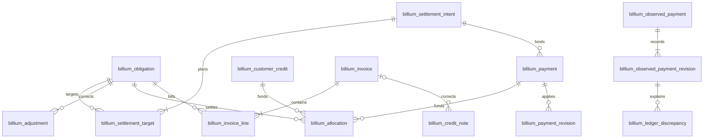

# Billium — модель данных

Синхронизация PLAN1.P3.12, 2026-10-29, дополнения P4.2/P4.3/P4.5/P4.6. Реализованы platform, ledger,
usage admission/aggregation, schedule commercial periods и monetary occurrences. Rating booking,
execution, documents и collection ниже сохраняют явно обозначенные будущие потоки.
Основания: INV-01–INV-14, D21, D45–D52, D54/D55/D57/D60/D62/D63.
DDL: `packages/core/database/migrations/{platform,ledger,usage,schedule}/`. Реестр модулей:
[`spec/modules.json`](../../spec/modules.json); контракты композиции:
[module-compatibility.md](module-compatibility.md) (D55).
[Полнота дизайна](design-coverage.md) задаёт поддерживаемые границы и оставшийся объём реализации.

Общие правила реализованной схемы (D19/D21/D22/D23/D45/D60):

- Таблицы ядра имеют префикс `billium_`; таблица Laravel `migrations` принадлежит инфраструктуре хоста.
  Один модуль владеет таблицей. Ссылки на соглашение, заказ и книгу соседей остаются `*_ref` (INV-01).
- Ledger связывает `(installation_ref, seller_ref, environment, billing_account_ref, currency)` составными
  FK. Account обязателен для применяемых funds/obligations; ещё не разрешённый account у observed факта
  может быть NULL. Seller берётся из authenticated caller, payload — селектор (INV-14, D60).
- Деньги — `bigint` minor units, currency — constrained text; wire использует Money и версию exponent.
  Проверки арифметики используют `numeric`, исключая переполнение промежуточной суммы (INV-09).
- Статусы — `text` + CHECK; внутренние bigint identity отличаются от стабильных внешних refs.
  Время — UTC `timestamptz`; JSON ограничен размером/структурой и санитизацией (D21/D22).
- Runtime — отдельная роль без schema ownership, CREATE, наследования owner и raw protected DML.
  Запись ledger идёт через guarded routines; DBA/schema owner вне гарантии (D60).

## Связи реализованного ledger

## Словарь ledger (D45–D49, D57/D60)

Все имена в таблице — реальные SQL-имена. Указаны существенные поля; полные CHECK/FK находятся в DDL.

| Таблица | Поля и смысл | Backstop |
|:--|:--|:--|
| `billium_obligation` | `obligation_ref`, `basis_ref`, `customer_ref`, `component_ref`, `amount_due_minor`, `adjusted_minor`, `allocated_minor`, `credited_minor`, generated `open_minor`, `terms_digest`, `semantic_digest`, `price_version_ref`, `tax_snapshot_ref`, `currency_exponent_version`, `billed_invoice_id` | UNIQUE basis в seller/environment; исходные terms неизменяемы, изменения отдельным adjustment; allocated + credited ≤ due + adjusted (INV-09/12, D45/D46) |
| `billium_adjustment` | `adjustment_ref`, `obligation_id`, `kind`, `amount_minor`, `cause_ref`, `revision`, `receipt_ref` | append-only, UNIQUE obligation/revision; routine меняет adjusted и revision атомарно (INV-12) |
| `billium_invoice`, `billium_invoice_line` | invoice snapshot/metadata, subtotal/tax/total, counters, revision; line position, obligation, amount, snapshot; nullable `legal_document_ref` | issued freeze и metadata allow-list; no line edits after draft; P3 issue без юридического номера, P6 добавит номер в той же root Tx через participant (INV-13, D49) |
| `billium_credit_note` | `credit_note_ref`, nullable `invoice_id`, `obligation_id`, `amount_minor`, `mode`, `reason`, nullable `legal_document_ref`, `receipt_ref` | `open_only` или `reverse_allocations`, scoped FK, credit/counters в одной routine (D45/D60) |
| `billium_customer_credit` | `credit_ref`, `source_ref`, `amount_minor`, `remaining_minor`, revision | remaining в [0, amount]; account/currency isolation (INV-09/14) |
| `billium_settlement_intent`, `billium_settlement_target` | business identity, `policy_version=pro_rata_open/1`, digest, revision, status; ordered target obligation ids/positions | frozen target order; source amount не выбирает произвольную obligation (D46/D60) |
| `billium_settlement_intent_closure` | expected revision, step authorization, proof kind/digest/evidence, cause, receipt | same-root no-effect proof; admitted/dispatched effect запрещает закрытие (D60/D63) |
| `billium_payment` | `payment_ref=operationRef`, authority/lineage/operation, kind/original, account, captured/refunded/allocated, applied revision, `financial_hold`, `reallocation_required`, intent | bounded applied projection; `reallocation_required = (allocated > captured − refunded)`; refund-detail не увеличивает refunded charge (D35/D41/D57) |
| `billium_payment_revision` | immutable applied revision/material digest/totals/receipt | cumulative totals присваиваются, не складываются; UNIQUE payment/revision (INV-06) |
| `billium_observed_payment`, `billium_observed_payment_revision` | current observed fact и material journal; requested/authorized/captured/refunded/voided, evidence, material digest, provider metadata | nonnegative observed totals могут превышать admission limits; UNIQUE seller/environment/authority/lineage/operation и revision (D57/D60) |
| `billium_allocation` | obligation, ровно один payment/customer_credit, intent, signed `amount_minor`, `reverses_id`, cause, policy, receipt | immutable journal, scoped FK; full linked reversal, UNIQUE reversal; counters и receipt меняются атомарно (INV-09/14) |
| `billium_allocation_receipt` | receipt identity/kind/source, semantic digest, versioned body | business replay под новым command key возвращает прежний receipt; иной digest — conflict (INV-05/08) |
| `billium_ledger_discrepancy`, `billium_discrepancy_event` | comparison basis digest, observed/charge/refund revisions, expected/actual, hold; held/resolved evidence events | факты не исправляются молча; resolution — отдельное evidence event (D48/D57/D60) |
| `billium_observation_park` | observed revision, inbox id, dependency kind/ref, released_at/reason | missing intent паркует allocation, missing original — refund dependency; release аудируется (D60) |

## Protected routines и root Tx

`LedgerPrivileges` проверяет роль до миграции и выдаёт SELECT на protected tables и EXECUTE только
на публичные guarded routines. `SECURITY DEFINER` использует `search_path = pg_catalog, pg_temp`,
qualified table names; PUBLIC и runtime лишены доступа к private receipt/release helpers.
Владелец routines — migration owner, runtime не может стать им через membership (D60).

`billium_record_obligation`, `billium_adjust_obligation`, `billium_record_customer_credit`,
`billium_declare_settlement_intent`, `billium_close_settlement_intent_no_effect`;
invoice routines `billium_create_invoice`, `billium_update_invoice_metadata`, `billium_issue_invoice`,
`billium_close_invoice`, `billium_mark_invoice_uncollectible`;
`billium_allocate`, `billium_reverse_allocation`, `billium_issue_credit_note`, `billium_reallocate_payment`;
observation routines `billium_record_observation`, `billium_project_payment`, `billium_record_refund_detail`,
`billium_park_observation`, `billium_release_observation_park`, `billium_reconcile_refund_basis`
владеют соответствующими проверками scope, account, currency, capacity, revision и journal/counters.
Прямой вызов routines также берёт затронутые locks в общем порядке; runner делает prelocks (D60).

Корневой OperationRunner делает claim первым, берёт session FOR SHARE, module admission и полный lock plan.
Typed participants принимают capability той же connection/runner/root transaction и объявляют locks заранее;
они не открывают собственный root и не принимают caller-supplied TransactionContext как доказательство.
Один economic event — одна root Tx; state + journal + receipt + outbox + money_commit_log коммитятся вместе
(INV-01/05/08, D60). Порядок и реальные tests: [lock-model.md](lock-model.md).

## Observation, refund и чтение

Source namespace — `(seller_ref, environment, source_authority, source_lineage, operation_ref)`;
одно operationRef у двух authority не означает одну операцию. Partition дополнительно связан с channel
и partition_ref. Material digest отделяет economic revision от повторной доставки нового evidence
(INV-06/08/14, D41/D48/D60).

`LedgerQueries::paymentStatus` возвращает `observed`, последнюю согласованную `applied`, `exposure`,
`financialHold` и сведения о pending allocation/recovery. Immutable overcapture/overrefund сохраняется
как observed + discrepancy/hold, а bounded applied projection остаётся последней согласованной.
Missing intent не скрывает observed/payment и не блокирует последующие sequence partition;
drain dependency выполняется в новой root Tx. Refund detail не меняет charge.refunded_minor.
Сверка суммы refund-деталей с charge basis выполняется job после consistency window, а не при apply:
порядок refund→charge не создаёт ложную discrepancy (D41/D48/D57/D60).
`billium_refund_reconcile_progress` хранит время последней сверки payment: bounded worker выбирает
сначала ещё не проверенные, затем давно проверенные строки и повторно проверяет изменившийся basis.

`LedgerQueries::dueObligations(account, asOf, limit, cursor)` использует только явные
`due_at IS NOT NULL AND due_at <= asOf`, статус open, положительный open amount и
`collection_eligible_at IS NULL OR collection_eligible_at <= asOf`. NULL due исключён из выборки.
Будущий collection guard дополнительно проверяет hold/reallocation/recovery при admission (P7, D63).
`due_policy_version`, `source_policy_ref`, `source_policy_snapshot_digest` фиксируют основание срока;
cursor привязан к authenticated scope/account/asOf и `(due_at,id)` (D60).
Подробный wire/query контракт: [ledger-queries.md](../contracts/ledger-queries.md).

## Platform, feed и retention

| Таблицы platform | Реализованная ответственность | Основание |
|:--|:--|:--|
| `billium_idempotency_receipt` | UNIQUE seller/environment/command_kind/key, digest, stored accepted/refused outcome; conflict не создаёт новый эффект | INV-05, D31 |
| `billium_financial_session`, `billium_financial_session_event`, `billium_installation_state` | deployment generation/attachment/epoch, recovery/active/closing/sealed, transitions и certificates; installation legacy/admin state | D54/D60/D62 |
| `billium_money_commit_log` | append-only `commit_no`, session epoch, kind/time; диагностическая история root Tx | D54/D60 |
| `billium_module_state`, `billium_module_transitions` | admission/lifecycle storage; disable прекращает новые intents, сохраняет history/recovery; binary uninstall не purge | D55 |
| `billium_outbox_event`, `billium_outbox_delivery`, `billium_event_contract` | immutable versioned event; delivery per destination с claim/backoff/park; explicit catalog registration | INV-08, D52/D63 |
| `billium_outbox_command`, `billium_outbox_command_delivery` | отдельная internal lane; новые команды не расширяют strict public v1 event enum | D63 |
| `billium_outbox_watermark`, `billium_feed_subscription`, `billium_feed_bootstrap_lease` | retention floors, filtered subscription/cursor binding, snapshot/tail pin до acknowledgement/expiry | D52/D60/D63 |
| `billium_feed_partition` | channel, authority, seller/environment, partition_ref, lineage/generation, custody/accounted sequences, active/recovery_required/retired; UNIQUE live namespace WHERE state <> retired | D60 |
| `billium_inbox_message`, `billium_inbox_conflict` | raw dedupe/digest, lineage/sequence, custody/frontier, park/error/quarantine и конфликтующее evidence | INV-08, D60 |
| `billium_feed_bootstrap_session`, `billium_feed_bootstrap_item` | staged manifest/digest/count/cursor/source-retention lease; per-item applied/parked/discrepancy disposition; atomic adoption | D60 |

Runtime открывает financial session только в recovery через guarded routine; activation/sealing/seal и
соответствующий session event записываются одной routine в одной Tx. Прямые INSERT и UPDATE состояния,
certificate/sealed_at закрыты; UPDATE(updated_at) оставлен только для PostgreSQL row locks.
Retirement feed partition и его замена требуют ready bootstrap с завершёнными item dispositions;
sequence 1 не открывает новую active partition поверх retired namespace без bootstrap adoption (ACC-RST-07).

Миграция `2026_10_20_000101_create_billium_feed_partition_table` создаёт partition **и обе** staged
bootstrap tables. Import проверяет manifest, применяет items отдельными roots, затем атомарно retired-ит
старую partition и принимает новую; неполный bootstrap не делает partition active. Каждый drain применяет
не более одного события в новой root Tx; после Funds locks нельзя inline захватить следующий event (D60).

Feed cursor — `(tx_id,id)` с горизонтом `pg_snapshot_xmin`, не identity id и не max sequence.
Filtered cursor связан с subscription/selection; новый потребитель получает согласованный snapshot,
cursor и retention pin. Утерянный tail требует rebootstrap. Prune требует настроенного RET-01 floor,
учитывает required subscriptions и живые bootstrap pins; outbox retention не заменяет retention
денежных журналов/receipts/tombstones (D25/D52/D60/D63, REQ-FAIL-16/22/30).
После закрытия старого namespace поздний ключ требует expired/recovery-required disposition,
а не нового финансового эффекта; числовые production retention horizons задаёт политика владельца
(REQ-FAIL-16/25/30, D25/D59).

## Authority, restore и исторические решения

Каждый money-writing профиль требует host `FinancialSessionAdmission`. OwnerSession относится к
installation + deployment generation + authority epoch; краткоживущие process tokens несут expected
session/epoch/DB attachment из authority вне копируемой БД. Worker restart внутри session не transfer.
Новая deployment session, restore или потеря continuity открывают recovery; отдельная activation требует
RetirementProof, полной сверки unresolved effects/feed gaps и ActivationCertificate выбранной lineage.
`WriterAdmission` дополнительно допускает исходящие PSP effects в effect-capable профиле (D54/D61/D62).

Session seal — локальный shared/exclusive barrier: финансовые roots держат FOR SHARE до commit;
seal берёт FOR UPDATE после закрытия admission/drain и пишет sealed, не беря поздних domain locks.
Raw custody может продолжаться; retired epoch economic apply отказывается. Token TTL, hard root deadline
и host supervision ограничивают drain; timeout оставляет closing/recovery, не объявляет безопасную активацию.
Сетевой запрос уже у PSP этот barrier не отзывает (INV-03, D54/D60/D62).

D39 (release/matching `max(commit_no)` и глобальный dispatch checkpoint) и D42 (прежние детальные
coherence algorithms) сохранены как superseded/deferred история; текущие механизмы определены
D54/D57/D60. `max(commit_no)` — диагностика, **никогда** доказательство свежести backup или условие
автоактивации. Release/seal не активирует следующего owner (D54).

## Состояния и будущие владельцы

Реализованный invoice имеет `draft`, `issued`, `partially_paid`, `paid`, `uncollectible`, `void`, `discarded`.
Discarded draft не получает номер; issued terms/lines заморожены, metadata ограничена allow-list;
allocation/reversal/credit изменяют derived paid/open counters в той же Tx. Юридический номер и render —
будущий documents participant P6, сеть renderer после commit (INV-09/13, D20/D49).

Будущий execution владеет immutable binding/profile/capability lineage, money_operation, одной attempt
на всю жизнь операции, provider evidence и operation revisions. Charge/refund/authorize/capture/provider-void
имеют отдельные команды/refs; local cancel запрещает новые отправки. Unknown разрешается lookup,
не новым ключом; сетевой вызов вне Tx, finish fenced по operation/attempt CAS и external token epoch.
Refund резервируется у исходного charge и идёт его исполнителю; подтверждённый exceptional факт
попадает в observed/hold, а не отбрасывается CHECK capacity (INV-02/03/04/07/10, D37/D57/D60/D63).
Business binding остаётся UNIQUE `(source_context, business_intent_ref, kind)` без seller;
иной seller с тем же основанием получает conflict. Ключ команды дополнительно связан с digest
(INV-05/14, D36). Обычный refund admission ограничен captured − confirmed − reserved;
unknown не освобождает резерв по таймеру. Succeeded не регрессирует, в admitted операция не
возвращается; failed-terminal требует outcome evidence/absence certificate, TTL/404 недостаточно.
Поздний actual effect сохраняется с discrepancy даже после cancelled/failed-terminal
(INV-04/06/10, D28/D37/D57).

После подтверждённого refund policy reallocation `credit_note` делает linked reversal и credit note
атомарно, закрывая долг; `reversal` оставляет долг открытым с запретом автоматического collection
до разрешённой policy. До подтверждённого refund ledger не уменьшает allocation (D35/D41/D60).

Usage сохраняет immutable metric versions и append-only fact revisions (D13/D56; owner usage, P4.2).
Schedule сохраняет commercial periods по immutable business interval identity (P4.5).
Будущие rating/occurrence booking сохраняют price versions, non-overlapping non-superseded
occurrences и basis UNIQUE obligation (D12/D56; owner rating/schedule).
Новые условия действуют вперёд; после issue positive late delta создаёт linked correction obligation,
negative delta — credit note по versioned correction policy (INV-11/12/13, D12/D13/D63).
Будущий collection guard проверяет authorization/generation до admission и dispatch через port+context;
автосбор не начинается после refund reversal без policy. Documents хранит series/number/economic identity,
render provenance; cash/fiscal export опирается на actual unique effects, receivable export — ledger
(D35/D55/D63). Эти будущие таблицы/PSP integrations не заявлены реализованными в P3.

## Commercial period evidence и accepted terms (P4.5)

Все четыре таблицы принадлежат schedule; ключи включают seller/environment. Grant, quota,
consume и host subscription state здесь отсутствуют (D22/D23/D45/D56; owner schedule).

| Таблица | Состояние и backstop |
|:--|:--|
| `billium_schedule_quote` | append-only quoteRef, exact terms/period/quote digests, host revision/cancellation generation, validity и bounded frozen body |
| `billium_schedule_component` | mutable serialization head: scoped component key, immutable host agreement correlation, последняя accepted revision/generation/funding revision, effective boundary/covered-until и exact terms |
| `billium_schedule_revision` | append-only accepted host monetary terms + immutable integration receipt; UNIQUE component/revision и quoteRef; composite FK связывает exact revision/generation/terms digest с quote |
| `billium_schedule_period` | append-only resolved UTC [start,end), local policy/evidence, source revision/funding revision; UNIQUE component/purpose/start/end, coverageRef и occurrenceRef; revision не входит в business uniqueness |

Резолвер сохраняет source anchor, explicit policy, requested и resolved local boundaries, UTC offsets,
ordinal и tzdb marker. Исторический replay не вызывает resolver; source policy и stored boundary evidence
сохраняются вместе. Commercial identity определяется интервалом, price/host/funding revisions — provenance.
Runtime получает SELECT/INSERT, immutable triggers запрещают UPDATE/DELETE history; только head получает
ограниченные UPDATE columns. FK периода на accepted revision deferred до commit, поэтому обе записи
создаются в одной root Tx. Boot SQL не выполняет (INV-11/12, D22/D55/D56; owner schedule).

Lock path: claim → session/install/module admission → transaction-local host approval guard →
`BillingSchedule (40)` на `component_key`. Guard хоста обязан сериализовать exact approved revision и
cancellation generation до commit; default отказывает. После lock повторно проверяется business replay,
затем validity, monotonic revision/generations, future boundary и anchor policy. Accepted revision,
period, head, receipt и diagnostic money commit log коммитятся одной root; business refusal сохраняет
только свой idempotency receipt. Пересчёт posted money и supersession planned occurrences принадлежат
отдельному occurrence/correction протоколу, не прямому UPDATE periods (D27/D56/D63; owner schedule/platform).

Integration query `coverage` возвращает immutable `billium.schedule.coverage/1` в authenticated scope,
не новый strict public event. Coverage/occurrence refs стабильны при transport replay. Funding revision
в notice — frozen host provenance, не подтверждение оплаты и не команда grant owner. Annual monetary
coverage и monthly grants не размножают друг друга; P4.5 не вызывает ledger booking и не пишет grant state
(REQ-OWN-02/03, REQ-OUT-01/02/10, D56; owner schedule/host).

## Schedule occurrences (P4.6)

`schedule` owns the following tables. Every business scope includes seller/environment
(D12/D22/D23/D56; owner schedule).

| Table | Responsibility and backstop |
|:--|:--|
| `billium_schedule_billing_schedule` | Revision/generation CAS, strict state/runnable/next_occurrence_at, next calendar ordinal, claim lease, attempts/retry_at and row_version |
| `billium_schedule_billing_schedule_revision` | Append-only calendar terms, inputs digest and effective boundary; immutable provenance |
| `billium_schedule_billing_occurrence` | Immutable resolved interval/evidence and inputs; stable occurrence_ref plus historical incarnation; normal monetary purposes only |
| `billium_schedule_occurrence_amendment` | Append-only revision confirmation, planned replacement, cancellation or amendment request pointing to the original occurrence |
| `billium_schedule_occurrence_outbox` | Atomic module-owned notifications; preserves the frozen public event catalogue (D63; owner schedule/platform) |
| `billium_schedule_correction_head` | Approved correction revision/source frontier CAS, serialized by the original occurrence lock |
| `billium_schedule_billing_correction` | Append-only correction children with original period, predecessor, reason, optional tax policy provenance, registered digest and canonical obligation basis |

Normal business identity is `seller/environment/component/purpose/[start,end)`, resolved to UTC
microseconds. `occurrence_ref = occ_ + first48(sha256(canonical identity))`; schedule reference,
schedule revision, transport key and inputs digest do not enter identity. The active-reference
partial UNIQUE and GiST exclusion arbitrate inserts. The exclusion remains
`(seller_ref =, environment =, component_ref =, coverage_class =, service_period &&)` for
planned/rated/obligated rows. `usage_settlement` uses coverage class usage; recurring_charge and
proration share time coverage. Proration requires a same-component original parent and lies
inside its interval; its parent link never exempts it from overlap protection. Historical
superseded rows remain immutable; returning to an old interval creates the next incarnation
(INV-11/12, D12/D56; owner schedule).

`occurrence.ensure.v1` inserts using a PostgreSQL arbiter and recovers exclusion errors at a
savepoint. Another key with the same identity and inputs returns the existing occurrence with
created=false. Changed inputs require explicit correction. A revision can replace only planned
work; rated/obligated originals receive amendment_required records and retain their bytes.
Cancellation increments the schedule generation and cancels planned work only. FSM permits
planned→rated/obligated/superseded/cancelled and rated→obligated; triggers reject deletion,
revival and immutable-column changes (INV-05/11/12, D12/D27/D56; owner schedule).

Roots lock schedule rank 40 before the complete occurrence rank 50 set. They recheck their
planned row set under locks and retry LockPlanChanged. Outer rating/correction roots use the
public `OccurrenceLocks` port before ranks 65/70: it delegates to the root LockSet and remembers
the rows locked in that live context. Participants assert that remembered parent lock and
runner/module/scope authority; they acquire no additional lock, create no root/claim/outbox and
write only schedule tables. This adapter supplies lock inspection without changing the shared
TransactionContext contract (D27/D60/D63, FA03; owner schedule).

Correction is a literal purpose exclusively in billing_correction. Its obligated normal parent
and original [start,end) are rechecked; original_period_ref is the stable period correlation
derived from the parent occurrence. UNIQUE parent/revision and parent/source-frontier plus
head CAS reject duplicates/reordering. Exact frontier replay is checked before head CAS.
`CorrectionBasis::derive(parentOccurrenceRef, correctionRevision)` canonically binds the
obligation basis. A correction can overlap only through its registered parent lineage and
never enters the normal scheduler/exclusion table. The outer P4.8 root owns rating/ledger work;
registering lineage alone books no obligation (INV-11/12, D56/D63/FA03; owner schedule/rating).

Due reads are authenticated, seller/environment scoped, bounded to 500 schedules and use
keyset `(next_occurrence_at,id)` with a scope/asOf-bound cursor. The partial index
`billium_schedule_due_idx(seller_ref,state,next_occurrence_at,id) WHERE runnable` covers the scan;
claim expiry and retry_at filter unavailable work. Each schedule materializes in its own root:
occurrence, cursor, persisted calendar evidence and outbox commit together. The resolver's
zero-based next ordinal is advanced only after successful materialization; unfinished batch
tails remain due. CAS refuses parallel stale jobs. Separate recordFailure roots clear leases,
increment attempts and schedule `asOf + min(2^attempts*60,3600)` seconds. dueStats exposes due
count/oldest age. The resolver's ordinal bound completes a schedule after its final supported
interval (D12/D22/D27/D56, COV-329; owner schedule).

`fixtures/vectors/schedule/occurrences/annual-money-monthly-grants.json` records the selection
gate for one annual monetary occurrence correlated with twelve external grant windows. The
host grant owner supplies those windows; entitlement_grant and collection_* cannot create
monetary occurrences. Collection references existing debt. This fixture establishes no live
grant delivery or provider qualification (REQ-OWN-02/03, D56/D59, COV-500/544; owner schedule/host).

## Expand/contract и доказательства

Migration identity и config key фиксируются с первого появления в `spec/identities.json` (M-28).
Lint запрещает enum, destructive down, смешанный column expand/contract, blocking CHECK/FK additions
без NOT VALID, validate в том же шаге и unsafe grants. ACC-RST-10 проверяет реальные PostgreSQL writes:
4 старых worker, expand с lock_timeout 2s, 2 новых вместе со старыми, killed/restarted backfill,
conservation и journal/receipt/commit completeness, отдельный VALIDATE и old-code replay.
Contract DROP COLUMN отложен за rollback window. Поколения приложения и host authority — test doubles;
это не live rolling deployment и не PSP qualification (D21/D50/D59).

## Usage admission (D13/D19/D22/D23/D55/D56; owner usage, P4.2)

`billium_usage_metric` хранит immutable MetricVersion; `billium_usage_stream` фиксирует единственный
gross/net mode и normalization ref для `(seller, environment, commercialBasisRef)`. Конфликт mode
или normalization не создаёт вторую billable basis. `billium_usage_fact` хранит ревизии, frozen
subject/customer/billing account/component/agreement, mapping revision, validity и исходный commercial
period. Canonical envelopes и receipt сохраняются как bounded immutable evidence; scope, keys, numeric
quantity, correction links и индексируемые dimensions представлены отдельными колонками (D13/D19/D22/D56).

`Usage::submitUsageFact` сначала проверяет contract digest, authenticated seller/source и получает
host-owned `UsageAttribution` snapshot вне Tx. Host port подтверждает normalized provenance и source
selection/filters и возвращает историческую mapping revision с validity/cutoff и исходным периодом;
default port отказывает unresolved input. Интервал целиком помещается в mapping validity и один period,
eventAt находится внутри интервала. receivedAt не выбирает payer или period. Пересекающий границу факт
требует pre-split input; exact splitting policy пока не зарегистрирована (D13/D56; COV-214/215).

Root OperationRunner берёт claim → session shared barrier в Administrative mode → platform/usage
module admission → usage-owned advisory leaf lock `(seller,environment,source,factId)`. Usage body
не берёт последующих platform/financial locks и не вызывает сеть. Факт, immutable business receipt и
platform claim коммитятся атомарно; rating, obligation, money commit и outbox event здесь не создаются.
UsageReceipt `accepted` подтверждает durable admission; transport ACK и rated/applied monetary result
имеют отдельный смысл. Replay после disable возвращает прежний receipt без нового admission
(INV-05/08/14, D27/D55/D56; owner platform/usage).

Business uniqueness — `(seller,environment,source,factId,revision)`. Тот же canonical digest возвращает
stored receipt; другой payload конфликтует. Revision 1 не имеет predecessor; revision N продолжает
ровно N−1 того же seller/source/fact, с originalFactDigest. Missing predecessor отказывается без claim
и допускает retry после его поступления. Cycles, forks, cross-metric links и изменение frozen attribution,
period, event time, interval или grouping запрещены. Effective revision — наибольшая принятая revision.
Policy `replace_same_fact_revision/1` допускает меньшую nonnegative replacement quantity; signed negative
quantity не входит в wire contract. Это не refund. Attribution correction требует будущей authorized
financial correction policy с lineage и здесь отказывается (D13/D56/D63; owner usage, corrections P4.8).

UTC instants в usage хранятся fixed-width nanosecond text с C collation: PostgreSQL timestamptz теряет
sub-microsecond precision wire contract. Numeric quantity — `numeric(33,9)`, не деньги. SQL PK/FK/CHECK
и append-only triggers защищают историю. Runtime получает только SELECT/INSERT usage tables;
boot provider только объявляет migration path при явном enable. Миграции и platform module registry
устанавливает host отдельно; disabled/uninstalled module при свежей установке не создаёт таблиц,
registry rows, workers или routes (D13/D19/D22/D55/D56; owner usage/platform).

`UsageQueries::period` всегда фильтрует authenticated seller/environment, subject, metricVersion и frozen
mappingRef, `[start,end)` event window; LIMIT 1…500 и keyset `(event_at,fact_id,revision,source)` ограничивают
страницу. Индекс `billium_usage_subject_window` начинается с
`(seller_ref,subject_ref,metric_version,event_at,fact_id,revision)`; отдельный chain index обслуживает
effective revision anti-join. Query tests содержат out-of-order/nanosecond pages, seller isolation и
EXPLAIN fixture с 2,000 rows. Между страницами новые corrections требуют fresh scan; final aggregate
snapshot/frontier — владелец P4.3. Duration semantics пока unsupported contract-ом, поэтому GiST overlap
index для duration не создаётся (D56; COV-334, owner usage; ACC-CON-12).

## Usage aggregation (D13/D19/D22/D23/D27/D56/D63; owner usage, P4.3)

Usage хранит immutable aggregation policies и source-finality contracts отдельно от immutable wire
MetricVersion. Версия метрики остаётся непрозрачной строкой P4.2; алгоритмы замкнуты:
`additive_sum@1`, `gauge_latest_as_of@1`, `gauge_max@1`, `gauge_time_weighted@1`,
`distinct_exact_union@1`. Реестр отказывает неизвестным/approximate алгоритмам. DB adapter проверяет
соответствие immutable model, grouping и полного набора источников. Текущий wire gauge допускает
latest/max; time-weighted реализован в reducer registry и не подменяет wire latest/max
(D13/D56; owner usage).

| Таблица | Состояние и защита |
|:--|:--|
| `billium_usage_source_finality_contract` | append-only required sources, grace, post-final policy, reopening и digest |
| `billium_usage_aggregation_policy` | append-only metric digest, algorithm/version, quantity scale, gauge и identity policies |
| `billium_usage_source_head` | seller/environment/source row для сериализации внешнего evidence |
| `billium_usage_source_completeness` | append-only source-assigned evidence sequence, range, watermark, status и repair reference |
| `billium_usage_aggregate_series_head` | mutable head revision/digest и row-version CAS; canonical `series_key` |
| `billium_usage_aggregate_snapshot` | immutable quantity, predecessor, completeness frontier и gauge reduction evidence |
| `billium_usage_aggregate_member` | immutable effective fact revisions, digests, source, event time и exact unscaled input |
| `billium_usage_aggregate_distinct_member` | controlled opaque member identities с identity key/namespace и contributing fact; только privileged erasure |
| `billium_usage_aggregate_reproducibility_event` | append-only `retention_expired`/`erased` dispositions |
| `billium_usage_aggregate_event` | immutable internal `usage.aggregate.frozen.v1` notification в Tx снапшота |

Глобальный порядок дополняется `FeedPartition (30) < UsageSeries (35) < BillingSchedule (40)`.
Freeze создаёт head через INSERT ON CONFLICT, берёт ranked row lock по canonical `series_key`,
после чего читает все входные ревизии одним SQL statement. Intake evidence блокирует source head
того же ранга. Snapshot, retained contributions, CAS head и internal notification коммитятся одной Tx.
Нет сети, obligation или публичного v1/v2 outbox event. Внешний rating root заранее планирует
`AggregateStore::lockRequest(window)`; participant reassert-ит этот lock через текущий LockSet,
проверяет head, effective inputs, completeness и reproducibility. Пропущенный ранний lock
после более высокого ранга отказывается по глобальному порядку (D27/D56/D63; owner usage).

Effective revision выбирается до event-window filter; superseded/retracted вклады не складываются.
Additive суммирует только effective quantities. Gauge заменяет ревизию факта отдельно от sample
reducer; ties идут по event time/source/source sequence/fact identity, без arrival order.
Carry и declared-zero заданы policy и сохраняются как reduction evidence; интерполяции нет.
Time-weighted использует integer value-microseconds с одним явно выбранным округлением в конце.
Distinct — union retained opaque hex64 IDs, а не сумма partial counts; contribution rows сохраняют
shared member при замене другого contributing fact (D19/D56; owner usage).

Canonical snapshot digest содержит ровно algorithm, metric (с definition digest), scoped group,
window, quantity, effective members, distinct, completeness и reproducibility. Scoped group включает
seller/environment и grouping dimensions; это различает даже пустые окна разных продавцов.
Не входят receivedAt, ingest sequence, DB ids, local clock, snapshot revision и predecessor digest.
Snapshot ref выводится из digest. Membership и exact member contributions сохраняются вместе с
результатом: digest один не считается доказательством после pruning. При отсутствии command key
повтор freeze сравнивает content digest с head; optional command key добавляет stored platform replay
и конфликт при изменённом payload (D13/D19/D23/D56; owner usage).

DB adapter изолирует P4.2 table knowledge. Group selector содержит registered dimensions и frozen
subject/customer/billing-account/component/agreement/revision/attribution-version/mapping/period refs.
Fact identity внутри aggregation — canonical `[source,factId]`, без межисточниковых коллизий.
Source sequence отсутствует в текущем wire и остаётся null; tie использует source/fact identity.
Event instants с ненулевой sub-microsecond частью отказываются явно, без truncation billable meaning.
Received time и добавленный `ingest_seq` только информативны. Progress сравнивает effective membership;
max ingest sequence не является доказательством completeness или commit frontier (D13/D56; owner usage).

Completeness строится только из source evidence: больший evidence sequence перекрашивает диапазон.
Все required sources должны покрывать [start,end) статусом complete и source watermark должен достичь
end+grace. Delayed/gap/dropped/retention_expired удерживают freeze; repair/replay refs видны в query.
Retry exhaustion сообщает внешний collector. Без snapshot query не возвращает quantity; при lag/hold
также не выдаёт устаревшее количество как готовое к booking. Accept-adjust создаёт новый immutable
snapshot с predecessor исходного окна; reject/manual-review и запрет reopening сохраняют прежний head.
Поздние факты не переносятся в следующий период; денежную correction выполняет P4.8
(D56/D63; COV-200/216/218; owner usage).

Exact-distinct policy фиксирует identity namespace, key version и shared/source-scoped cross-source
identity. Adapter выдаёт только opaque hex64, а его provenance.version должен совпадать с declared
identity key version. Смена normalization/key требует новой metric version; raw PII не принимается
и не включается в ошибки. Shared объединяет одинаковые IDs разных sources; source-scoped включает
source в идентичность. Member tables доступны controlled runtime, публичные queries не раскрывают IDs.
Owner-only `billium_usage_erase_distinct_members(seller,environment,snapshot_ids)` обнуляет IDs и
атомарно добавляет erased event, сохраняя immutable quantity/history. Erasure исходных P4.2 facts
координируется retention/privacy policy владельца отдельно; оставшаяся monetary snapshot не означает
recomputable membership. Erased/expired либо потерянные retained source inputs запрещают финансовый
replay; participant также отказывается. Численные retention horizons и законность сохранения денежных
снапшотов задаёт host owner policy, а не эвристика агрегатора (D13/D56/D59; owner usage).

Rating владеет append-only `billium_rating_price_version`, tiers, commitment terms и tax snapshots.
`billium_rating_price_publication` одновременно является scoped lock head и внутренним событием
публикации; один root transaction фиксирует его вместе с версией и всеми terms. Ранг 44 следует
за billing schedule и предшествует occurrence; unique seller/environment/price/version остаётся
конечным арбитром. Deferred checks отказывают разрывы tiers и несовместимый commitment; runtime
получает только SELECT/INSERT и UPDATE колонки head для row lock, но immutable trigger запрещает
изменение. Tax evidence host разрешает до транзакции, rating фиксирует точную строку ставки,
resolver и digests; ошибку или отсутствие ставки нулём не заменяет (D19/D22/D23/D27/D56/D63;
owner rating).
