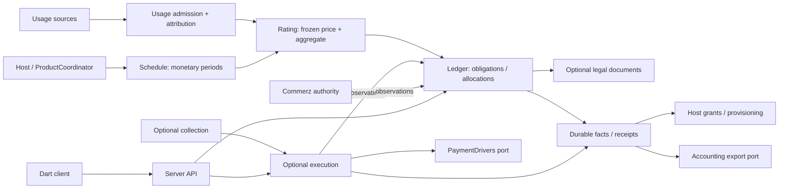

# Billium — полнота дизайна и границы поставки

Статус: **спроектировано, не реализовано**, PLAN1 D53–D63, 2026-10-24.
Исполнение P1/P2 сохранено; core начинается в P3. Детальные алгоритмы, inputs, зависимости,
файлы и команды приёмки находятся в JSON текущего плана в [workspace](../planning.md).
Этот документ фиксирует принятый состав продукта и исключает трактовку research как готовой поддержки.

## Состав и authority

| Сценарий | Delivery / authority | Денежный writer | Состав |
|:--|:--|:--|:--|
| Магазин с существующим payment journal | embedded / embedded-commerz | Commerz исполняет; Billium пишет свои receivables | contracts, platform, ledger; observations через мост |
| Небольшой PHP-хост | embedded / standalone-billium | PHP Billium в БД хоста | platform, ledger; execution и другие модули по manifest |
| Центральный billing service | server / standalone-billium | PHP Billium service | тот же core + HTTP/auth/routing ports |
| Удалённое исполнение для клиента | server / remote-billium | PHP Billium service | HTTP commands/queries, PHP/Dart contracts, optional Dart SDK |
| Server только receivables | server / external-owner semantics | внешний исполнитель; Billium ledger projection | execution/collection выключены, observations аутентифицированы |
| Только контракты | отдельный PHP или Dart пакет | writer отсутствует | schemas/DTO/codec/MoneyWire, без БД и framework runtime |

Delivery и authority — независимые оси. Появление server не меняет исполнителя старой операции.
Статусы «оплачено», «обязательство погашено», «чек зарегистрирован», «право выдано»,
«ресурс готов» не заменяют друг друга (D53, D55, D58).

Core остаётся одним пакетом с внутренними модулями. Manifest каждого модуля задаёт зависимости,
core API range, schema migration stream, версии consumed/produced events и lifecycle. Contracts
не импортируют core; core не импортирует server, Commerz, Tariffler, AiFina или provider SDK.
Ledger obligation/payment paths работают без legal document issue/render. Documents, execution,
collection, usage/rating/schedule включаются только при выполнении своих зависимостей (D55).

Disable закрывает новые операции, сохраняет historical queries и предусмотренный recovery.
Drain ждёт явно учтённые pending/unknown; не объявляет их завершёнными по таймеру. Uninstall binary
не удаляет schema. Purge — отдельная операция с retention/hold checks и полномочиями. Модуль
пишет свои таблицы, не запускает lifecycle ресурсов хоста и не меняет чужие финансовые таблицы.

## Зафиксированные денежные различия

| Область | Принятый контракт | Проверяемый результат |
|:--|:--|:--|
| Command / attempt / provider effect | разные identities; один logical attempt, повтор передачи сохраняет key и payload | timeout/retry не создаёт второй effect |
| Local cancel / PSP void | cancel запрещает новые отправки; void отменяет authorization отдельной командой | local cancel не выдаётся за подтверждение PSP |
| Authorize / capture / refund | capability-gated отдельные операции и резервы с original-operation link | concurrent partial effects не превышают разрешённую ёмкость |
| Admission / external fact | допуск ограничен; подтверждённое отклонение сохраняется в evidence + discrepancy | overrefund не теряется из-за CHECK и не становится новой автоматической командой |
| Merchant config | immutable lineage и credential locator, отдельный запрет новых операций | старый refund/lookup не уходит новому merchant |
| Invoice / credit note / refund | document correction, receivable correction и исходящий effect разделены | credit note не автоматически вызывает PSP refund |
| Payment / allocation | внешний денежный факт и применение к долгу разделены | несколько allocations не превращаются в несколько cash facts |
| Monetary credit / usage credit | Billium customer credit и внешние quota/grants — разные сущности | reward/usage units не принимаются как деньги |
| Commercial occurrence / grant occurrence | business period identity не включает revision расписания | годовая оплата и 12 monthly grants не создают 12 повторных долгов |

Сеть вызывается после commit recoverable intent. Provider idempotency имеет конкретный срок и
scope в descriptor драйвера; локальная business uniqueness сохраняется независимо от этого срока.
Unknown удерживает резерв до доказанного исхода. Fencing защищает локальную запись, но не отзывает
уже отправленный запрос. Полный recovery-протокол задан D54 и execution design P5 (D57).

Owner session принадлежит deployment, а не каждому PHP worker. Перезапуск worker с новым host process
token внутри той же session не включает recovery. Restore/смена deployment требует внешнего attachment
и retirement proof. Ledger-only также получает host admission context; неконтролируемый откат БД под
живым deployment не обнаруживается по данным самой копии и исключён из безопасной процедуры (D62).

## Usage, rating и календарь

MetricVersion фиксирует semantics, unit, extraction/filter, grouping, attribution, correction и
finality policy. Subject и payer разделены; изменение привязки не переносит исторические факты
другому плательщику. Additive суммирует выбранные revisions, gauge заменяет/интегрирует по явной
политике, distinct требует exact member identity или квалифицированного snapshot. Сумма частичных
cardinality не является distinct union. Duration/rate требуют зарегистрированной семантики;
неподдерживаемый вид отклоняется (D56).

Rating использует frozen aggregate window/frontier, PriceVersion, tax/rounding versions и source
digest. Gross usage и net overage одного основания не начисляются одновременно. Стратегии fixed,
per-unit, graduated и volume, commitments и modifiers имеют явный порядок и compatibility rules.
Произвольный скрипт не получает права писать деньги. Неизвестная комбинация возвращает typed
unsupported. Retail promotions и product quota не переносятся в pricing Billium.

Денежные интервалы полуоткрытые `[start,end)`, с закреплённой timezone/calendar policy: end-of-month,
DST, leap year, anniversary, prepaid/postpaid и proration. Schedule revision может заменить только
ещё не начисленное будущее; old occurrence identity и frozen price сохраняются. Late usage после
финализации создаёт traceable adjustment/credit, а issued invoice не пересчитывается молча.

После issue положительная дельта создаёт отдельную correction obligation с исходным периодом,
parent basis и уникальной correction revision; отрицательная — credit-note lines. Налог корректировки
определяет versioned seller correction policy через TaxSnapshotPort. Оригинальные prices/period/lines
остаются неизменными. Это зарегистрированная correction lineage, а не повторный recurring occurrence (D63).

## Документы, collection и интеграции

Legal/tax policy поступает от владельца правил для seller. Issue фиксирует snapshots, series и номер
атомарно; render выполняется вне Tx по immutable input/template/version digest. Повтор render не
выдаёт новый документ. Fiscal route принадлежит исполнителю оплаты; receipt passthrough и отдельный
fiscal driver не отправляют один эффект дважды. Correction revision имеет свой stable external ID.
Сбой фискала не меняет payment outcome (D56, D57).

Фискальные intents и cash facts строятся по фактическим уникальным effects, включая исключительные
overrefund; allocation/receivable facts — по ledger. Bounded applied projection не скрывает реальный
денежный выход. В embedded-commerz фискальный owner остаётся внешним (D63).

Collection проверяет outstanding balance, consent, cancellation generation и authority перед
новым шагом. Unknown предыдущего шага останавливает дальнейшее взыскание. Delivery retry и
business retry после подтверждённого decline имеют разные бюджеты. Один component имеет одного
renewal owner. Host получает durable grace/cancellation/compensation facts и сам управляет правами
и ресурсами; provisioning timeout не становится новым charge (D56).

Collection step выдаёт immutable authorization, а execution через host-composed typed guard
проверяет актуальные consent/revocation под тем же lock при admission и dispatch. Отмена до
dispatch-start запрещает отправку; после committed dispatch permit нельзя обещать отсутствие
эффекта или освобождать reservation как no-effect. Даже отмена до создания operation имеет durable
tombstone; ledger закрывает settlement intent только по проверенному доказательству без эффекта.

HTTP/SDK возвращают разные acceptance/outcome/allocation receipts. Client timeout означает запрос
статуса исходной операции. Dart не повторяет финансовый lifecycle и не владеет credentials PSP.
Migration сохраняет seller/environment, source lineage, legacy IDs, checksums и original bindings.
Host write-freeze certificate для ledger требуется отдельно от execution lease. Cutover меняет
маршрут новых intents; старые charge/refund остаются у прежнего владельца (D58).

Platform владеет registry публичных событий, outbox и отдельным CommandOutbox. Замороженный
`billium.event.v1` сохраняет семь исходных типов; новые типы получают согласованный v2 catalog.
Feed selection фиксируется в cursor/bootstrap; пропущенные типы продвигают scan cursor, расширение
подписки требует нового bootstrap. Модули регистрируют свои schemas через platform SPI при явном
install/upgrade и не изменяют чужие таблицы. Source authority берётся из host auth context, а не
из поля запроса. Для migration continuity нужны freeze/snapshot/cursor/checksum proofs; величина
`money_commit_log` сама по себе никогда не разрешает активацию (D63).

## Осознанные исключения и условия расширения

| Идея | Диспозиция |
|:--|:--|
| Lago / Kill Bill как authority | не foundation v1; возможный будущий backend после named consumer, capability/concurrency/restore/export/license qualification |
| OpenMeter / Kafka / ClickHouse | необязательный внешний источник нормализованных usage; не runtime dependency embedded |
| Отдельные PaymentKernel / Wallet / Meter / FinancialKernel | не создаются; существующие bounded contexts и ports сохранены |
| Dart ledger writer / FFI headless billing / dual writer | исключены из Billium; Dart contracts и SDK |
| SQLite money writer | не поддержан v1; contracts-only не требует PostgreSQL |
| Usage reservations, reward ledger, offline quota | внешний owner; late reserve/commit/release проверяется на границе с host double |
| Publisher payouts, GL, FX/netting разных валют | отдельные домены; evidence/export refs не дают Billium права на выплаты/проводки |
| PSP adapters и конкретные RU провайдеры | PaymentDrivers; поддержка только после квалификации driver/capabilities |
| Юридические реквизиты, налоговый режим и платность продуктов | параметры deployment/host policy, не предположения библиотеки |

## Готовность к исполнению и выпуску

Для каждого принятого элемента есть owning item, inputs, конкретные схемы/алгоритмы, негативные
сценарии, выходные файлы и команды проверки. Future checks создаются соответствующим item;
наличие их текста в плане не означает, что они уже выполнялись. Исходная исследовательская записка
сохранена внутри plan research с digest; нормативный execution input содержит извлечённый смысл.

Release gate P10 включает profile/install matrix, PHP/Dart fixtures, PostgreSQL concurrency,
fault injection, targeted mutation, измерения SQL/очередей, retention, restore и rolling upgrades,
seller authorization, secret redaction и dependency provenance. Production manifest отдельно
фиксирует verified driver, operational owner, fiscal/tax policy, consent, retention и SLO/RPO/RTO.
Недостающие production inputs блокируют включение затронутого профиля, а не проектирование пакета.
Дизайн и synthetic tests не являются live PSP qualification (D59).
