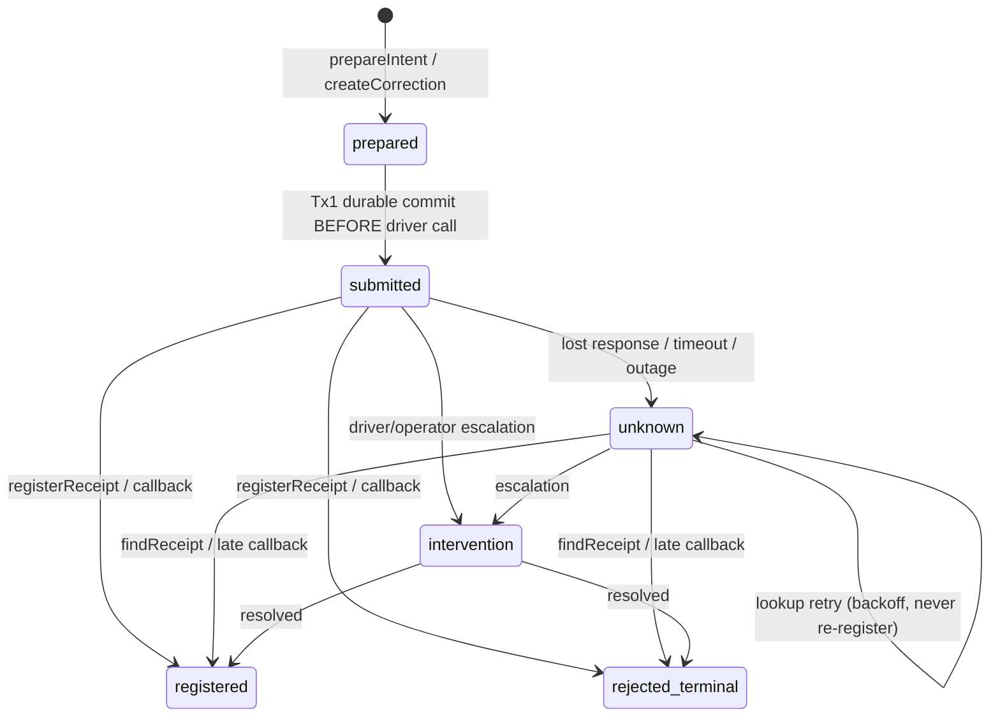

# Billium Fiscal Orchestration Boundary (`P6.5`)

Fiscalization is owned strictly by the **original payment executor** (`Billium\Execution\`). Payment execution state and fiscal receipt state are independent lifecycles: a fiscal provider outage, timeout, or terminal rejection never mutates a settled payment (`paid` remains intact) and never triggers compensating PSP actions.

## Execution-Profile Ownership & Policy Non-Universality

| Execution Profile | Allowed `fiscal_route` Values | Role |
|:--|:--|:--|
| `standalone-billium` | `psp_passthrough`, `fiscal_driver`, `none` | Owns payment execution; prepares and dispatches `billium_fiscal_intent` |
| `remote-billium` | `psp_passthrough`, `fiscal_driver`, `none` | Owns payment execution; prepares and dispatches `billium_fiscal_intent` |
| `embedded-commerz` | `projection_only`, `none` | Never owns payment execution; records `billium_fiscal_projection` only, **0 provider sends** |

- **Non-universality**: Sellers, environments, profiles, or operation kinds with no active policy or `receipt_required = false` (`fiscal_route = 'none'`) create zero fiscal intents.
- **Mutual exclusivity**: Each fiscal intent freezes a single dispatchable route (`psp_passthrough` OR `fiscal_driver`), exact `(driver_id, driver_contract_version)`, `callback_trust_strategy`, `merchant_revision_ref`, and deterministic `external_id`. Policy changes never mutate already-frozen intents or dual-send the same effect through both routes.
- **`embedded-commerz` refusal**: Attempting to prepare or dispatch a `billium_fiscal_intent` under `embedded-commerz` is refused both at the application boundary (`CapabilityUnsupported`) and by PostgreSQL `CHECK (execution_profile IN ('standalone-billium', 'remote-billium'))`.

## Tables & Storage Guards (`2026_11_19_000034_create_billium_fiscal_tables.php`)

All four tables are owned by `ExecutionPlugin` (`tablePrefix = 'billium_'`, nouns `fiscal_policy`, `fiscal_intent`, `fiscal_evidence`, `fiscal_projection`) and do not modify any `billium_execution_*`, `billium_payment`, or `billium_outbox_*` DDL:

1. **`public.billium_fiscal_policy`** (append-only; runtime grants `SELECT, INSERT`):
   - Versioned policy per `(installation_ref, seller_ref, environment, execution_profile, operation_kind, policy_version)`.
   - `CHECK` constraints enforce profile-to-route isolation and non-empty driver coordinates for dispatchable routes.
   - Trigger `billium_fiscal_policy_append_only` rejects `UPDATE`/`DELETE` (`SQLSTATE 55000`).
2. **`public.billium_fiscal_intent`** (monotonic state machine; runtime grants `SELECT, INSERT, UPDATE`):
   - Identity & deduplication keys:
     - `UNIQUE (installation_ref, seller_ref, environment, intent_ref)`
     - `UNIQUE (installation_ref, seller_ref, environment, economic_effect_ref, receipt_kind, correction_revision)`
     - `UNIQUE (installation_ref, seller_ref, environment, external_id)`
   - Stores frozen `fiscal_route`, `driver_id`, `driver_contract_version`, `callback_trust_strategy`, `merchant_revision_ref`, `merchant_account_ref`, `parent_fiscal_intent_ref`, `exceptional`, `exposure_provenance` (JSONB object, required non-empty when `exceptional = true`), `payload_snapshot`, and `payload_digest`.
   - Trigger `billium_fiscal_intent_guard_trg` forbids `DELETE` (`55000`), forbids mutating any frozen identity/route/amount/snapshot column (`55000`), forbids mutating terminal `registered`/`rejected_terminal` rows (`23514`), enforces monotonic `lookup_attempts` (`23514`), and forbids backwards transitions—specifically forbidding `submitted -> prepared`, `unknown -> prepared`, and `unknown -> submitted` (`23514`).
3. **`public.billium_fiscal_evidence`** (append-only custody log; runtime grants `SELECT, INSERT`):
   - Immutable audit trail of every `register_response`, `lookup_response`, `callback`, `transport_failure`, and `callback_rejected` event with `credential_version_ref`, `trust_verdict`, `payload_digest`, and secret-redacted `sanitized_payload` (raw callback signatures are never stored).
   - Trigger `billium_fiscal_evidence_append_only` rejects `UPDATE`/`DELETE` (`55000`).
4. **`public.billium_fiscal_projection`** (append-only `embedded-commerz` projection log; runtime grants `SELECT, INSERT`):
   - Strictly `CHECK (execution_profile = 'embedded-commerz')`, idempotent on `(installation_ref, seller_ref, environment, economic_effect_ref, receipt_kind, correction_revision, fiscal_status)`.
   - Preserves `exceptional` and `exposure_provenance` while guaranteeing zero external fiscal driver invocations.

## Fiscal Intent State Machine & Recovery Protocol



- **Outside-Tx Transport Boundary**: `TransportBoundary::assertOutsideTransaction()` runs before every `FiscalDriver` call and credential resolution.
- **Durable Intent Before Side Effect**: `dispatchIntent()` commits `prepared -> submitted` in short Transaction #1 before invoking `FiscalDriver::registerReceipt()`. A lost response or 24-hour outage records `transport_failure` evidence and moves to `unknown` in Transaction #2.
- **Unknown Means Lookup, Never Re-Register**: Calling `dispatchIntent()` or `lookupIntent()` on `submitted`/`unknown` invokes `FiscalDriver::findReceipt()` exclusively (`registerCalls === 1`, `duplicateRegistrations === 0`).
- **Historical Credential Continuity**: `lookupIntent()` resolves credentials strictly via `ContinuityMerchantCredentials::resolve($historicalMerchantRevision, 'lookup')`, ensuring rotated replacement merchants never intercept lookup recovery of historical intents.
- **Repeated Corrections**: `createCorrection()` links `parent_fiscal_intent_ref`, increments `correction_revision` (`1`, `2`, ...) under row-level lock on the economic effect, freezes the original route and merchant revision, and is idempotent on `correctionBasisRef` (producing a stable retry `external_id`).

## Actual-Effect Basis & Exceptional Exposure (ACC-RST-12)

`ActualEffectExtractor` derives fiscal inputs solely from authenticated unique `billium_execution_provider_fact` rows with `normalizedStatus = 'succeeded'` and positive `operationAmount`, never from bounded applied `billium_execution_capacity.confirmed_refund_minor` or ledger allocation state:

- In an over-refund hold (`capture 100`, two confirmed actual refunds `70 + 70`), fiscalization creates **1 sale intent (`100`)** and **2 refund intents (`70 + 70 = 140`)**; the discrepancy-triggering refund carries `exceptional = true` and `exposure_provenance` and is never suppressed.
- An `unknown` or unconfirmed refund produces **0 fiscal intents** until authenticated actual provider evidence arrives.
- Replaying extraction or preparation across any permutation order yields identical intent counts, amounts, and `external_id`s with **0 compensating PSP actions**.

## COV-337 Due-Lookup Index & Bounded Seller-Scoped Claim

Index definition:

```sql
CREATE INDEX billium_fiscal_intent_due_lookup
    ON public.billium_fiscal_intent (seller_ref, state, next_lookup_at, id);
```

Claim query executed by `FiscalOrchestrator::claimDueLookups($scope, $asOf, $limit, $afterId)`:

```sql
SELECT id
FROM public.billium_fiscal_intent
WHERE seller_ref = ?
  AND state = ?
  AND next_lookup_at <= ?
  AND id > ?
  AND installation_ref = ?
  AND environment = ?
  AND (lease_expires_at IS NULL OR lease_expires_at <= ?)
ORDER BY next_lookup_at ASC, id ASC
LIMIT ?
```

Claimed candidate IDs are leased atomically via compare-and-swap `UPDATE ... WHERE id IN (...) AND state IN ('unknown', 'submitted') AND (lease_expires_at IS NULL OR lease_expires_at <= ?) RETURNING id` without bypassing `LockSet`.

- Leading equality predicates `(seller_ref, state)` plus range predicate `next_lookup_at <= ?` and matching `ORDER BY next_lookup_at ASC, id ASC` allow PostgreSQL to use an index scan on `billium_fiscal_intent_due_lookup` without sorting.
- `next_lookup_at <= $asOf` guarantees future-scheduled lookups are never reclaimed early.
- Per-seller scoping (`seller_ref = ?`) plus bounded `$limit` (`1..500`) and atomic CAS lease acquisition prevent cross-seller leakage and ensure one failing seller cannot starve lookups for other sellers.

## COV-295 / COV-533 Extension Isolation & Callback Trust

- **Exact Contract Version Negotiation**: `FiscalDrivers::resolve($driverId, $contractVersion)` requires an exact `(driverId, contractVersion)` match and refuses unknown versions with `ProblemCode::CapabilityUnsupported` (never substituting latest).
- **Schema-Free Extension Isolation (COV-295)**: `FiscalIntegrationExtension` implements Packman `ExtensionPlugin` and `WithCapabilities` (providing `FiscalDrivers`) without implementing `WithSchema`, owning zero tables and never touching core platform/ledger/execution DDL or DML.
- **Callback Trust Strategy (COV-533)**: Every intent freezes its `callback_trust_strategy` (`hmac_signature`, `driver_verified`, `mutual_tls`). Incoming callbacks must match exact `driverId`, `driverContractVersion`, and `trustStrategy`, and pass `FiscalDriver::verifyCallback()`. Untrusted callbacks are refused (`AuthDenied`) with redacted `callback_rejected` custody evidence and zero state mutation; duplicate or late callbacks against terminal intents are recorded as `duplicate_ignored` without modifying the receipt or payment state.
