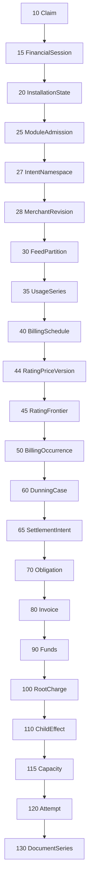

# Lock model P3

Владелец модели — platform OperationRunner/LockSet; доменные rows принадлежат своим модулям
(INV-01, D27/D60). Источник порядка — `packages/core/src/Enums/Runner/LockRank.php`.
Корневая транзакция берёт ранги строго по возрастанию; внутри ранга id только растут.
Claim — первая запись корневой Tx (insert, не row lock). Funds сначала payment ids
(сегмент 0), затем customer-credit ids (сегмент 1).



| Rank | LockRank |
|:--|:--|
| 10 | Claim |
| 15 | FinancialSession |
| 20 | InstallationState |
| 25 | ModuleAdmission |
| 27 | IntentNamespace |
| 28 | MerchantRevision |
| 30 | FeedPartition |
| 35 | UsageSeries |
| 40 | BillingSchedule |
| 44 | RatingPriceVersion |
| 45 | RatingFrontier |
| 50 | BillingOccurrence |
| 60 | DunningCase |
| 65 | SettlementIntent |
| 70 | Obligation |
| 80 | Invoice |
| 90 | Funds: payment ids, затем customer-credit ids |
| 100 | RootCharge |
| 110 | ChildEffect |
| 115 | Capacity |
| 120 | Attempt |
| 130 | DocumentSeries |

Порядок един для application prelocks и guarded routines (D27/D60).
Участник берёт только свои ранги и не переставляет их.
Полный pre-read lock plan объявляет все row sets **до** domain locks. После locking делается re-read;
изменившийся набор вызывает `LockPlanChanged` и новый DB-only attempt. LockSet проверяет rank,
seller/environment и возрастающие ids. Новый id в уже взятом ранге может только увеличиваться;
нарушение — `LockOrderViolation` (D27/D60).

Каждая финансовая command/reducer/participant берёт session FOR SHARE после claim и держит до commit.
Ordinary roots проверяют active mode/epoch; recovery reducers используют принятый recovery epoch без
новых outgoing effects/automatic collection. Seal закрывает admission, ждёт bounded drain, берёт
session FOR UPDATE и записывает sealed, без поздних domain locks. Это локальный barrier, не отзыв PSP
request; raw custody может продолжаться. При timeout/unknown worker нет safe seal/activation.
Границы drain — process-token TTL, root hard deadline и host supervision; fairness advisory locks не
предполагается, latency/lock waits/MultiXact под нагрузкой измеряет P10 (D54/D60/D62).

Typed participant получает capability того же runner, connection и transaction, использует заранее
объявленный plan. Он не становится вторым writer и не создаёт вложенный economic root. Каждое событие
feed/drain — отдельная root Tx; после Funds первого события нельзя захватить unplanned второе.
Повтор DB-only work разрешён для `40001`, `40P01`, `LockPlanChanged`; сеть никогда не повторяется
в таком retry. `money_commit_log` вставляется без явного lock и служит диагностикой;
`max(commit_no)` не доказывает freshness backup (INV-03/08, D54/D60).

Runtime имеет SELECT/EXECUTE на protected ledger, без INSERT/UPDATE/DELETE/TRUNCATE и owner membership.
Routines повторно берут declared affected rows в том же порядке (runner locks reentrant), проверяют
account/currency/capacity/reversals и атомарно меняют counters+journal. SECURITY DEFINER принадлежит
migration owner, имеет safe `pg_catalog, pg_temp` search_path, qualified identifiers и restricted EXECUTE.
Privileged DBA/schema owner вне этой гарантии (D60).

| Правило | Enforcement | Proof (пути от корня) |
|:--|:--|:--|
| INV-01 один writer | typed participants, ownership, protected grants | `packages/core/tests/Feature/ParticipantContextIsolationTest.php`, `packages/core/tests/Arch/TableOwnershipTest.php`, `packages/core/tests/Feature/RuntimeRoleGrantsTest.php` |
| INV-05 key+digest | first-write UNIQUE claim, D31 savepoint | `packages/core/modules/platform/tests/Concurrency/IdempotencyClaimConcurrencyTest.php` |
| INV-06 totals | material revision journal, assignment, economic digest | `packages/core/modules/ledger/tests/Concurrency/ObservationPartitionTest.php`, `packages/core/modules/ledger/tests/Concurrency/RefundBaseTest.php`, `packages/core/modules/ledger/tests/Feature/ObservationMaterialDigestTest.php` |
| INV-08 receipt boundary | custody/frontier отдельно от economic application | `packages/core/modules/ledger/tests/Feature/ObservationIdempotencyTest.php`, `packages/core/modules/platform/tests/Feature/InboxSourceIsolationTest.php` |
| INV-09 conservation | routines own allocation/payment/credit counters | `packages/core/modules/ledger/tests/Concurrency/AllocationBackstopTest.php`, `packages/core/modules/ledger/tests/Concurrency/AllocationSamePaymentTest.php`, `packages/core/modules/ledger/tests/Concurrency/AllocationCreditNoteTest.php` |
| INV-12 immutable terms | DB guard + adjustment routine | `packages/core/modules/ledger/tests/Schema/LedgerBackstopTest.php` |
| INV-13 issued freeze | DB guards, typed issue participant | `packages/core/modules/ledger/tests/Schema/LedgerBackstopTest.php`, `packages/core/modules/ledger/tests/Concurrency/InvoiceIssueMetadataTest.php`; legal-number atomicity — P6 |
| INV-14 scope/account | composite FK + routine scope checks | `packages/core/modules/ledger/tests/Concurrency/CrossSellerAllocationTest.php`, `packages/core/modules/ledger/tests/Feature/AllocationAccountIsolationTest.php` |
| D54 session seal | shared/exclusive barrier, epoch admission | `packages/core/modules/platform/tests/Concurrency/FinancialSessionSealTest.php`, `packages/core/tests/Drill/LedgerOnlyRestoreAdmissionTest.php` |
| D57 actual/applied | observed facts, bounded projection, hold | `packages/core/modules/ledger/tests/Feature/ExceptionalExposureTest.php` |
| D60 participants | same-root capability + planned locks | `packages/core/tests/Feature/ParticipantContextIsolationTest.php`, `packages/core/tests/Feature/CorrectionParticipantTest.php` |
| D21 upgrade | compatible expand, interrupted backfill, separate validate | `packages/core/tests/Drill/RollingUpgradeTest.php` |

Запуск committed-data/N-process proofs в PostgreSQL 16 (D50, без RefreshDatabase):

```bash
docker compose run --rm toolchain php scripts/db/preflight.php
docker compose run --rm toolchain vendor/bin/pest --group ACC-CON-08,ACC-CON-09,ACC-CON-19
docker compose run --rm toolchain vendor/bin/pest --group D60,D62
docker compose run --rm toolchain vendor/bin/pest packages/core/tests/Drill/RollingUpgradeTest.php
```

Admission/host authority и поколения rolling drill симулированы, PostgreSQL transactions/processes реальны.
Эти tests не удостоверяют live authority retirement, PSP capabilities или production seal latency (D59).
