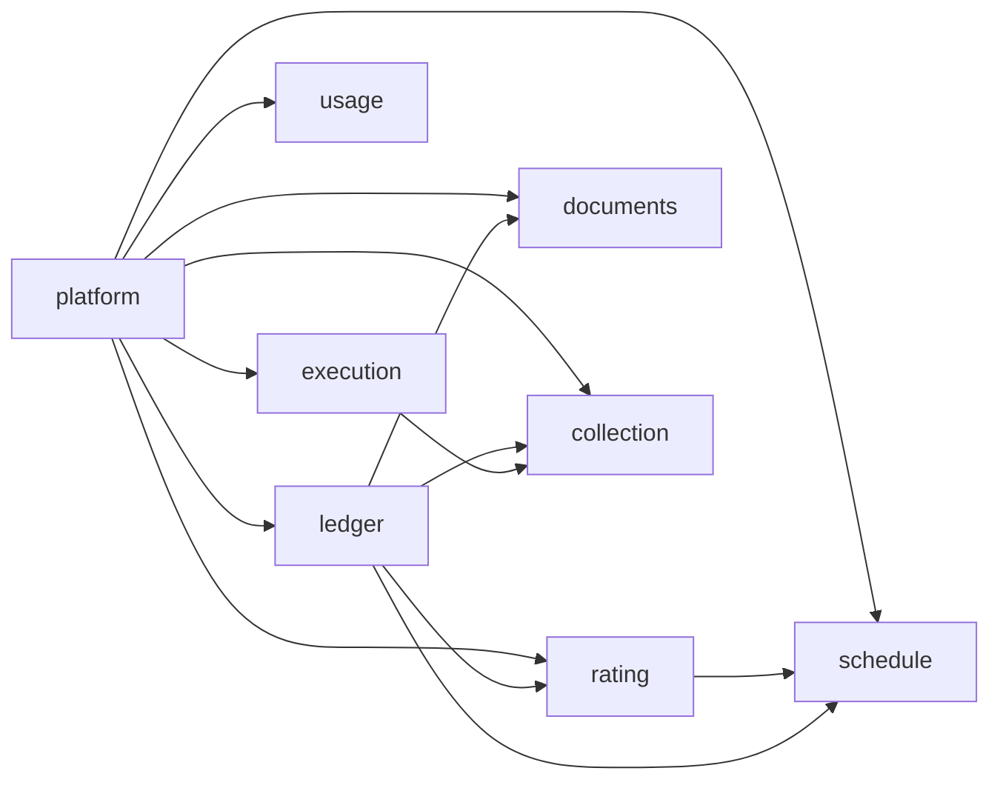

# Billium — матрица модулей и профилей композиции

Статус: PLAN1.P10.1 (D55, D61, D71, D72).

Документ фиксирует поддерживаемые профили композиции Billium, границы обязательных и опциональных модулей, правила отключения с сохранением исторического чтения и воспроизводимую smoke-проверку матрицы.

## Профили композиции

Доставка (`server` HTTP/JSON vs in-process Laravel) и денежные полномочия (`execution` / `WriterAdmission`) ортогональны (D61). Все профили строго product-agnostic (D71): Billium не содержит ссылок на внешние хостовые продукты и не обращается к их БД.

| Профиль | Состав пакетов | `platform` / `ledger` | `usage` / `rating` / `schedule` / `documents` | `execution` | `collection` | `WriterAdmission` | Назначение |
| :--- | :--- | :---: | :---: | :---: | :---: | :---: | :--- |
| `contract-only` | `billium-contracts` (PHP) / `billium_contracts` (Dart) | X | X | X | X | X | Типы денег, канонический JSON/digest, кодеки и коды ошибок без core, server, БД и провайдерских SDK |
| `embedded` (`embedded-host` / `ledger-only`) | `billium-contracts` + `billium-core` (+ опц. `billium-server`) | M / M | O | X | X | X | Встраиваемый хост с учётом и проекциями; 0 исходящих отправок провайдерам |
| `standalone` (`standalone-billium`) | `billium-contracts` + `billium-core` | M / M | O | O | O | O (при `execution`) | Полная in-process композиция без отдельного HTTP-сервера; при выключенном `execution` — 0 отправок |
| `remote` (`remote-billium`) | `billium-contracts` + `billium-core` + `billium-server` | M / M | O | M | O | M | Выделенный HTTP-сервис исполнения и учёта с обязательным `execution` и hard-fence допуском |

Обозначения: `M` — обязательный, `O` — опциональный, `X` — запрещённый в профиле.

## Граф зависимостей модулей (DAG)



Инварианты старта (`ModuleCatalog::check`, `ExecutionCompositionGuard`, `BilliumCompatibilityDoctorCheck`):

1. **Опущенный `execution` ⇒ 0 провайдерских отправок**: `ExecutionServiceProvider` не регистрируется, `PaymentDrivers` и `WriterAdmission` не привязаны; попытка включить `execution` в `ledger-only` отклоняется на старте (`InvalidConfiguration` / `module.composition_forbidden`).
2. **Отключённый `documents` ⇒ чистые пути `ledger-only`**: `DocumentsServiceProvider`, `LegalDocumentIssuer` и `DocumentRenderService` не регистрируются, внешние порты `DocumentRenderer` / `DocumentStorage` / `TaxSnapshotPort` не требуются, а `Ledger` работает штатно.
3. **Несовместимая зависимость или версия отклоняются на старте**: отсутствующий модуль-зависимость (`module.dependency_missing`), несовпадение диапазона API зависимости (`module.dependency_range`), неподдержанная версия core API (`module.core_api_unsupported`) и неприменённая/несовместимая схема (`module.migration_unapplied`, `module.schema_read_unsupported`) закрывают readiness.

## Отключение модуля и чтение истории

Жизненный цикл модуля (`ModuleLifecycle`): `accepting → draining → recovery_only → retired`.

- При переходе в `draining`, `recovery_only` или `retired` новые намерения (`new_intent`) запрещаются, но `historical_read` и `receipt_replay` остаются разрешёнными.
- Отключение и вывод из эксплуатации никогда не выполняют автоматическую очистку схемы или данных (`purgesData = false`).
- Если у отключённого модуля есть сохранённая история, compatibility check требует установленный исторический читатель (`module.historical_reader_missing`).

## Изоляция контрактных пакетов

- **PHP (`packages/contracts`)**: зависит только от PHP 8.4, `ext-mbstring`, `axiomasoft/packman` и `brick/money` / `brick/math`; не импортирует `Billium\Core`, `Billium\Server`, `Illuminate\*`, `PDO` или SDK платёжных провайдеров.
- **Dart (`packages/contracts-dart`)**: зависит только от `crypto`; не импортирует `dart:io`, `dart:ffi`, HTTP/DB клиенты или core/server пакеты и никогда не является monetary writer.

## Воспроизводимая smoke-проверка

```bash
# Pest-матрица профилей, зависимостей, истории и изоляции контрактов
docker compose run --rm -u 0:0 toolchain vendor/bin/pest --filter=ProfileMatrix

# Повторяемый shell smoke по всем 4 профилям (contract-only, embedded, standalone, remote)
docker compose run --rm -u 0:0 toolchain bash scripts/smoke/profile-matrix.sh
```

Связанные документы: [module-compatibility.md](module-compatibility.md), [acceptance-catalog.md](../acceptance-catalog.md).
