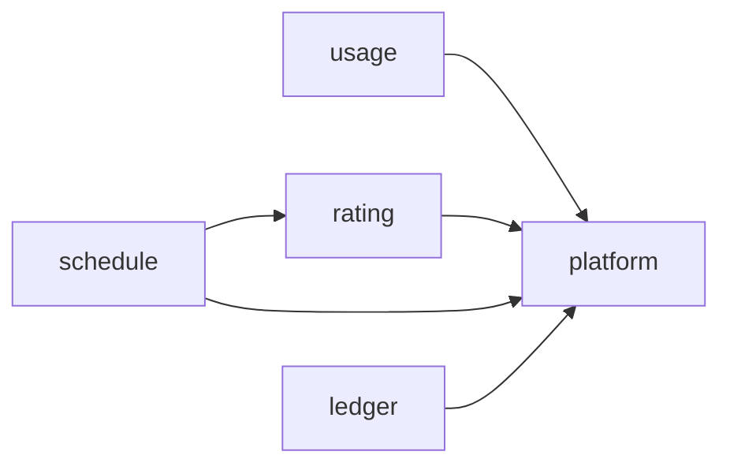

# Optional usage, rating and schedule composition

P4.9 implements the internal module seams of D55/D56. Owners are usage (normalized facts and
aggregation), rating (immutable prices, tax evidence and rated bases), schedule (commercial periods
and monetary occurrences), ledger (debt and monetary observations), and platform (root admission,
receipts and lifecycle). Contracts/core/server/testkit remain the package topology; no vendor server,
entitlement module or extracted commercial package is required (D13/D55, REQ-PROF-02/03, REQ-OUT-01/14).

## Installation DAG and operation capabilities

Arrows below mean **requires at installation**, as recorded in `spec/modules.json`. Contract calls
needed by one operation are listed separately; they do not force every provider into every runtime
(D55; owners platform/rating/schedule).

| Module / provider | Migration stream and owner | API consumers call | Required SPI / operation capabilities |
|:--|:--|:--|:--|
| usage / `UsageServiceProvider` | `database/migrations/usage`, usage tables only | `Usage`, `AggregationService`, `AggregationQueries` | Authenticated `CallerContext`; `UsageAttribution` for intake; exact versioned `MetricReducerRegistry` for aggregation |
| rating / `RatingServiceProvider` | `database/migrations/rating`, rating tables only | `PriceVersionStore`, `RatingQuoter`, `RatingPreparer`, `RatingBooking` | Pure quote: `PricingStrategyRegistry` and retained tax inputs only. Prepare: schedule queries, pinned prices, host `TaxSnapshotPort`; usage queries only for metered inputs. Book: schedule locks/participants; usage locks/participants only for metered inputs; ledger participants only when posting |
| schedule / `ScheduleServiceProvider` | `database/migrations/schedule`, schedule tables only | `IntervalResolver`, `AgreementRevisionCommit`, `OccurrenceService`, `ScheduleQueries` | Accepted host terms; `AgreementRevisionGuard` for commercial commit, `Clock`; platform root admission. No ledger, renderer, grant or payment executor |
| ledger / `LedgerServiceProvider` | `database/migrations/ledger`, ledger tables only | `Ledger`, `LedgerParticipants`, `LedgerQueries` | Host financial-session authority for monetary roots; no legal renderer or execution prerequisite |

The matrix specifies role capabilities under D13/D55/D56/D60/D63 (owners in the first column).
`#[Api]` contracts are consumer entry points; `#[Spi(Implement)]` marks trusted host implementations
of pricing, metric reduction and tax. `#[Spi(Call)]` registries are called with exact role/version;
implementations receive immutable data, never a ledger persistence capability. Host attribution and
agreement authority remain the host's responsibilities (REQ-CON-31/33, REQ-NBR-06, INV-01).

Core registers ledger only when listed in `billium.modules.enabled`. Each commercial provider requires
both membership in that list and `billium.<module>.enabled=true`. Providers bind services and discover
their own migration paths; boot executes no SQL, installs no module state and starts no workers.
The host explicitly migrates and calls installation init/lifecycle APIs. Fresh omitted modules have no
tables or bindings. Disable closes new intents while history/recovery and retained implementations
remain available; binary uninstall is not purge (D55; owners core/platform and each module).

## Fixed price without a usage backend

For a pinned fixed price, `PrepareRating.components[*].snapshotRef="fixed"` selects the versioned
`fixed_occurrence/1` basis. Rating freezes one component occurrence with its seller, environment,
account/customer attribution, agreement revision, original interval, occurrence inputs, source and
price terms digests. Its internal quantity is one occurrence, not measured usage. The entire frozen
basis is recomputed and checked before booking; a changed quantity, scope or price refuses. A per-unit
or tiered price cannot select this path (D55/D56, INV-11/12/14; owner rating).

The quote path resolves without any database or ledger provider. Fixed schedule preparation and
unposted booking run with platform/rating/schedule alone, with no usage schema or service. Adding
ledger permits the same frozen basis to create debt through `LedgerParticipants`; legal document
issue/render and payment execution are separate operations. Metered inputs still require final,
reproducible usage snapshots and their root locks; they never fall back to fixed inputs or zero
(D55/D56/D60, REQ-OWN-03; owners rating/schedule/usage/ledger).

## Trusted extension and replacement

Host application providers may tag `PricingStrategy` implementations with `billium.pricing_strategies`
and `MetricReducer` implementations with `billium.metric_reducers`. Built-in version 1 roles remain
installed; an extension adds an explicitly selected new version of an existing typed strategy or
metric semantic family. A minimal fixed-price version 2 and additive-input version 2 are exercised
in the integration tests. New term shapes or wire metric models require their own negotiated contract
revision; this seam does not introduce arbitrary money scripts (D56, COV-292/293; owners rating/usage).

Registries index `(strategyId,strategyVersion)` and `(algorithmId,algorithmVersion)`. Duplicate or invalid
registrations fail when the registry is constructed; missing versions fail on exact resolution,
before any financial write can commit. Provider defaults preserve a host-bound registry. Tax has one
host-bound `TaxSnapshotPort`; quotation/finalization freezes resolver version, input and evidence
digests. Missing tax evidence holds work rather than inventing a rate. Extension installation changes
neither migration ownership nor financial writer authority (D55/D56, COV-292/293/294; owners rating/usage).

Historical role versions must remain installed while their snapshots can be replayed or corrected.
Registries expose no live remove/replace operation. If deployment omits a required historical version,
recomputation refuses explicitly; the current version is never substituted. Before removing code the
host must retain the old implementation or record a reproducibility disposition that prevents financial
replay of affected history. Source adapter replacement preserves the same normalized immutable metric,
fact identity, digest, attribution and completeness inputs, so it preserves aggregate snapshots;
different semantics require a new metric/policy version (D13/D55/D56, INV-05/12; owners host/usage/rating).

Source/host/vendor adapter implementations live outside Billium. They emit Billium contracts and own
their own state; Billium does not import neighbours or read their financial tables. Trusted PHP plugins
are application code, not a sandbox: the boundary tests and restricted database role establish the
tested boundaries, not isolation from malicious installed PHP (REQ-OWN-16, REQ-CON-15, D55/D59; owners host/core).

## Supported A–D scenarios and evidence

A–D are adoption scenarios mapped onto the existing delivery/authority axes, not new wire profiles
(REQ-PROF-06, D55; owner architecture).

| Scenario | Supported composition | Authority guard |
|:--|:--|:--|
| A: commerce owns payment | `embedded-commerz`; platform + ledger, commercial modules optional | Billium execution/collection and WriterAdmission are forbidden; commerce keeps original payment ownership |
| B: host journal / small app | Journal-only `ledger-only` server, or an embedded host composition; commercial modules optional, fixed schedule can omit usage | No implicit Billium execution; a journal is not permission to execute a payment |
| C: central Billium writer | `standalone-billium` with explicit execution and host admission when enabled | Billium is the single owner of its accepted operations; financial-session and effect admission remain required |
| D: remote execution | `remote-billium` server + execution | Missing execution or WriterAdmission refuses readiness; no local commerce fallback |

No P4 composition changes an existing operation binding, provider account or refund executor
(D55, REQ-PROF-05, REQ-OWN-20/21, INV-02/07; owner execution).

`P4ModuleCompositionTest` cases cover a fresh database without ledger/usage, pure quote, unposted
fixed rating, ledger booking without legal issue/render, trusted strategy/metric/tax extension versions,
unchanged migration sets, normalized source replacement, missing implementation rollback and A–D
readiness refusals. `P4DependencyBoundaryTest` scans actual source AST names, SQL/table access and
forbidden neighbour/renderer dependencies, with negative examples. Existing bootstrap, lifecycle,
module boundary and migration tests remain in place. These are local PHP/PostgreSQL and host-double
proofs; execution readiness checks do not qualify a live PSP or remote deployment (D55/D59, REQ-ACC-18;
owners core/platform/testkit).
