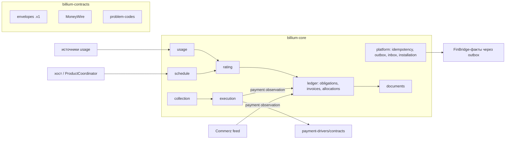

# Billium — целевая архитектура

Статус: исходное решение PLAN1.P1.6 (2026-10-17), уточнено D53–D63 (2026-10-24). Дизайн P3–P10 ещё не реализован. Полнота и границы поставки — [design-coverage.md](design-coverage.md). Нормативная основа — `docs/requirements.md` (REQ/INV),
первичные факты — `knowledge/research/DR-0*.md` плана `2026.10.14-№1-BILLIUM-V1`
в [workspace](../planning.md) (DR0N-NN), практики —
`artifacts/P1-methods/methods.json` (M-NN), решения — `decisions/D9.json`…`D28.json`. Модель данных и инварианты —
[`data-model.md`](data-model.md); раскладка каталогов и freeze — `knowledge/target-structure.md` плана.

Правила документа: каждое решение ссылается на D# с альтернативами (D7); внешний факт — через DR-ID с
URL, датой и версией в DR-файле; непроверенное помечено `unverified` и вынесено в «Риски».

## Итог

Billium строится как **собственное PHP-ядро с внутренними модулями** и портами для внешних
драйверов, документов, источников usage и интеграций. Выбор build сохраняет обязательный embedded-путь,
единый PHP writer и существующие границы ответственности. Lago, Kill Bill и OpenMeter остаются
архитектурными референсами и условными будущими адаптерами; их конкретные edition, лицензия,
concurrency и recovery требуют отдельной квалификации при выборе backend. Исследовательское сравнение
не является свидетельством готовой поддержки или обязательной зависимости (D53, D55, D58).

## Решения по областям

| Область | Решение | Основа | D# |
|:--|:--|:--|:--|
| contracts | build — спецификация billium-contracts (ревизия, JSON Schema, fixtures, problem-codes); тонкие PHP- и Dart-пакеты без writer | CL-73, CL-43; DR01-17, DR01-21; M-01, M-06, M-19; REQ-CON-01, REQ-CON-03 | D9 |
| execution journal | build — модуль execution: operation, attempt, frozen binding, inbox, lease/fence, lookup через PaymentDrivers | CL-44, CL-66, CL-90; DR01-20, DR01-23, DR01-24, DR01-36; M-51, M-56; REQ-OWN-08, INV-02 | D10, D26, D27 |
| obligations/invoicing | build — модуль ledger: obligations, invoices, credit notes, allocations, customer credit; subledger без GL | CL-40, CL-41, CL-65; DR01-08, DR01-09, DR01-10, DR01-37; REQ-OWN-03, INV-09 | D11, D20 |
| rating/schedule | build — модули rating и schedule: неизменяемая PriceVersion, rated line с provenance, occurrence по бизнес-идентичности | CL-54, CL-58; DR01-07, DR03-05, DR03-14; REQ-OWN-01, INV-11, INV-12 | D12 |
| usage-приём | build — модуль usage: свой входной контракт фактов, dedupe (seller, source, factId, revision), явная семантика метрики | CL-52, CL-55; DR01-29, DR01-30, DR01-31, DR03-01; REQ-CON-15, REQ-CON-16 | D13 |
| документы | hybrid — build: нумерация, lifecycle, коррекции; adopt: renderer и storage за портами, фискал через исполнителя | CL-36, CL-42; DR02-14, DR02-17, DR02-20, DR01-37; REQ-OWN-07, REQ-CON-24, REQ-CON-25 | D14, D24 |
| collection | build — опциональный модуль collection: dunning case, шаги, authorizeCollection, списание через execution | CL-20, CL-90; DR02-21, DR01-24; REQ-OWN-06, REQ-FAIL-19 | D15 |

Сквозные решения: стек (D16), раскладка (D17), профили (D18), деньги в хранении (D19), политика
invoice (D20), эволюция схемы (D21), строгие поля (D22), seller в ключах (D23), gate adopt (D24),
retention (D25), binding (D26), модель блокировок (D27), раздельные FSM (D28).

## Модули ядра и поток денег

- Каждый модуль пишет только свои таблицы и общается с соседними модулями через контракты ядра и
  события (M-21, M-23). Межмодульная ссылка — по ключу, без записи в чужую таблицу.
- Исход исполнения попадает в ledger только через `applyPaymentObservation` (REQ-CON-13) — тем же
  путём, что и feed Commerz в `embedded-commerz` (REQ-OWN-11). Execution не пишет allocation (D28).
- Внешние вызовы (драйвер, renderer, доставка) — вне транзакции, после commit намерения (INV-03).
- Все денежные мутации проходят один pipeline: admission → claim идемпотентности → locks в
  глобальном порядке → запись → outbox → commit (M-55, D27).

## Профили embedded и server

Профили поставки (CD-14) и профили authority исполнения — разные оси (REQ-PROF-06).

| Профиль поставки | Состав | БД и tenancy | Кто использует |
|:--|:--|:--|:--|
| `embedded` | billium-contracts + billium-core в Laravel-хосте; модули включаются конфигом | соединение и scope хоста, без `tenant_id` (REQ-PROF-09) | PHP-облака продуктов (REQ-PROF-12, REQ-PROF-13) |
| `server` | те же пакеты + billium-server: HTTP API, problem+json, auth verdict port, routing продавцов | своя PostgreSQL; продавцы разделены seller в каждом ключе (INV-14) | мост `commerz-billium` в `remote-billium` (REQ-PROF-18); выбор FlexCRM — вопрос владельцу |

| Authority-профиль | Модуль execution | Источник исходов для ledger | Основа |
|:--|:--|:--|:--|
| `embedded-commerz` | выключен | feed Commerz (REQ-NBR-03) | REQ-PROF-04, REQ-OWN-11 |
| `remote-billium` | включён, только server | собственный журнал | REQ-PROF-04, REQ-PROF-18 |
| `standalone-billium` | включён | собственный журнал | REQ-PROF-04, REQ-PROF-07 |

Правила:

1. Первая поставка — embedded-библиотека obligations/invoice/allocation (REQ-PROF-20, D18).
   Execution включается только при названных operational owner, SLO, backup/restore и migration plan
   (REQ-PROF-21).
2. Authority-профиль фиксируется в операции с первой принятой команды; появление server не
   переключает старые операции (REQ-PROF-05, INV-02).
3. Embedded и server — один код и одна схема; различаются составом модулей, не правилами расчёта
   (M-22). Лёгкий профиль не ослабляет инварианты (REQ-PROF-22).
4. Где включён execution, хост/deployment реализует `WriterAdmission` от authority **вне**
   копируемой БД и подтверждает остановку/изоляцию старых отправителей. Каждая смена deployment owner session,
   restore, release/acquire или потеря непрерывного lease открывает recovery. `release` запечатывает
   session после закрытия admission и drain; он не активирует recovery. Activation — отдельная
   привилегированная команда с RetirementProof, reconciliation coverage и сертификатом выбранной
   lineage/epoch. Равенство `max(commit_no)` не доказывает свежесть БД и не разрешает dispatch (D54,
   заменяет D39 и закрывает перенесённый D42 design gap; runtime proof — P3/P5).
5. В каждой root financial Tx `financial_session` держится FOR SHARE до commit; seal берёт FOR UPDATE.
   Raw custody callback/response может продолжаться после seal, но old session не применяет финансовые
   изменения. Recovery reducers работают с новым допущенным epoch. Уже отправленный запрос PSP
   локальный fence не отзывает: pending/unknown сохраняет identity и reserve (D54, D57, D60).
6. Manifest модулей валидирует зависимости и API/schema/event версии. Ledger может учитывать
   obligation/payment/allocation без documents/render, collection или execution. Disable сохраняет
   history/recovery, uninstall не выполняет purge; extraction нового пакета требует named consumer (D55).
7. OwnerSession относится к deployment generation, а не к одному FPM/queue worker. Workers получают
   краткоживущие host tokens и могут перезапускаться/масштабироваться внутри active session. Во всех
   денежных профилях `FinancialSessionAdmission` хоста задаёт expected epoch/DB attachment вне backup;
   execution дополнительно требует WriterAdmission. Contracts-only не требуют этих портов. Неконтролируемый
   in-place rollback БД под живым deployment без host restore barrier не считается безопасным restore (D62).
8. Server ledger-only с внешним исполнителем допускается без execution/collection/WriterAdmission;
   денежные observations аутентифицируются по seller/environment/sourceAuthority. Это delivery=server
   при external-owner semantics, а не новый wire executionProfile. Optional production Dart SDK при
   отсутствии named consumer получает явную non-extraction диспозицию; обязательные transport tests
   PHP/Dart не пропускаются и остальные фазы не блокируются (D61).

## Стек

Версии проверены 2026-10-17 (D16):

| Компонент | Выбор | Проверка |
|:--|:--|:--|
| PHP | ≥ 8.4 (8.4.26 от 2026-09-24; поддерживаются 8.2–8.5) | https://www.php.net/releases/ |
| Laravel | 13 (`laravel/framework` v13.37.0 от 2026-10-16 требует `php ^8.3`) | https://repo.packagist.org/p2/laravel/framework.json |
| PostgreSQL | ≥ 16 (16.15 поддерживается до 2028-11-09; 18.6 — текущая) | https://www.postgresql.org/support/versioning/ |
| Статанализ и стиль | PHPStan max (2.3.1), Pint, Rector | https://repo.packagist.org/p2/phpstan/phpstan.json |
| Dart | 3.x (stable 3.13.5 от 2026-09-29) — только billium-contracts и SDK клиента | https://storage.googleapis.com/dart-archive/channels/stable/release/latest/VERSION |

- PHP — единственный денежный writer. Dart — клиент контрактов и SDK: формирует команды, читает
  исходы, не хранит денежное state и не повторяет lifecycle (REQ-OWN-18, REQ-CON-26, REQ-CON-37).
- Денежный writer — только PostgreSQL ≥ 16: partial unique, `NOT VALID`, `SKIP LOCKED` и
  N-процессные доказательства (REQ-ACC-11, REQ-FAIL-29). SQLite для writer в 1.0 не поддерживается.
- Внутренние деньги — bigint minor units + currency, exponent из версионированной таблицы ISO 4217
  (D19, DR04-11). В P2 принят Brick Money (D44); wire и cross-language fixtures остаются источником совместимости.
  Общего money-пакета нет (REQ-OUT-14).

## Пакеты

Монорепо `packages/<name>/` (D17). Extraction gate: новый пакет появляется только с названным
потребителем, инвариантом, который он защищает, и D#; иначе это внутренний модуль
`packages/core/modules/<m>` (M-37). Строки «gate» — пакеты, которые не создаются до подтверждения
потребителя.

| Пакет | Назначение | Профиль | Потребитель | Инвариант | D# |
|:--|:--|:--|:--|:--|:--|
| `axiomasoft/billium-contracts` (PHP) | ревизия спеки, envelopes `*.v1`, MoneyWire VO, codec, problem-codes | оба | мост `commerz-billium` (REQ-NBR-01), хосты, billium-core | INV-05, INV-08, REQ-CON-02 | D9, D17 |
| `billium-contracts` (Dart, pub `billium_contracts`) | MoneyWire, envelopes, ошибки, codec на общем корпусе fixtures | клиент | Dart SDK server-профиля, conformance PHP↔Dart | REQ-CON-03, REQ-OWN-18 | D9 |
| `axiomasoft/billium-core` | модули platform, usage, rating, schedule, ledger, documents, collection, execution | оба | хосты embedded (REQ-PROF-12, REQ-PROF-13), billium-server | INV-01, INV-09, INV-10, INV-11, INV-14 | D10–D15, D17 |
| `axiomasoft/billium-server` | HTTP API, problem+json, auth verdict port, routing продавцов | server | мост `commerz-billium` в `remote-billium` (REQ-PROF-18) | REQ-PROF-08, INV-14 | D18 |
| `axiomasoft/billium-testkit` | dev: тест-драйвер PaymentDrivers, conformance-адаптер, doubles | dev | тесты P3–P9, conformance моста (REQ-ACC-17) | REQ-ACC-18 | D17 |
| `billium-sdk` (Dart, pub `billium_sdk`) — gate | Dart-клиент server API поверх billium-contracts | клиент | gate: Dart-потребитель server API от владельца до P8 | REQ-CON-26, REQ-CON-37 | D17 |
| `axiomasoft/billium-finbridge` — gate | мост экспорта фактов в FinBridge | оба | gate: AiFina/FinBridge принимает `finbridge.fact/1` (P6) | REQ-CON-22, REQ-CON-34 | D17 |

Зависимости: contracts ← core ← server; testkit (dev) → contracts, core. Ядро не зависит от
server, Commerz, Tariffler, AiFina или конкретного драйвера (REQ-CON-23, REQ-PROF-02).

## Границы с соседями

| Сосед | Billium даёт | Billium получает | Запрещено | Основа |
|:--|:--|:--|:--|:--|
| Commerz | billium-contracts, исходы `payment.outcome.v1` | `payment.execute.v1`; в embedded-commerz — feed наблюдений | писать или читать таблицы Commerz; код моста в Billium | REQ-OWN-11, REQ-NBR-01, REQ-NBR-03, REQ-OUT-08 |
| PaymentDrivers | команды по `payment-drivers/contracts` | исходы, lookup, verifyCallback, capabilities | provider SDK и адаптеры в Billium | REQ-CON-23, REQ-NBR-04, REQ-OUT-06 |
| Фискал (PaymentDrivers fiscal) | `registerReceipt` после исхода, как исполнитель | `findReceipt`, статус чека | менять денежный факт по статусу чека | REQ-CON-24, REQ-NBR-05, REQ-FAIL-24 |
| Хост / ProductCoordinator | occurrences, obligations, receipts | revision соглашения, компоненты, cancellation generation, seller и права actor | выдавать grant или lease | REQ-NBR-06, REQ-OUT-02, REQ-OUT-11 |
| Tariffler | — (не импортирует) | usage/overage-факты по контракту Billium через адаптер источника | резервировать квоты, читать PlanVersion | REQ-NBR-07, REQ-OUT-01, REQ-OUT-10 |
| Источники usage | dedupe и rating | нормализованные факты со стабильным ID | начислять внутри consume | REQ-NBR-08, REQ-CON-15 |
| AiFina / FinBridge | факты через outbox | — | проводки и GL | REQ-CON-22, REQ-NBR-09, REQ-OUT-04 |
| AzGuard | порт verdict | verdict авторизации через мост хоста | импорт AzGuard в ядро | REQ-NBR-14 |
| Vaulter / хранилище хоста | ссылки на рендер | storage ref | GC документов renderer-ом | REQ-NBR-15 |
| Memster, Edufy | порт импорта legacy | адаптеры миграции | угадывать цену, оплату, provider ID | REQ-NBR-11, REQ-NBR-16, REQ-FAIL-28 |
| Licensing | — | — | выдавать lease | REQ-NBR-10, REQ-OUT-07 |

Конфликты канона CONFLICT-01, -02, -07, -09, -13 закрыты в пользу канона; эта архитектура не
сдвигает границ, поэтому предложение CD-записи не требуется.

## Риски и непроверенное

- `unverified`: concurrency vendor-схем не проверялась прогоном (DR01-39) — не влияет на build, но
  исключает «adopt по аналогии».
- P2 завершил contracts/toolchain этап и выбрал Brick Money (D44); фактические результаты и
  deviations сохранены в P2. Это не квалификация будущего core или реального PSP.
- Открыто у провайдеров: ротация credentials (DR-02 DR02-T05), restore refund без ответа у
  CloudPayments (DR02-11), `uuid` при ошибке 33 АТОЛ (DR02-17) — драйверы и execution сохраняют
  provider ID до сети и не трактуют пустой lookup как absent (REQ-FAIL-08).
- Числовые горизонты retention, валюты, PSP первого запуска, продавцы — вопросы владельцу
  (REQ-FAIL-16, REQ-OUT-15).
