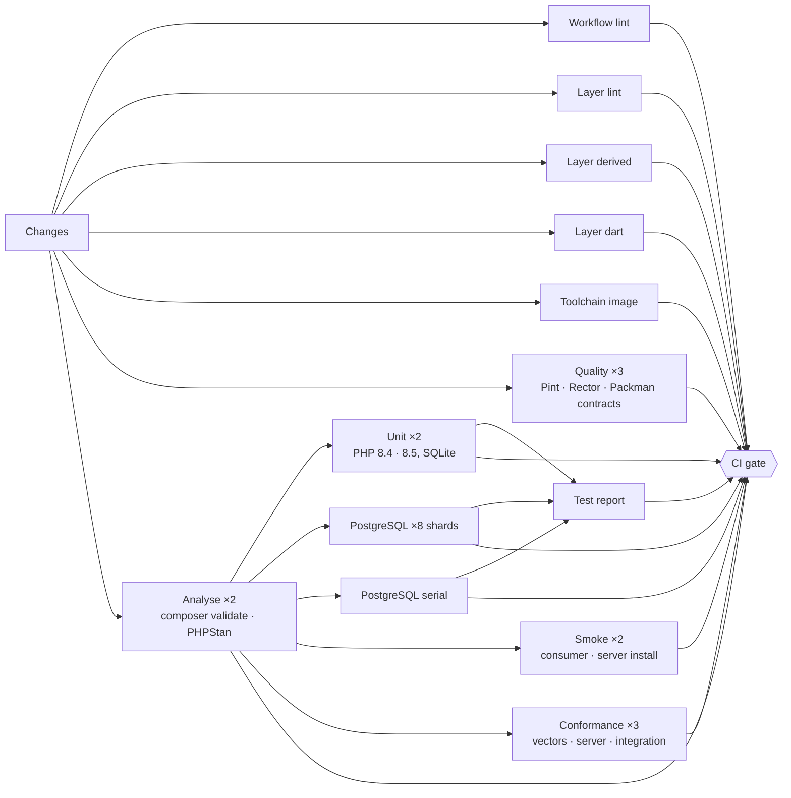

# Continuous integration

`scripts/ci.sh` holds every check. GitHub Actions (`.github/workflows/ci.yml`) runs the same checks as a
graph of parallel jobs, and each job calls exactly one `scripts/ci.sh --step <name>` or `--layer <name>`.
Locally the whole gate is still one command inside the toolchain image:

```bash
docker compose run --rm toolchain bash scripts/ci.sh                 # every layer, in order
docker compose run --rm toolchain bash scripts/ci.sh --layer php     # one layer
docker compose run --rm toolchain bash scripts/ci.sh --step php-pg   # one step, as CI runs it
docker compose run --rm toolchain bash scripts/ci.sh --list-steps    # step names
```

## Job graph



A full run has 29 jobs. After `Changes` (about 15 s), up to 11 jobs start at once; once `Analyse` is
green (about 1.5 min) the 16 test jobs fan out. A full run takes about 6 minutes of wall-clock time, down
from about 16 minutes for the former single `gate` job. The free plan runs at most 20 jobs at a time per
organization, so some test jobs wait a few seconds for a runner.

| Job | Runs | Why it is separate |
|---|---|---|
| Changes | `ci.sh --affected` over `tests/zones.json`, then `scripts/ci/select-jobs.py` | A change runs only the layers it can affect. |
| Analyse | `php-validate`, `php-phpstan` | The tests wait for these: an invalid manifest or a type error makes test results moot. |
| Quality | `php-pint`, `php-rector`, `php-contracts` | Style, refactoring and contract drift block the merge, not the tests. |
| Workflow lint | actionlint, zizmor | Checks the workflow itself, pinned actions and permissions. |
| Layer lint / derived / dart | `ci.sh --layer …` | Python and Dart checks that need no database. |
| Unit | `php-unit` (Pest without the `pg` group, SQLite) | PHP 8.4 is the supported runtime; PHP 8.5 shows upcoming breakage early. |
| PostgreSQL shard 1–8 | `php-pg` with `BILLIUM_TEST_SHARD=i/8` | The 1.6k-test `pg` group split into time-balanced slices. |
| PostgreSQL serial | `php-pg-serial` | These tests read the cluster-wide transaction horizon and must run alone. |
| Smoke | `php-smoke-consumer`, `php-smoke-server` | Install the packages into empty projects. |
| Conformance | `conformance-vectors`, `-server`, `-integration` | Three groups that share no build output. |
| Toolchain image | builds `docker/toolchain` and starts its tools | Only when `docker/` or `compose.yaml` change, and on manual runs. |
| Test report | merges JUnit and coverage | One summary for all test jobs. |
| CI gate | checks every `needs` result | The single required status check. |

Every job that needs PostgreSQL starts the `postgres` service from `compose.yaml` (same roles and
throwaway tuning as local development) and gets its own cluster, so jobs never share a suite lease.

## Selection

- **Pull requests and pushes to `main`**: `ci.sh --affected <base>...<head>` maps changed paths to
  layers through `tests/zones.json`. Changes to `.github/`, `scripts/ci*`, `docker/` or `compose.yaml`
  select every layer. A job that is not selected is reported as skipped, and the gate treats skipped as
  passing.
- **Manual runs** (`workflow_dispatch`) select everything. The `only` input narrows a run to named jobs
  or matrix cells, for example `php-pg:3 conformance-integration derived`. Accepted names: `lint`,
  `derived`, `dart`, `toolchain`, `workflows`, every `ci.sh` step and `php-pg:<shard>`. Use it to prove a
  fix on the cells that failed: "Re-run failed jobs" replays the old commit, so it cannot test a fix.

```bash
gh workflow run ci.yml --ref <branch> -f only="php-pg:3 conformance-integration"
```

## Sharding

`php-pg` passes `--shard=<i>/<n>` to Pest. `tests/.pest/shards.json` stores per-class timings, and Pest
packs the classes so that every shard gets about the same test time. Classes that are missing from the
file are spread round robin and Pest prints a `WARN` that the file is out of date. To refresh it,
run the `pg` group once with timing collection against a local database:

```bash
PACKMAN_TEST_DESTRUCTIVE_OPT_IN=1 PACKMAN_TEST_DB_PER_PROCESS=1 \
  vendor/bin/pest --group=pg --exclude-group=pg-serial --parallel --update-shards
```

The shard count is `PG_SHARDS` in the workflow. Each shard runs 8 Pest workers (`BILLIUM_TEST_PROCESSES`),
each with its own database.

## Reports and coverage

Test steps write JUnit to `BILLIUM_TEST_REPORTS` when it is set. Each test job prints a table of counts
and its slowest tests to the job summary (`scripts/ci/test-report.py`), and uploads its reports. The
`Test report` job combines all of them.

Coverage uses pcov (`BILLIUM_TEST_COVERAGE=1`) on pushes to `main` and on manual runs. Pull requests skip
it because it roughly doubles test time. `scripts/ci/merge-coverage.php` merges the per-job `.cov` files
with php-code-coverage's own merger. The `coverage` artifact holds `clover.xml` and an HTML report, and
the job summary shows the line, method and class totals.

Failed smoke and conformance jobs upload `build/**/*.log` and `build/**/*.json` as
`diagnostics-<step>`, because the drill logs are the only record of what went wrong.

## Hygiene

- Actions are pinned to commit SHAs, and the actionlint image is pinned by digest. In-repo actions use
  the self-repository form `uses: $/.github/actions/setup`. `.github/actionlint.yaml` silences
  actionlint 1.7.12, which does not know that syntax yet.
- The workflow has no default permissions. Jobs get `contents: read`, and checkouts do not keep
  credentials.
- A new push cancels a superseded run of the same branch or pull request, but `main` keeps a verdict
  for every commit.
- `.github/actions/setup` is the shared setup. It clones Packman anonymously from
  `axiomasoft/packman` at `PACKMAN_REF` and fails with a clear error if the repository is not public or
  the tag is missing. It also installs PHP and Composer dependencies (cache keyed by `composer.lock`),
  Python with `docker/toolchain/requirements.txt`, Dart at the toolchain image's `DART_VERSION`, and
  PostgreSQL.
- The PHPStan, Rector and Pint result caches are kept between runs. Each tool invalidates its own cache
  when its configuration or dependencies change.
- Benchmarks (`scripts/bench`) and mutation testing are not part of routine CI.
