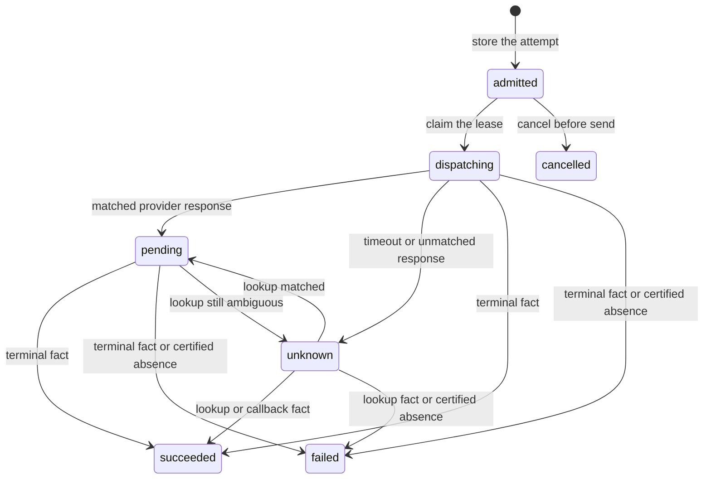

# Payment execution operations

## Choose the financial owner

| Composition | Payment execution owner | Billium deployable surface |
| --- | --- | --- |
| Contracts only | Existing consumer executor | PHP or Dart wire codecs and contracts. No Laravel runtime, database, worker or authority setup. |
| `embedded-commerz` | Commerz | Billium platform and ledger, including qualified observation custody and receivables projection. Execution is off. |
| `ledger-only` | External executor | The Billium ledger and its observation receiver. Incoming effects require the host's qualified custody and financial session. |
| `standalone-billium` | Billium PHP when execution is enabled | Optional execution module alongside platform and ledger. An installation without execution still supports the ledger. |
| `remote-billium` | Billium PHP server process | Execution, platform and ledger. The host supplies the HTTP/authentication boundary and seller routing. |

Attempt states live in `Billium\Execution\Enums\AttemptState`. A new attempt is stored `admitted`. The worker claims a lease and moves it to `dispatching` before the provider call. A matched response becomes `pending`; a lost or ambiguous response becomes `unknown`. `unknown` and `pending` are resolved by lookup of that same attempt. `succeeded`, `failed` and `cancelled` are terminal. Lookup does not open a second charge.

Configure `billium.modules.composition` and the explicit `billium.modules.enabled` list before starting workers. `embedded-commerz` with `platform` and `ledger` is the default. `WriterAdmission` belongs to the outgoing execution path. Every financial profile still needs `FinancialSessionAdmission` and `FinancialAuthorityEvidence` from an independent host issuer. Scope the process and activation evidence to the exact installation, seller, environment, authenticated `intentOwnerNamespace` and `sourceAuthority`. The two grants are independent. A source claim in an envelope alone grants no authority.

`billium.execution.outgoing_enabled` defaults to `false`. A passive execution module can read retained outcomes, replay receipts and receive custody while new outgoing effects remain disabled. Enabling outgoing execution requires `billium.execution.release_evidence_ref`, `billium.execution.retention_policy_ref` and a host-bound `ExecutionReadiness`. Its `assertConfigured()` verifies the selected dossiers, adapter qualification, independent authority and the hard egress fence before the execution provider registers. Missing or rejected evidence raises a configuration error at startup.

Run the packaged `billium.modules.compatibility` doctor check and resolve its errors before enabling the effect-capable routes or workers. The check reads the declared module contract and host bindings. Record actual database migration and role preflight separately. Initialize the installation and register event contracts explicitly after applying the selected schema sets. The command `billium:event-contracts:register --database=<owner-connection>` uses the migration owner connection. Use the restricted runtime connection for requests, relays and workers. See [outbox delivery and recovery](outbox-feed.md).

## Host inputs before enabling new effects

| Input | What the operator verifies |
| --- | --- |
| `CallerContext`, `FinancialSessionAdmission`, `FinancialAuthorityEvidence` | Independently authenticated caller and process authorization, durable owner and transition journal, and certified activation of the selected namespace. Under a database lock these accessors read the verified local state only. |
| `ExecutionOriginResolver` | A verified original commercial basis for a new root, matching scope, operation, intent, source context, execution profile and routing epoch. Existing receipts replay from retained original identity. |
| `PaymentDrivers`, `AdapterQualification` | Exact registered version and capability dossier for the original merchant, currency and action. Supply a trusted verifier and independent qualification references. |
| `ExecutionReadiness` | At startup `assertConfigured()` verifies the release and retention dossiers and the required host integrations. At runtime `assertReady()` rechecks the exact binding, amount and action before new admission or dispatch. Verification runs outside the transaction. Writer and egress authority enforce revocation at the send boundary. Retained command receipts remain readable when these inputs are unavailable. |
| `MerchantCredentials` | Versioned secret locators, same-account continuity across rotation, lookup/refund access for historical bindings, and documented revocation. |
| `WriterAdmission`, `DispatchEgress` | Independent owner authority, exact dispatch ticket, egress revocation and retirement evidence. Fail closed on timeout, stale claims or unavailable authority. |
| `ProviderAbsenceVerifier` | A trusted verifier for absence claims that cover the entire original request window and exact account/identity with late send blocked. Lookup timeout, 404, provider key expiry and a clean session seal grant no release. |
| `CollectionExecutionGuard`, `CollectionCancellationParticipant` | Applies only to an independently verified collection origin. The collection owner supplies the consent, cancellation generation and transaction participant. The historical `CollectionConsentGuard` descriptor names the collection owner's guard responsibility. A regular one-off execution does not require the collection module. |
| `CallbackPayloadArchive` | Optional for safe bounded data. Configure independently durable archival for complete recovery of secret-bearing or oversized callback frames. Without archival the bounded rejection evidence remains available and custody must not acknowledge the complete frame. |
| `OriginalReplayAuthority` | Optional explicit approval and independently archived first-egress request for `AttemptWorker::replayOriginalWithinWindow`. Bind the original exact bytes, key, account, committed attempt, current owner and finite provider idempotency window. Recovery looks up first; an unavailable archive never permits a fresh initiate. |
| `QualifiedFactualCommandPublisher`, `IncomingCommandAuthenticator`, `ScopedCallerContext` | Qualified internal transport and detached verification over immutable command/envelope identity, sender, receiver, live owner scope and payload digest. The scoped context must install the exact authenticated caller object. The application supplies the transport and verifier. |
| `ObservationBootstrapAuthenticator` | Required when establishing or transferring qualified observation ownership through authenticated bootstrap. Supply actual coverage from the original owner before admitting the retained tail. |
| `PublicEventDestinations` | Optional immutable mapping from a registered public event contract key to bounded destinations. An explicit call-site destination list overrides the catalog. Public delivery does not grant access to the financial receiver. |

`MerchantActionGate` and `MerchantRegistry` resolve to the execution module's same registry. `PaymentObservationSink` uses the execution-provided platform outbox bridge for factual observation commands. `AuthenticatedObservationContext` and `AuthenticatedObservationBootstrap` are supplied by Core and Platform. Use their authenticated paths to establish context.

The release record needs a named operator, escalation contacts, recovery SLO, retry and retention policy, provider qualification, backup/PITR policy, restore rehearsal evidence and independent authority/egress continuity. Size retention for the applicable provider retry and lookup windows, late callbacks, refund and dispute periods, downstream replay pins, legal holds and recoverable backups. Establish the actual values with the affected owners. Keep the migration owner, runtime roles, archival custody, and verification keys independent of any restored copy. Record a forward-only migration rehearsal and a rollback-by-recovery procedure before enabling a production deployment.

## Provider qualification dossier

For each provider, API version, merchant account/mode, currency and action, record the primary provider specification and its revision, negotiated behavior, and observed results. Record at least create/initiate idempotency scope and window, lookup and inventory completeness, separate authorization/capture/void, partial/multiple refunds, callback signing and correlation, recurring consent and revocation, fiscal payload and receipt correlation, and reconciliation reports and statuses. Record supported and unsupported capability modes explicitly. An uncertain provider response remains unknown. Capture, void and refund run against the original binding, even if default routing changes.

Keep separate evidence for contract doubles, the committed PostgreSQL runtime with simulated independent provider/host journals, and the actual selected provider. Each pilot result needs the exact fixture and provider version, scenario and failure checkpoint, retained receipt/query identities, observed effect counts and residual gaps. Include a lost create reply, a late signed callback and credential rotation. A real-provider pilot requires separately authorized access, pinned sources and a qualified adapter. No provider is selected by the repository fixture suite.

## Command, worker and query entry points

- `RootPaymentCommands::admit()` accepts `payment.execute.v1` and `payment.authorize.v1`. The receipt is evidence of local admission. It may precede any provider call. `RootPaymentCommands::cancel()` fences a local unsent operation. `AuthorizationCommands::admit()` handles separate capture and provider authorization void. `RefundCommands::admit()` reserves against the original charge. Use a separately authorized child intent and the original business identity on retry.
- Invoke `AttemptWorker::dispatch()` for the specific durably admitted attempt. The host schedules it with the assigned scope, worker identity and bounded lease. `AttemptWorker::recover()` performs the original lookup. A local worker timeout or lost receipt calls for the original key and query first. Do not queue a replacement PSP action on an unknown result.
- Route signed input through `CallbackCustody::receive()` with the original merchant revision, authenticated scope, and optional operation hint. The receipt controls acknowledgement. Route referred work through `EvidenceReducer::reduce($workRef)` for qualified material state transitions. Treat unmatched evidence and verification failures according to their persisted custody/work disposition.
- `ExecutionQueries::find()`, `status()` and `receipt()` read the original authorized operation. `ExecutionHistoryQueries` resolves business or child identity, exact command key receipts and admission conflicts. Include the original source authority/context. `ExecutionEvidenceQueries::material()` and `work()` expose authorized revision, factual totals, held exposure and recovery work. Read the accepted ledger projection independently via `LedgerQueries`. Queries do not refresh PSP state or acquire writer tickets.
- `billium:outbox:relay --commands` services the qualified factual lane. `billium:outbox:relay` services public delivery. Transport acknowledgement records custody. The ledger's durable application receipt establishes projection. Preserve the original contract, event identity and destination when requeuing parked deliveries.

Inspect original receipts, operation state, attempts, observed vs. applied amounts, held capacity, discrepancies and downstream publication independently. An authorization is a hold. A refund request is a reservation until verified provider evidence resolves it. Unapplied external exposure remains observable and prevents unsafe allocation. The execution journal owns provider evidence. The ledger owns receivables, allocations and monetary credit. Product agreements, grants, provisioning, licensing, fiscal registration and general ledger posting keep separate owners and state. Receipt status comes from the fiscal owner, even if a related payment succeeds.

See [reconciliation and recovery](execution-recovery.md) for unknown effects, restore and operator intervention.
